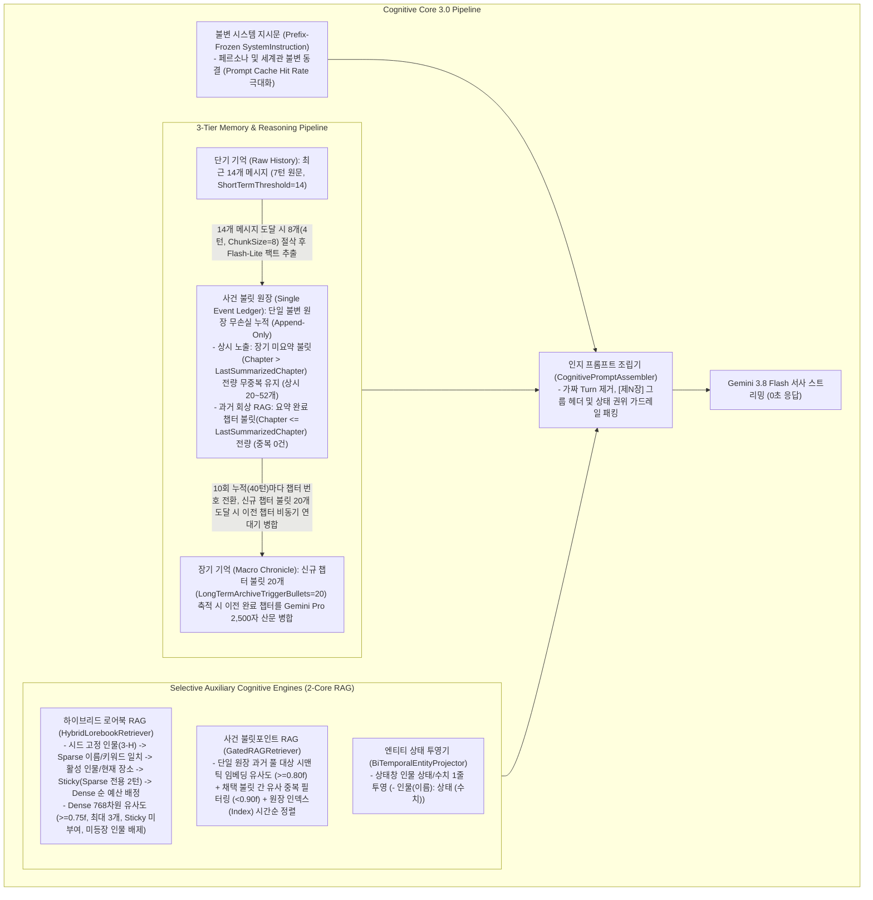
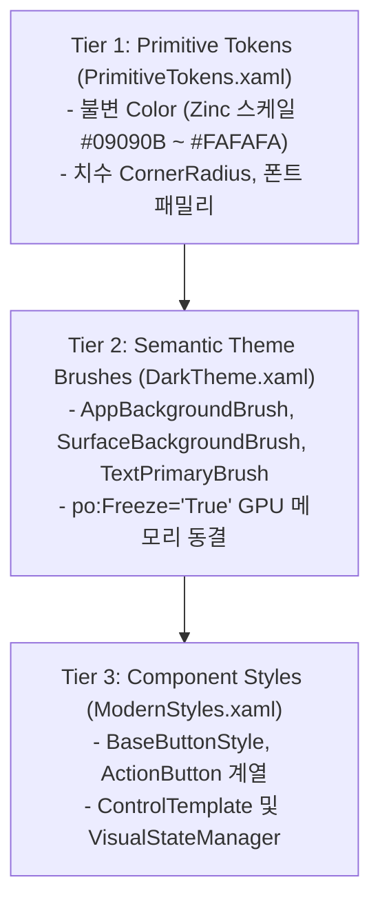
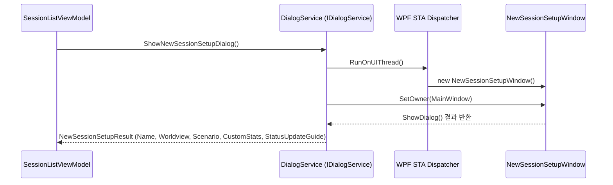

# GRC Architecture & Deep Dive

본 문서는 GRC(GenAI Roleplay Chat) 클라이언트의 핵심 엔진 구조와, C#/.NET 8.0 환경에서 달성한 동시성 제어 및 메모리 관리 기법을 상세히 기술합니다.

---

<memory_pipeline>

## 1. 인지 코어 3.0 메모리 파이프라인 (Cognitive Core 3.0 Memory Pipeline)

대규모 롤플레잉 서사를 진행할 때, 모든 대화를 프롬프트에 무제한 누적하면 컨텍스트 윈도우 초과, 프롬프트 캐시 미스, 비용 폭발 및 서사 왜곡(Lost in the middle)이 발생합니다. GRC v3.0은 이를 해결하기 위해 **불변 접두사 동결(Prefix-Frozen SystemInstruction)**, **사건 렛저(Event Ledger) 팩트/비밀 추출**, **2대 핵심 게이티드 RAG(하이브리드 로어북, 사건 불릿포인트)**를 유기적으로 결합한 Cognitive Core 3.0 클린 아키텍처를 탑재했습니다.

`[IMPLEMENTED]` 메모리 파이프라인 및 인지 모듈 구현체:
- 파이프라인 총괄: [MemoryManagerService.cs](../../../GRC/GRC/Services/MemoryManagerService.cs)
- 인지 프롬프트 조립기: [CognitivePromptAssembler.cs](../../../GRC/GRC/Services/Cognitive/CognitivePromptAssembler.cs)
- 구조화 로어북 엔트리 및 세부 스키마: [LorebookEntry.cs](../../../GRC/GRC/Models/LorebookEntry.cs), [LoreDetails.cs](../../../GRC/GRC/Models/LoreDetails.cs)
- 로어북 3단계 결정론적 렌더러: [LoreRenderer.cs](../../../GRC/GRC/Services/Cognitive/LoreRenderer.cs)
- 서사 문장부호·스키마 SSOT 계약: [NarrativeContract.cs](../../../GRC/GRC/Services/Cognitive/NarrativeContract.cs)
- 엔티티 명칭·별칭·경계 판정 엔진: [EntityNameResolver.cs](../../../GRC/GRC/Helpers/EntityNameResolver.cs)
- 사건 렛저 추출기: [EventLedgerExtractor.cs](../../../GRC/GRC/Services/Cognitive/EventLedgerExtractor.cs)
- 하이브리드 로어북 인출기: [HybridLorebookRetriever.cs](../../../GRC/GRC/Services/Cognitive/HybridLorebookRetriever.cs)
- 살리언스 게이티드 RAG: [GatedRAGRetriever.cs](../../../GRC/GRC/Services/Cognitive/GatedRAGRetriever.cs)
- 시간 인식 관계 투영기: [BiTemporalEntityProjector.cs](../../../GRC/GRC/Helpers/BiTemporalEntityProjector.cs)
- SIMD 벡터 연산 헬퍼: [VectorMathHelper.cs](../../../GRC/GRC/Helpers/VectorMathHelper.cs)

### 1) 불변 접두사 동결 (Prefix-Frozen SystemInstruction)
*   세계관, 시스템 페르소나, 불변 지시문을 `SystemInstruction`에 완전히 격리하여 고정합니다.
*   **서술 기본 원칙(`FormatRule`) 및 퓨샷 규격**: 대사는 큰따옴표(`" "`), 독백 및 속마음은 낫표(`「 」`), 행동/배경은 기호 없는 평문 소설체로 명시하고, 마크다운 강조(*별표* 등) 배제 지침, 로어북에 정의된 인물별 말투(반말/존댓말 어미, 문장 길이, 호흡) 준수, 다인 장면에서 유저의 현재 행동과 무관한 인물의 의무적 발화 억제 규칙, 4줄 직관적 `<example>` 퓨샷을 고정 주입합니다. 말줄임표 등 숫자 상한은 의도된 말투 설계와 충돌하므로 두지 않으며(장르 중립 원칙), `SystemInstruction`에는 동적 태그명(`<world_lore>` 등)을 직접 언급하지 않습니다.
*   동적으로 변하는 로어북, 사건 렛저, 대서사 연대기는 최신 유저 메시지 직전의 **동적 컨텍스트 슬롯(Dynamic Context Slot)**에 주입함으로써, LLM 엔진의 프롬프트 캐시 적중률을 극대화하고 문체 오염을 방지합니다(캐시 적중 토큰 `cachedContentTokenCount`는 [TokenLogger.cs](../../../GRC/GRC/Helpers/TokenLogger.cs)의 `CachedTokens` 컬럼으로 기록되며, `AsyncLocal<string?>` 기반 `TokenLogScope`를 통해 `Status_Update`, `Ledger_Extraction`, `Chronicle_Merge`, `Reply_Suggestion`, `Tts_Translation`, `Lorebook_Generation`, `Illustration_Prompt` 등 모든 비스트리밍 호출 목적을 함수 시그니처 오염 없이 식별합니다).
*   **메타 지시문 독립 격리 및 자동 진행 단일 판정**: 빠른 진행(`fast_forward`), 자동 이어쓰기(`auto_continue`), 시간 경과(`time_skip_progression`) 등 개입 명령(`metaDirective`)은 `userMessage.Text`에 합성하지 않고 `CognitiveContext.MetaDirective`를 통해 `<current_action>` 외부의 독립 상위 태그로만 조건부 렌더링하며, 여러 지시는 기존 지시 뒤에 이어 붙입니다. 자동 진행 여부는 UI 표시 문구가 아니라 `metaDirective`의 `type="auto_continue"`로만 판정하여 `<current_action>`을 `(서사를 계속 진행하십시오.)`로 정규화합니다.
*   **초단답·자동 진행 임베딩 쿼리 폴백 (`ResolveEmbeddingQueryTextLocked`)**: 자동 진행이거나, 알려진 인물·로어북 엔티티 언급이 없는 4자 이하 초단답이면 직전 `model` 서술의 마지막 문단을 768차원 임베딩 쿼리로 대체합니다.
*   **최종 지시 (`<final_instruction>`)**: 참조 태그의 개조식 형태 모방 금지, `<current_action>` 행동·대사의 첫 줄 복창 금지(문맥상 유저 대사를 본문에 인용할 때는 임의 개작 없이 원문 유지), 직전 응답의 외양 묘사·비유 반복 금지를 한 문장으로 결합하여 곧바로 이어지는 다음 장면을 소설 산문으로만 서술하도록 지시합니다.

### 2) 단기 기억 (Raw History)
*   가장 최근에 주고받은 날것의 대화 14개 메시지(7턴 대화, `ShortTermThreshold = 14`)를 손실 없이 보존합니다.
*   **비동기 압축 트리거**: 14개 메시지에 도달하면 가장 오래된 8개 메시지(4턴 대화, `MemoryCompressionChunkSize = 8`)를 절삭하여 백그라운드 태스크(`Task.Run`)에서 사건 팩트 추출을 시작합니다(절삭 직후 최근 6개 메시지 = 3턴 보존). 낙관적 락(`_shortTermVersion`)을 통해 동시성 정합성을 보장합니다.

### 3) 사건 불릿 원장 (Single Event Ledger 및 [제N장] 시간축 앵커)
*   **단일 원장 무손실 누적 (Append-Only) 및 서사 밀도 기반 2~5개 동적 추출**: 절삭된 8개 메시지는 **Gemini 3.5 Flash-Lite** 모델을 통해 JSON 스키마 첫 필드로 구간 서사 밀도(`density: "LOW" | "MEDIUM" | "HIGH"`)를 선행 판정한 뒤, 대명사('그', '그녀' 등)를 배제하고 `[원인/배경 + 명시적 고유명사 주체 + 행동/대화/사건 + 결과/관계·상태 변화]`를 담은 1~2문장의 자기완결형 인과 팩트 불릿(단일 씬 일상·스킨십 `LOW: 2개`, 표준 사건 `MEDIUM: 3개`, 다중 씬·복수 인물·위기 `HIGH: 4~5개`)으로 추출됩니다. 물리적 사건뿐만 아니라 인물 간의 의미 있는 감정/신뢰 변화, 호칭·태도의 전환, 공유된 정서적 순간과 개인적 약속, 그리고 대화를 통해 새로 전해 들은 미방문 장소나 미대면 인물의 핵심 정체성(신분·직책·종족·역할) 단서를 고유명사와 함께 추출하여 서브컬처 장르의 관계 서사 연속성을 보존합니다. 추출 프롬프트는 정적 규칙/TypeScript 스키마를 `SystemInstruction`으로 물리 분리하여 매 4턴마다 구글 서버의 **KV Cache를 100% 재사용**하며, `Temperature: null` 설정을 통해 Flash-Lite 모델의 무한 반복 루프를 원천 차단합니다. 응답은 `LlmJsonParser`를 통해 내결함성 파싱(프리앰블 스킵 및 잘린 JSON 복구)되며, Google의 차세대 통일 임베딩(`gemini-embedding-001`, MRL 768차원, 서울 `asia-northeast3` 리전)과 함께 `_currentContext.EventLedgers` 단일 리스트에 영구 누적됩니다.
*   **가짜 Turn 메타태그 완전 적출**: 4턴 배치 단위로 동일하게 찍히던 왜곡된 가짜 Turn 번호를 완전히 제거하고, 단일 원장 인덱스(`Index`)를 통해 100% 발생 시간순 인과관계를 보존합니다.
*   **장기 미요약 불릿 무중복 상시 노출(`_lastSummarizedChapter`) 및 회상 풀 이분할**:
    - **상시 노출 칸 (`<internal_chronicle_facts>`)**: 장기 연대기 병합에 실제 성공한 마지막 장 번호(`_lastSummarizedChapter`)보다 뒤의 불릿(`Chapter > _lastSummarizedChapter`)을 개수 제한 없이 전량 노출합니다. 새 챕터 불릿이 20개(`LongTermArchiveTriggerBullets = 20`) 쌓일 때까지 이전 챕터의 장기 요약을 보류하므로, 요약 완료된 불릿을 중복으로 남겨두지 않고도 항상 최소 20개~최대 52개(약 25~64턴 분량)의 미요약 불릿이 무중복으로 상시 유지됩니다. 장 번호가 변경될 때만 `[제N장]` 그룹 헤더를 1회 출력하며, `current_chapter` 속성에 현재 진행 장 번호를 명시합니다.
    - **과거 회상 RAG 풀 (`<recalled_history>`)**: 장기 연대기로 요약 완료된 챕터의 불릿(`Chapter <= _lastSummarizedChapter`) 전량을 `GatedRAGRetriever` 검색 대상으로 100% 이관하여, `<macro_chronicle>`과 `<internal_chronicle_facts>` 간의 중복을 0건으로 제거하면서도 과거 챕터의 구체적 고유명사·약속을 핀포인트로 회상합니다.
    - **영구 저장 및 서사 열람 UI 동기화**: `_lastSummarizedChapter`는 `ExportSession` 시 `ChapterContext.LastSummarizedChapter`로 `Session.json`에 기록되고, 복원 시 그대로 사용됩니다. 필드가 없는 구버전 세션(`-1`)만 `ChapterCount - 1`로 추론합니다. 또한 `_currentContext.Plot`은 항상 미요약 활성 챕터(`Chapter > _lastSummarizedChapter`) 전체를 챕터별로 묶어 표시하며, 장기 요약 완료 시 요약된 챕터를 제거하여 서사 열람 UI에서도 공백이나 중복이 발생하지 않습니다.

### 4) 장기 연대기 (Macro Chronicle 무중복 지연 이관)
*   **챕터 번호 전환(40턴)과 장기 요약 이관(신규 챕터 불릿 20개 또는 40턴 챕터 마감) 이중 트리거**: 10회 중기 압축 누적(80개 메시지 = 40턴 대화, `MediumTermThreshold = 10`) 시에는 전환 전 활성 챕터(`activeChapterBeforeTransition`)의 불릿 개수를 먼저 산출한 뒤 `_chapterCount`를 다음 장으로 전환합니다. 방금 불릿이 누적된 챕터가 20개(`LongTermArchiveTriggerBullets = 20`) 이상에 도달했으면 그 직전 챕터(`activeChapterBeforeTransition - 1`)까지 즉시 비동기 요약·이관하며, 잔잔한 일상물 진행 등으로 20개 미만인 채 10회차(40턴) 챕터 마감을 맞이한 경우에도 방금 완결된 직전 챕터(`_chapterCount - 1`)는 새 챕터의 오버랩 버퍼로 유지하고 수명이 만료된 전전 챕터(`_chapterCount - 2`)까지 **Gemini Pro** 모델에 비동기 전달하여 3개 이상 챕터가 상시 창에 적체되는 현상을 원천 방지합니다.
*   **살리언스 증발(Salience Evaporation)** 기법을 적용하여 **2,500자 이내**의 대서사 산문 연대기(`_longTermSummary`)로 병합 보존하고, 병합에 성공했을 때만 `_lastSummarizedChapter`를 해당 장 번호로 갱신합니다(일시적 통신 오류로 실패 시 다음 중기 압축 주기에 자동 재시도).

### 5) 보조 인지 엔진 (2-Core RAG & Relational Projector)
*   **구조화 로어북 SSOT 스키마 (`CharacterLoreDetails` / `WorldLoreDetails`), 하이브리드 로어북 RAG (`HybridLorebookRetriever`), 호감도 단계별 3중 스포일러 마스킹 (`MaskLorebooksForPrompt` & `LoreRenderer`)**:
    - **순수 구조화 JSON SSOT (Zero-Legacy)**: `LorebookEntry`는 문자열 내부 구분자(`/`, `->`, `* 항목명:`)에 의존하던 평문 DSL과 레거시 파서(`LegacyLoreParser`)를 완전히 적출하고, 인물 전용 11필드 레코드(`CharacterLoreDetails`: `RoleSummary`, `Appearance`, `SurfacePersona`, `InnerMotivation`, `InitialContact`, `BondTrigger`, `BondPayoff`, `OtherRelations`, `SpeechTone`, `EverydayQuote`, `EmotionalQuote`, `Notes`), 비인물 전용 4필드 레코드(`WorldLoreDetails`: `IdentitySummary`, `SensoryDetails`, `RulesAndPrinciples`, `NarrativeHook`, `Notes`), 그리고 런타임 기억 추출용 `FreeText`(`Category == "기억"`)만을 JSON 단일 진실 공급원(SSOT)으로 저장합니다.
    - **선행 3단계 스포일러 마스킹 및 결정론적 프롬프트 렌더링 (`LoreRenderer`)**: `entry.Content`는 `[JsonIgnore]` 계산 프로퍼티로서 `LoreRenderer.Render(entry, entry.RevealStage)`가 호출 시점에 결정론적으로 조립합니다. `HybridLorebookRetriever.Retrieve` 호출 전 `MemoryManagerService.MaskLorebooksForPrompt`가 각 인물의 현재 호감도/신뢰도를 검사하여 `entry with { RevealStage = stage }`(`1`: `< 30` 기본 프로필·일상 대사만 공개 / `2`: `30~59` `BondTrigger -> BondPayoff` 유대 심화 해금 / `3`: `>= 60` `InnerMotivation` 및 `EmotionalQuote` 완전 해금)로 선행 마스킹하므로, 5,000토큰 로어북 예산이 실제 프롬프트 주입 길이 기준으로 정확히 산정되며 UI/TTS용 `CurrentActiveLorebooks`는 원본 참조를 보존합니다.
    - **계층적 하이브리드 인출 및 미등장 인물 Dense 배제**: 예산(5,000토큰)은 아래 순서로 배정되며, 첫 항목은 예산을 넘어도 최소 1개 포함됩니다.
        1. **시드 고정 로어북 (3-H)**: `CHAR:` 시드가 제시 중인 창 동안 해당 신규 인물의 로어북(호감도 1단계 마스킹)을 최우선 배치하여, 예산이 포화되어도 신규 인물 묘사 근거(외양·말투·표면 태도)가 빠지지 않도록 보장합니다.
        2. **Sparse 직접 매칭**: 엔트리 이름 또는 키워드가 검색 텍스트(직전 `model` 응답 + 현재 유저 입력, Turn 1에는 `<initial_scenario>` 본문)에 어절 경계로 매칭된 항목입니다. 매칭 시 `DefaultStickyTurns = 2`(트리거 턴 포함 총 3턴 활성)가 충전됩니다.
        3. **확정 보충**: 현재 장소(`activePlaceNames`, 단일 `currentPlace`)와 활성 인물(`activeCharNames`)입니다. 활성 인물은 4-E 결정에 따라 단기 기억 버퍼 전체 + 최근 사건 불릿 3개 + 현재 입력을 `EntityNameResolver.ExtractCharacterNameTokens` 어절 단위로 광역 스캔하여, 대명사·약칭 구간에서도 로어북이 증발하지 않도록 합니다. 이 보충 항목은 Sparse 직접 매칭을 밀어내지 않습니다.
        4. **Sticky 잔존**: 직전 턴 Sparse 매칭 항목만 해당하며, Dense 매칭에는 Sticky를 부여하지 않습니다.
        5. **Dense 보충**: 시맨틱 유사도 `>= 0.75f` 항목을 유사도 내림차순 상위 최대 3개(`DefaultMaxDenseMatches = 3`)로 제한합니다. 상태창 `Chars`에 없는 인물 로어북은 Dense 경로로 인출하지 않으며, 미등장 인물 정보의 공식 유입 경로는 시드 고정(3-H)과 Sparse(본문 이름 등장)뿐입니다.
        6. **1단계 참조 개체 1줄 요약 자동 병기 (`CognitivePromptAssembler.AppendReferencedEntitySummaries`)**: 이번 턴에 채택된 로어북 본문(`Content`) 내에 이름이 언급(`EntityNameResolver.ContainsEntityMention`)되었으나 직접 채택되지 않은 타 로어북이 있을 경우, 전체 본문 인출이나 다단계 재귀 없이 해당 개체의 1줄 핵심 정의(`Character.RoleSummary` 또는 `World.IdentitySummary`)만 `- [참조 개체 요약] {Name} ({Category}): {Summary}` 형태로 `<world_lore>` 하단에 1단계 병기하여 단독 로어북 인출 시 정체성·종족·직책 오인을 차단합니다.
*   **사건 불릿포인트 RAG (`GatedRAGRetriever`)**: 레거시 키워드 게이팅 데드코드를 전면 적출하고, 매 턴 계산된 768차원 유저 쿼리 임베딩을 실측 기반 순수 코사인 유사도(**$\ge 0.80f$**, Case 2 일상 행동 오탐 최댓값 `0.7914` 차단 및 Case 3 핀포인트 회상 `0.8627 ~ 0.9053` 보존) 스캔에 직결하여 상위 최대 5개(`DefaultMaxResults = 5`)를 핀포인트 인출합니다. 채택 과정에서는 이미 선택된 불릿과 코사인 유사도가 `DeduplicationSimilarityThreshold = 0.90f` 이상인 동일 장면·반복 사건 불릿을 건너뛰고 차순위 독립 사건을 채택하여 5개 슬롯의 회상 다양성을 보장합니다. 인출 결과는 단일 원장 인덱스(`Index`) 발생 시간순으로 정렬하여 선후 인과 역전을 차단하며, `<recalled_history priority="secondary">` 속성으로 현재 상태 우위를 명시합니다.
*   **엔티티 상태 투영기 (`BiTemporalEntityProjector`), 명칭·경계 판정 엔진 (`EntityNameResolver`), 상태창 정합성 가드 (`UpdateContextStatus`)**:
    - 상태창 인물을 `- 인물(이름): 상태 (수치)` 또는 `- 인물(이름): 상태` 형태로 간결하게 투영하며, 현재 위치(`Places`), 플레이어 주요 수치(`CustomStats`), 인벤토리(`Items`)를 `<entity_relationship>` 직후의 `<current_state>` 태그로 서사 AI에 동적 공급합니다.
    - **StatusAI 출력 스키마**: `BuildStatusRequest`는 `currentPlace: string`(단일 장소, 세부 구역은 `"정식장소명 - 세부구역"`), `elapsedTime: "none" | "hours" | "days" | "months" | "years"`(하룻밤 수면·익일 아침 기상은 `"hours"`, 최소 이틀 이상 새로 흐른 경우만 `"days"`), `isSceneResolved`, `triggeredSeeds`를 출력합니다. 로어북의 정식 장소·아이템 명칭 목록(`<canonical_names>`)은 세션 동안 불변이므로 시스템 프롬프트의 `<custom_rules>` 뒤에 배치하여 캐시를 유지합니다. NPC 목록 규칙은 "기존 NPC 유지 및 신규 조우 NPC 추가(PC 제외)"로, 현재 장면에 없는 NPC가 목록에서 탈락하여 호감도 추적과 활성 인물 스캔이 끊기는 것을 방지합니다.
    - **장소·아이템 정규화와 주인공 필터**: `ChapterContext.Places`는 하위 호환용 리스트 타입을 유지하되 항상 `[currentPlace]` 1개로 덮어쓰며(구형 `places` 배열 응답은 첫 원소로 폴백), 장소·아이템명은 `NormalizePlaceName`/`NormalizeItemName`으로 로어북 정식 명칭에 정규화합니다. 플레이어 지칭어(`당신`, `주인공`, `플레이어`, `PC`, `유저` 등)와 마스터 세계관에서 추출한 주인공 고유명사(`UpdateProtagonistNamesLocked`)는 `Chars`에서 코드로 제거합니다.
    - **시간 경과 턴 호감도 상한 (4-C)**: 일반 턴(`none`/`hours`)에는 코드 상한을 두지 않고 세션별 `StatusUpdateGuide`를 신뢰합니다. `elapsedTime`이 `days`/`months`/`years`일 때만 `NarrativeContract.AffinityStatTerms` 명칭의 `"현재/최대"` 형식 스탯 상승폭을 `최대치 × (5% / 12% / 20%) × (1 - 이전값/최대치)`로 제한하며, 하락은 제한하지 않습니다. 상한은 코드에만 존재하므로 프롬프트 문구는 두지 않습니다.
*   **사건 해결 변수 기반 서브컬처 에피소드 & 시드 엔진 (`<story_seeds>`, `isSceneResolved`, `triggeredSeeds`)**:
    - **시드 창(window) 상태 규칙**: 창은 `UpdateContextStatus`에서 개설하며(`fast_forward`만 `BuildNarrativeRequestAsync`에서 개설), 개설 시점에 제시 횟수(`SeedOfferCounts`)를 1회 증가시킵니다.
        - 창 없음 + 장면 종료(LLM `isSceneResolved`, 또는 로어북 장소 엔티티 변경) + 쿨다운 통과(소모 후 2턴) → 새 창 개설.
        - `elapsedTime >= days` 또는 `fast_forward` → 쿨다운을 무시하고 새 창 개설(진행 중인 창은 종료 후 재개설, 같은 턴에 시드가 소모되어 창이 닫힌 경우도 재개설).
        - 창 진행 중 + 장면 종료 판정 → 기존 창 유지(재추출·제시 횟수 증가 없음). 창 기간에는 매 턴 `ActiveSeedKeys`에서 시드 문장을 다시 렌더링(호감도 마스킹 최신화)하여 본문 감지·StatusAI 화이트리스트를 복구합니다.
        - 창 내 시드 소모 → 창 종료(`ActiveSeedKeys`/`MonitoredSeedKeys` 동시 초기화) + 쿨다운 시작 / 개설 후 3턴(`SeedWindowDurationTurns = 3`) 경과 → 서사 주입용 `ActiveSeedKeys`만 종료하고, StatusAI 감시용 `MonitoredSeedKeys`는 장면 종료(`sceneResolvedEffective`) 시점까지 유지하여 4~6턴 이상 이어지는 중장기 에피소드 완수 판정 누락을 차단합니다. 또한 창 개설 1턴째에 유저가 시드 미소진 상태에서 즉시 타 장소로 이동한 경우 기존 창 후보의 `SeedOfferCounts` 증가분을 롤백합니다.
    - **3대 풀과 기아 방지 정렬 (3-G)**: 각 풀은 **제시 횟수 오름차순**을 최우선 정렬 키로 사용하여, 채택되지 않은 시드 1개가 후순위 시드를 무기한 차단하는 Head-of-Line Blocking을 해소합니다(안 쓴 시드는 소모하지 않음).
        - ① `[미등장 인물 조우]`(`Pool A`): 동일 제시 횟수 내에서는 **현재 장소와 공간적 접점(`InitialContact`/장소 `NarrativeHook`)이 있는 인물을 우선**하고, 그 다음 `Priority` 오름차순으로 정렬합니다. 시드 문장은 `[미등장 인물 조우] {Name} -> 초기 접점(...)`으로 축소하고, 외양·말투는 시드 고정 로어북(3-H)이 공급합니다.
        - ② `[장소/사건 훅]`(`Pool B`): `세계관` 카테고리를 제외한 미방문 장소·아이템·세력/사건의 `NarrativeHook`입니다. Turn 0에는 오프닝 본문에 등장하거나 초기 소지품으로 지급된 `아이템` 카테고리만 `HOOK:` 소모로 등록하며, `장소`는 언급이 아닌 실제 방문 시 소모합니다.
        - ③ `[동료 유대 심화]`(`Pool C` — 2슬롯 분리: `Slot C-Local` + `Slot C-Remote`): 호감도/신뢰도 $\ge 30$에서 1단계 `BOND:{Name}`, 1단계 완수 후 $\ge 60$에서 2단계 `BOND_SECRET:{Name}`입니다. 미실행 1단계 시드가 호감도 60 도달만으로 자동 증발하지 않도록 `AutoConsumeStage1BondsAt60Locked`를 폐지하고, 1단계 미완수 상태에서 호감도 $\ge 60$에 도달하면 `BOND:{Name}` 문구에 `(내면 단서 해금: ...)`을 합본 제시한 뒤 StatusAI가 `BOND:{Name}`을 확정 소진하면 다음 막간에 1단계 발단 계기 중복을 제거한 `BOND_SECRET:{Name}`(`(기완수 유대: {BondPayoff}) -> 내면 단서 해금: ...`)을 제시합니다. 또한 현재 장면/장소에 동석 중인 동료(`Slot C-Local`)와 타 거점에 있는 부재 동료(`Slot C-Remote`, `REMOTE_` 접두어 부여 및 `SeedOfferCounts` 동결)를 2슬롯으로 분리하여 원격 동료의 낮은 제시 횟수가 현장 동료의 유대 시드를 밀어내는 역전을 원천 차단합니다.
    - **소모 경로 분리 및 3인칭 소문·행선지 언급 오탐 차단**: `CHAR:`는 모델 응답 본문을 지문(`narrationOnly`)과 대사(`quotesOnly`)로 분리하여, **지문에 인물 이름이 등장했거나 대사 내 1인칭 자기소개(`내 이름은 ...`, `나는 ...`, `날 ...라 부르더구나`, `...라고 합니다`)로 등장했을 때만** 소모하며, 타인의 대사 속 3인칭 소문·경고 언급(`'시엘라'라는 권속`, `'설하'라고 불리는` 등)이나 StatusAI `triggeredSeeds`로는 소모하지 않습니다. 또한 본문 조우 가드를 통과해 `Chars`에 정식 등록된 인물은 `SyncStateBasedSeedConsumptionLocked`에서 `CHAR:{Name}`을 `ConsumedSeeds`에 동기화하여, 첫 대면 턴에 익명으로 등장해 동반 `HOOK:` 시드가 먼저 창을 닫은 뒤 다음 턴에 통성명하더라도 누락 없이 소모 기록됩니다. `장소` 카테고리의 `HOOK:` 시드는 StatusAI `triggeredSeeds`(`<offered_story_seeds>`)에서 제외하고 오직 `Places`(`currentPlace`) 상태 전이(`SyncStateBasedSeedConsumptionLocked`)로만 결정론적으로 소모하여 대사 내 행선지 제안 오탐을 원천 차단하며, 비장소(`사건`/`세력` 등) `HOOK:` 및 `BOND:`/`BOND_SECRET:`은 `MonitoredSeedKeys`와 해당 턴 등장 동료(`_turnEncounteredChars`)의 미소진 유대 시드 상시 감시를 통해 StatusAI `triggeredSeeds`로 확정됩니다.
    - **시간 경과 지시 (`time_skip_progression`)**: `elapsedTime >= days`이면 `PendingTimeSkip`에 다음 턴 지시를 기록하여 기존 메타 지시 뒤에 결합합니다. 화면 밖 인물·환경 변화 반영을 지시하고, 다음 턴에 실제로 제시될 시드가 있을 때만 `<story_seeds>` 중 1개 개막을 덧붙입니다.
*   **무상태(Stateless) 진단 반환 레코드 및 블랙박스 관측성 (`MemoryLog.txt`)**:
    - `IEventLedgerExtractor.ExtractLedgerFactsAsync`는 `LedgerExtractionResult(Items, Density)`를, `IGatedRAGRetriever.RetrieveRecalledHistory`는 `RagRetrievalResult(Items, Scores, MaxSimilarity, DedupDroppedCount)`를, `IHybridLorebookRetriever.Retrieve`는 `LorebookRetrievalResult(Entries, SelectionReasons, BudgetDroppedNames)` 불변 레코드를 직접 반환합니다.
    - 이를 통해 서비스에 직전 호출 상태를 남기지 않고도 매 턴 `MemoryLog.txt`에 `[유저입력] ts=...`(`FullHistory.json` 조인 키 및 원문 프리뷰), `[로어북]` 채택 사유(`시드고정`/`키워드`/`인물고정`/`장소고정`/`Sticky:N`/`Dense:0.XX`)와 예산 탈락 목록, `[RAG회상]` 건별 코사인 유사도·0건 시 최고 유사도(`최고유사도=0.XX < 0.80`)·중복 제거 건수, `[시드주입]`/`[다음턴시드]`의 창 진행 턴(`창N/3턴`)·후보별 제시 횟수(`제시:N회`, 합본 시 `합본/제시:N회`)·1턴 이동 횟수 롤백(`횟수롤백`)·3턴 창 만료 후 백그라운드 소진 감시 목록(`감시유지=[...]`), `[중기 기억 | 사건 원장 추출]` 서사 밀도(`밀도:LOW|MEDIUM|HIGH`)와 압축 대상 구간·버전 불일치 폐기 사유, 그리고 `[상태변화]` 턴 간 델타(`현장감지`/`위치`/`소지품`/`스탯`/`인물갱신`)를 완결된 인과 로그로 기록합니다.

</memory_pipeline>

---

<storage_optimization>

## 2. O(1) 무부하 파일 쓰기 (Zero-Deserialize JSON Append)

대화 이력을 디스크에 영구 저장(`FullHistory.json`)할 때 발생하는 오버헤드를 극단적으로 최적화했습니다.

`[IMPLEMENTED]` 파일 조작 알고리즘은 [FullHistoryLogger.cs](../../../GRC/GRC/Helpers/FullHistoryLogger.cs)에 구현되어 있습니다.

*   **문제점**: 일반적으로 JSON 배열에 요소를 추가할 때 전체 파일을 메모리로 읽어 역직렬화(Deserialize)한 뒤, 리스트에 Add하고 다시 직렬화하여 덮어씁니다. 서사가 길어질수록 이 과정에서 발생하는 GC(가비지 컬렉터) 스파이크와 I/O 지연이 UI를 멈추게 합니다.
*   **해결책 (`FullHistoryLogger.cs`)**:
    역직렬화를 완전히 포기하고 바이너리 스트림 조작으로 대체했습니다.
    1.  `FileStream`으로 파일을 엽니다.
    2.  끝에서부터 역방향으로 탐색(Seek)하여 배열을 닫는 괄호 `]`를 찾습니다.
    3.  새로운 메시지 텍스트를 바이트 단위로 직접 주입(Append)하고 다시 `]`를 덮어씌웁니다.
    4.  결과적으로 파일의 크기가 10MB이든 1GB이든 **O(1)의 일정한 시간 복잡도**로 파일 쓰기가 완료됩니다.

</storage_optimization>

---

<concurrency_streaming>

## 3. 비차단 동시성 제어 및 60FPS 스트리밍

네트워크 통신과 UI 렌더링 간의 병목을 완벽히 격리하여 '0초 지연(Zero-Delay)' 타이핑 경험을 제공합니다.

`[IMPLEMENTED]` 렌더링 틱 제어는 [StatefulStreamingHelper.cs](../../../GRC/GRC/Helpers/StatefulStreamingHelper.cs)에, 통신 채널은 [ChatWorkflowService.cs](../../../GRC/GRC/Services/ChatWorkflowService.cs)에 분리 구현되어 있습니다.

### 생산자-소비자 스트리밍 격리 (`System.Threading.Channels`)
*   `ChatWorkflowService` 내부에서 Gemini API로부터 문자 스트림을 받아오는 스레드(생산자)와, WPF 대화창에 문자를 그리는 스레드(소비자)를 `Channel<char>`로 분리했습니다. 네트워크 지연(Lag)이 발생해도 생산자 큐만 대기할 뿐 UI 렌더러는 절대 굳지 않습니다.
*   **실시간 마크다운 별표(*) 필터링**: 생산자 태스크에서 청크를 수신할 때 `c == '*'`를 즉시 드롭하여, AI가 실수로 출력한 `**` 기호가 스트리밍 화면에 노출되거나 완료 후 텍스트와 불일치를 일으키는 현상을 원천 방어합니다.

### 60FPS 배치 렌더링 (`StatefulStreamingHelper.cs`)
*   문자가 들어올 때마다 WPF의 `Dispatcher`를 호출하면 윈도우 메시지 루프가 포화되어 렌더링 스레드가 마비됩니다.
*   이를 막기 위해 유입되는 문자를 `ConcurrentQueue<char>`에 담아둡니다.
*   `DispatcherTimer`를 `DispatcherPriority.Render` 우선순위로 16ms(60FPS)마다 한 번씩 틱(Tick)을 발생시켜, 큐에 쌓인 문자를 일괄 Drain한 뒤 **틱당 단 한 번만 UI에 반영(FlushBuffer)**합니다.

</concurrency_streaming>

---

<session_architect>

## 4. AI Session Architect (자율 저작 에이전트)

유저가 기획서를 작성할 필요 없이, 키워드 한 줄만으로 TRPG 세션을 빌드해 주는 `Gemini 4 Argon` (`ThinkingLevel.high`, `ArchitectMaxOutputTokens = 32768`) 최적화 4단계(총 5회 API 호출) 에이전트입니다.

`[IMPLEMENTED]` 4단계 통합 스테이트 머신은 [SessionArchitectService.cs](../../../GRC/GRC/Services/SessionArchitectService.cs) 및 [SessionArchitectViewModel.cs](../../../GRC/GRC/ViewModels/SessionArchitectViewModel.cs)에 구현되어 있습니다.

*   **4단계 통합 상태 기계(4-Stage Consolidated State Machine)**:
    1. **1단계 (청사진 및 마스터 세계관 통합 — 1회 호출)**: `<master_setting>` 전용 4대 번호 섹션 개조식 마스터 세계관(`worldviewOutline`)과 8~15개 그물망 로어북 기획(`connectedEntities`)을 단일 추론 공간에서 공동 설계(Co-Design)합니다.
    2. **2단계 (2-Wave 통합 앙상블 구조화 로어북 — 2회 호출)**: 인위적인 마이크로 배치 분할(`batchSize = 3`) 없이, Wave 1에서 모든 비인물(장소·세계관·아이템) 무대 인프라를 `WorldLorebookArrayResponseSchema`(4대 필수 필드 강제) 기반 1회 통합 호출로 먼저 확정한 뒤, Wave 2에서 확정된 무대 전문(`<established_world_lore>`) 위에서 모든 등장인물 전원을 `CharacterLorebookArrayResponseSchema`(11대 필수 필드 강제) 기반 1회 통합 앙상블 캐스팅 호출로 동시 생성합니다. 각 필드는 `SanitizeCharacterDetails` / `SanitizeWorldDetails`를 통해 중복 라벨 래퍼나 바깥쪽 따옴표 없이 순수 값으로 정제되며, `speechTone`에는 기본 종결어미(반말/존댓말 등)와 문장 길이·호흡을 명시하고 샘플 대사의 어절 단위 말줄임표 도배를 지양하며 인물 간 화법·외형 틀이 동질화되지 않도록 하는 앙상블 분산 지침이 적용됩니다(숫자 상한 없음). WPF 로어북 편집창([EditLorebookWindow.xaml](../../../GRC/GRC/Views/EditLorebookWindow.xaml)) 또한 카테고리(`인물` 11필드 / `장소·아이템·세계관` 4필드 / `기억` 자유 텍스트)에 따라 전용 구조화 입력 폼과 실시간 `<world_lore>` 렌더링 미리보기를 제공합니다.
    3. **3단계 (오프닝 시나리오 선행 집필 — 1회 호출)**: JSON 이스케이프 및 개조식 문체 전이(Style Bleed)를 차단하기 위해 독립된 `text/plain` 문학 산문 모드로 첫 직면 장면을 집필합니다.
    4. **4단계 (상태창·Turn 0 시딩 및 시스템 지시문 통합 — 1회 호출 + C# 하이브리드 컴파일러)**: 완성된 오프닝 본문(`<opening_scenario>`)을 기반으로 초기 스탯(`stats`), 수치 갱신 가이드(`guide`), Turn 0 초기 컨텍스트(`initialChars`/`initialPlaces` 단일 시작 장소 1곳/`initialItems` PC가 실제 소유·휴대 중인 소지품 0~4개, 인물 Key 정규화 및 오프닝 등장 `아이템` 카테고리 훅 `ConsumedSeeds` 선소모 포함), 그리고 세션 특화 비수치 GM 수칙 4·5번(`genreDirectives`)을 단일 JSON으로 추출하고 `CompileHybridSystemPrompt`를 통해 코어 3대 헌법(`CoreSystemDirectivesHeader`: 1번 객관적 감각 서술, 2번 속마음·중대 결정 불간섭 및 위임 턴 일상 반응 조건부 허용, 3번 현실적 인과율 판정)과 즉시 결합합니다. 기존 세션을 재적용하면 구버전 2번 조항이 신규 조건부 2번 조항으로 자동 교체됩니다. 세션 최종 적용 시 [LorebookService.cs](../../../GRC/GRC/Services/LorebookService.cs)는 런타임 쿼리와 동일한 대칭 공간(`SEMANTIC_SIMILARITY`)으로 768차원 임베딩을 순서 보장형 병렬 발급합니다.
*   **100% C# 결정론적 무결성 관문 및 외과수술식 보정(`ReviewStepContentAsync` & `ReviseLorebooksSurgicallyAsync`)**:
    기존 단계별 LLM 자가 감사 재호출로 인한 자기강화 환각 및 토큰 낭비를 전면 제거하고, C# 파서와 정규식 기반의 즉시 결정론적 검수 관문(API 호출 0회)을 가동합니다. 기획된 로어북 항목 누락이나 인물 필수 대사(`"..."`) 누락 등 객관적 구조 결함이 적발되었을 때만 `[수정 대상: 항목명]` 태그를 생성하여 해당 항목만 핀포인트로 재생성·병합합니다.
*   **에이전트 세션 자산 결정론적 검증 게이트 ([SessionAssetValidator.cs](../../../GRC/tests/GRC.Tests/SessionAssetValidator.cs) & [SessionAuditTests.cs](../../../GRC/tests/GRC.Tests/SessionAuditTests.cs), `Category=SessionAudit`)**:
    [05_session_architect_agent_template.md](05_session_architect_agent_template.md) 기반 외부 에이전트가 생성한 3종 JSON 자산(`Preset.json`, `Session.json`, `FullHistory.json`)을 런타임 SSOT([NarrativeContract.cs](../../../GRC/GRC/Services/Cognitive/NarrativeContract.cs)의 `AffinityStatTerms`·`InitialScenarioAckText`, [LoreDetails.cs](../../../GRC/GRC/Models/LoreDetails.cs)의 구조화 스키마, [SessionArchitectService.cs](../../../GRC/GRC/Services/SessionArchitectService.cs)의 `CoreSystemDirectivesHeader`·정제기 고정점, 그리고 `W03_TURN0_COUNTS` 단일 시작 거점·소지품 0~4개, `W09_QUOTE_ELLIPSIS_DENSITY`·`W10_SPEECH_TONE_OVERLAP` 말투 품질 경고, 진행 세션용 `W11_UNLISTED_CHAR_KEY`)로 직접 검증하여 눈대중 검수(Blind Audit)를 원천 차단합니다.

</session_architect>

---

<multimodal_sync>

## 5. 멀티모달 감정 연기 TTS 동기화

텍스트가 렌더링되는 동안 발생하는 빈 시간을 활용하여 오디오를 미리 생성(Prefetch)하고 싱크를 맞춥니다.

`[IMPLEMENTED]` 보이스 프리페치 및 재생은 [GeminiTtsService.cs](../../../GRC/GRC/Services/GeminiTtsService.cs)와 연동됩니다.

1.  **실시간 대사 파싱**: 스트리밍 루프가 따옴표(`"..."`)를 만나면 이를 감지하여 대화 버퍼를 열고, 닫는 따옴표가 등장하면 즉시 백그라운드에서 `GeminiTtsService`로 오디오 번역 및 음성 합성(WAV)을 요청합니다.
2.  **재생 동기화 대기 (Sync Hold)**: UI 소비자가 문자를 그리다가 닫는 따옴표에 도달하면, 프리페치 큐에서 방금 생성 완료된 음성을 꺼내 재생합니다. 이때 `TaskCompletionSource`를 사용하여 음성 재생이 완전히 끝날 때까지 다음 지문 텍스트의 출력을 멈추어(Hold) 소리와 자막의 완벽한 템포를 맞춥니다.

</multimodal_sync>

---

<design_tokens>

## 6. 3계층 디자인 토큰 아키텍처 (3-Tier Design Token Architecture)

확장성과 테마 일관성을 확보하고 렌더링 성능을 극대화하기 위해 UI 자원을 3개 계층으로 분리하여 관리합니다.

`[IMPLEMENTED]` 토큰 및 스타일 정의는 [PrimitiveTokens.xaml](../../../GRC/GRC/Themes/PrimitiveTokens.xaml), [DarkTheme.xaml](../../../GRC/GRC/Themes/DarkTheme.xaml), [ModernStyles.xaml](../../../GRC/GRC/Themes/ModernStyles.xaml)에 구현되어 있습니다.

1. **Tier 1 (Primitive Tokens)**: 특정 테마에 종속되지 않는 절대적 색상(Zinc 팔레트 10단계), 상태 팔레트(Emerald, Amber, Rose, Cyan), UI 치수(`CornerRadiusCard`, `CornerRadiusBubble`) 및 타이포그래피 상수를 정의합니다.
2. **Tier 2 (Semantic Theme Brushes)**: 역할 기반(Background, Surface, Border, Text Primary/Muted)으로 시맨틱 SolidColorBrush를 구성합니다. 모든 브러시에는 `po:Freeze="True"` 속성을 선언하여 WPF 렌더링 파이프라인에서 불변(Frozen) 상태로 캐싱되도록 함으로써 멀티스레드 접근 안정성을 보장하고 드로우콜 오버헤드를 최소화합니다.
3. **Tier 3 (Component Styles & Controls)**: 시맨틱 브러시를 조합하여 암시적 버튼 스타일, 스크롤바, 리스트뷰 아이템 템플릿 등을 구성합니다.

</design_tokens>

---

<mvvm_dialog_service>

## 7. IDialogService 기반 순수 MVVM 분리 (Pure MVVM Decoupling)

뷰모델(ViewModel)이 구체적인 XAML 뷰(`Window`)를 직접 생성하거나 참조하는 강결합을 해제하여 테스트 가능성과 확장성을 확보했습니다.

`[IMPLEMENTED]` 다이얼로그 서비스 규격은 [IDialogService.cs](../../../GRC/GRC/Services/IDialogService.cs)에 정의되어 있습니다.

* **뷰모델 순수성 보장**: `SessionListViewModel` 및 `ChatViewModel`은 `Views.*` 네임스페이스를 일체 참조하지 않으며, 모든 팝업 및 창 전환을 `IDialogService` 추상화 인터페이스를 통해 비동기로 위임합니다.
* **STA 스레드 격리 및 소유자 바인딩**: 백그라운드 스레드에서 다이얼로그 메서드가 호출되더라도 `RunOnUIThread` 캡슐화를 통해 안전하게 UI 스레드로 전환되며, `SetOwner(MainWindow)` 가드를 통해 창의 최소화/복원 시 팝업이 뒤로 숨겨지는 Z-Order 버그를 방지합니다.

</mvvm_dialog_service>

---

<domain_service_extraction>

## 8. 도메인 서비스 추출 및 ChatViewModel 경량화

단일 책임 원칙(SRP)을 준수하고 AI 에이전트의 유지보수 컨텍스트를 최적화하기 위해, 거대해지기 쉬운 `ChatViewModel`의 부가 책임을 독립 도메인 서비스로 격리했습니다.

* **음성 합성 및 번역 캡슐화 ([GeminiTtsService.cs](../../../GRC/GRC/Services/GeminiTtsService.cs))**: 대사 스트리밍 도중 발생하는 일본어 번역 전처리, Google Cloud Vertex AI 음성 합성 호출, 취소 토큰(`CancellationToken`) 생명주기를 서비스 내부로 은닉했습니다.
* **오디오 재생 스레드 안전성 ([AudioService.cs](../../../GRC/GRC/Services/AudioService.cs))**: `MediaPlayer` 인스턴스의 STA 스레드 친화성을 보장하기 위해 생성자에서 UI `Dispatcher`를 캡처하고, 모든 재생 및 정지 명령을 디스패처로 보호했습니다.
* **타이핑 사운드 수명주기 관리 ([ChatWorkflowService.cs](../../../GRC/GRC/Services/ChatWorkflowService.cs))**: 텍스트 타이핑 효과음의 시작과 정지를 스트리밍 루프 및 `try-finally` 블록 내부에 결합하여 예외 발생 시에도 소리가 무한 반복되는 누수를 방지했습니다.
* **스탯 UI 파싱 팩토리 ([StatusPayload.cs](../../../GRC/GRC/Models/StatusPayload.cs))**: 뷰모델에 흩어져 있던 비정형 스탯 문자열 파싱 로직을 `CustomStatUI.Create` 도메인 팩토리 메서드로 이전하여 `CultureInfo.InvariantCulture`, finite 검증 등 방어적 파싱을 일원화했습니다.
* **고밀도(High-SNR) 4-슬롯 답변 추천 엔진 ([ReplySuggestionService.cs](../../../GRC/GRC/Services/ReplySuggestionService.cs) & [MemoryManagerService.cs](../../../GRC/GRC/Services/MemoryManagerService.cs))**: `BuildReplySuggestionContext`를 통해 과거 누적 줄거리(`Plot`)와 서술자 전용 NPC 설정(`SpeechTone` 등)을 배제하고 `<protagonist_profile>`(주인공 설정), `<active_scene_lore>`(현장 장소·인물 외형/역할), `<inactive_world_lore>`(타 장소·이미 조우한 현장 외 인물·현재 보유 소지품 1줄 카탈로그), `<current_snapshot>`, 그리고 `IsSceneResolved` 여부와 무관하게 상시 추출(미조우 인물 본명 `'누군가'` 마스킹 포함)되는 `<available_story_seeds>`만을 경량 조립합니다. 여기에 최근 대화 2턴(`<recent_conversation>`)과 겹치지 않는 이전 순수 유저 입력 최대 6개(`<user_recent_inputs_for_style>`)를 분리 주입하여, `Flash-Lite`가 유저 고유의 말투·어미를 복제하면서도 과거 대사 재탕이나 소모 아이템 환각 없이 4가지 장르 중립 기능 슬롯(`1. 정면 호응`, `2. 주도권/환기`, `3. 현장/소지품 활용`, `4. 국면 전환/다음 동선 출발`) 선택지를 생성합니다.
* **세션 비종속 일러스트 프롬프트 스튜디오 ([IllustrationPromptService.cs](../../../GRC/GRC/Services/IllustrationPromptService.cs), [IllustrationStudioViewModel.cs](../../../GRC/GRC/ViewModels/IllustrationStudioViewModel.cs), [IllustrationStudioWindow.xaml](../../../GRC/GRC/Views/IllustrationStudioWindow.xaml))**: `WAI-illustrious-SDXL v17.0` (`128374704` 백발 용족 6인 작가 블렌딩) 규격의 3행 6슬롯 과적합 방지 마스터 프롬프트 조립기입니다. 가중치 괄호(`(tag:1.2)`)와 서양풍 안면 왜곡 태그(`mature female`, `aged up`)를 결정론적으로 제거하며, 독립 캐릭터 보관함·장면 프리셋·최근 복사 기록(`IllustrationLibrary.json`), 전체 GRC 세션 로어북 참조, 100% 자유 다중 토글 무검열 R-18 단보루 태그 팔레트, 그리고 PICCO 정적 프리픽스 규격(`AI_Prompt_Engineering_Guidelines.md`)을 준수하는 AI 슬롯 추출·부분 수정·과적합 정리(`ReviseSlotsWithAiAsync`) 기능을 시작 화면([SessionListView.xaml](../../../GRC/GRC/Views/SessionListView.xaml))에서 세션 종속 없이 제공합니다. 또한 [GRC.csproj](../../../GRC/GRC/GRC.csproj)의 `EnableIllustrationStudio` MSBuild 프로퍼티 및 `ENABLE_ILLUSTRATION_STUDIO` 조건부 컴파일 가드를 통해 단일 브랜치에서 일반 배포판(`-p:EnableIllustrationStudio=false`, 바이너리 및 UI에서 일러스트 모듈 완전 배제)과 확장 배포판(`-p:EnableIllustrationStudio=true`)을 무충돌로 동시 빌드할 수 있습니다.

</domain_service_extraction>

---

<smart_autoscroll>

## 9. 스마트 오토스크롤 (SmartAutoScroll) 무결성 알고리즘

LLM 토큰 단위 스트리밍 출력, `VirtualizingStackPanel`(`ScrollUnit="Pixel"`)의 평균 컨테이너 높이 재산출, 그리고 사용자의 과거 대화 탐색(Upward Scrolling) 간의 충돌을 **물리 입력 이벤트와 레이아웃 결과 이벤트의 엄격한 역할 분리**로 해결했습니다.

`[IMPLEMENTED]` 스크롤 판정 로직은 [AutoScrollHelper.cs](../../../GRC/GRC/Helpers/AutoScrollHelper.cs) 및 [ChatView.xaml.cs](../../../GRC/GRC/Views/ChatView.xaml.cs)에 구현되어 있습니다.

* **물리적 입력 이벤트 기반 상태 전이 (`IsAutoScrollActive`)**:
  - `ScrollChanged`(레이아웃 결과 이벤트) 내부에서 `e.VerticalChange < 0`으로 사용자 의도를 추측하던 휴리스틱과 `500ms` 타이머(`LastUserInputTick`)를 폐기하고, 오토스크롤 해제(`IsAutoScrollActive = false`)는 오직 **물리적 상향 입력 이벤트**에서만 즉시 수행합니다:
    1. `PreviewMouseWheel` (`e.Delta > 0`)
    2. `ScrollBar.ScrollEvent` (`AddHandler(..., handledEventsToo: true)` — `SmallDecrement`, `LargeDecrement`, `First`, 또는 바닥 허용오차 밖으로의 `ThumbTrack`/`ThumbPosition`/`EndScroll`)
    3. `PreviewKeyDown` (`Key.Up`, `Key.PageUp`, `Key.Home`)
* **활성 상태(`IsAutoScrollActive == true`) 시 무조건적 하단 고정**:
  - 스트리밍 줄바꿈(`ExtentHeightChange > 0`), 새 메시지 추가 시 `VirtualizingStackPanel`의 평균 높이 재산출 및 스트리밍 종료 트림(`ExtentHeightChange < 0`), 멀티라인 입력창 확장·추천 답변 노출(`ViewportHeightChange < 0`), 그리고 가상화 패널의 자체 음수 오프셋 드리프트(`e.VerticalChange < 0`)가 발생하더라도 흔들림 없이 즉시 `ScrollToBottom()`으로 보정합니다.
  - `ChatView.xaml.cs`에서 `ChatViewModel.ChatHistory.CollectionChanged`(`NotifyCollectionChangedAction.Add`)를 구독하여 추천 답변 클릭이나 재전송 등 코드비하인드 이벤트를 거치지 않는 새 메시지 추가 시에도 즉시 하단 고정을 보장합니다.
* **레이아웃 불변 GPU 슬라이드업 애니메이션 ([ModernStyles.xaml](../../../GRC/GRC/Themes/ModernStyles.xaml))**:
  - `ChatMessageTemplate`의 `Loaded` 등장 애니메이션을 레이아웃 높이를 매 프레임 변경하던 `Margin` (`ThicknessAnimation`) 대신 GPU 렌더링 전용 속성인 `RenderTransform.(TranslateTransform.Y)` (`From="17" To="0"`)로 전환하여, 새 턴 시작 및 과거 대화 상향 스크롤(컨테이너 실현) 시 `VirtualizingStackPanel.MeasureOverride`가 60FPS로 재호출되며 오프셋을 흔드는 현상을 원천 제거했습니다.
* **데드락 없는 바닥 재결합 (`UpwardBounceCooldownMs`)**:
  - 하향 휠(`e.Delta < 0`)이나 키보드 하향 키(`Down`/`PageDown`) 입력 시 이미 바닥 허용오차(`24px`) 이내에 위치해 `ScrollChanged`가 발생하지 않는 경우에도 입력 핸들러에서 즉시 `IsAutoScrollActive = true`로 재결합합니다.
  - 상향 물리 입력 직후 `150ms` 이내(`LastUpwardInputTick`)에 발생하는 가상화 레이아웃 반동(`dV > 0`)은 `ScrollChanged`에서 무시하여 상향 스크롤 중 역보정 재결합을 차단합니다.

</smart_autoscroll>
