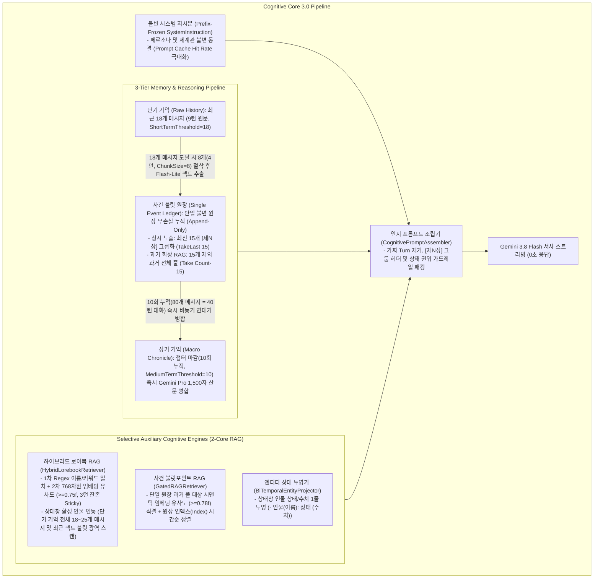
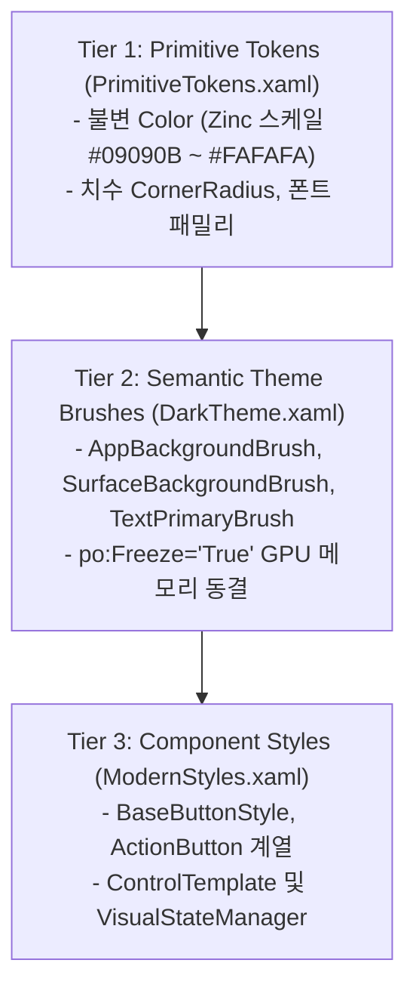
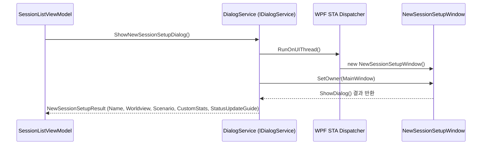

# GRC Architecture & Deep Dive

본 문서는 GRC(GenAI Roleplay Chat) 클라이언트의 핵심 엔진 구조와, C#/.NET 8.0 환경에서 달성한 동시성 제어 및 메모리 관리 기법을 상세히 기술합니다.

---

<memory_pipeline>

## 1. 인지 코어 3.0 메모리 파이프라인 (Cognitive Core 3.0 Memory Pipeline)

대규모 롤플레잉 서사를 진행할 때, 모든 대화를 프롬프트에 무제한 누적하면 컨텍스트 윈도우 초과, 프롬프트 캐시 미스, 비용 폭발 및 서사 왜곡(Lost in the middle)이 발생합니다. GRC v3.0은 이를 해결하기 위해 **불변 접두사 동결(Prefix-Frozen SystemInstruction)**, **사건 렛저(Event Ledger) 팩트/비밀 추출**, **2대 핵심 게이티드 RAG(하이브리드 로어북, 사건 불릿포인트)**를 유기적으로 결합한 Cognitive Core 3.0 클린 아키텍처를 탑재했습니다.

`[IMPLEMENTED]` 메모리 파이프라인 및 인지 모듈 구현체:
- 파이프라인 총괄: [MemoryManagerService.cs](../../../GRC/GRC/Services/MemoryManagerService.cs)
- 인지 프롬프트 조립기: [CognitivePromptAssembler.cs](../../../GRC/GRC/Services/Cognitive/CognitivePromptAssembler.cs)
- 구조화 로어북 엔트리 및 세부 스키마: [LorebookEntry.cs](../../../GRC/GRC/Models/LorebookEntry.cs), [LoreDetails.cs](../../../GRC/GRC/Models/LoreDetails.cs)
- 로어북 3단계 결정론적 렌더러: [LoreRenderer.cs](../../../GRC/GRC/Services/Cognitive/LoreRenderer.cs)
- 서사 문장부호·스키마 SSOT 계약: [NarrativeContract.cs](../../../GRC/GRC/Services/Cognitive/NarrativeContract.cs)
- 엔티티 명칭·별칭·경계 판정 엔진: [EntityNameResolver.cs](../../../GRC/GRC/Helpers/EntityNameResolver.cs)
- 사건 렛저 추출기: [EventLedgerExtractor.cs](../../../GRC/GRC/Services/Cognitive/EventLedgerExtractor.cs)
- 하이브리드 로어북 인출기: [HybridLorebookRetriever.cs](../../../GRC/GRC/Services/Cognitive/HybridLorebookRetriever.cs)
- 살리언스 게이티드 RAG: [GatedRAGRetriever.cs](../../../GRC/GRC/Services/Cognitive/GatedRAGRetriever.cs)
- 시간 인식 관계 투영기: [BiTemporalEntityProjector.cs](../../../GRC/GRC/Helpers/BiTemporalEntityProjector.cs)
- SIMD 벡터 연산 헬퍼: [VectorMathHelper.cs](../../../GRC/GRC/Helpers/VectorMathHelper.cs)

### 1) 불변 접두사 동결 (Prefix-Frozen SystemInstruction)
*   세계관, 시스템 페르소나, 불변 지시문을 `SystemInstruction`에 완전히 격리하여 고정합니다.
*   **서술 기본 원칙(`FormatRule`) 및 퓨샷 규격**: 대사는 큰따옴표(`" "`), 독백 및 속마음은 낫표(`「 」`), 행동/배경은 기호 없는 평문 소설체로 명시하고, 마크다운 강조(*별표* 등) 배제 지침과 4줄 직관적 `<example>` 퓨샷을 고정 주입하여 UI 파서와의 일관성을 유지합니다.
*   동적으로 변하는 로어북, 사건 렛저, 대서사 연대기는 최신 유저 메시지 직전의 **동적 컨텍스트 슬롯(Dynamic Context Slot)**에 주입함으로써, LLM 엔진의 프롬프트 캐시 적중률을 극대화하고 문체 오염을 방지합니다.
*   **메타 지시문 독립 격리 및 벡터 희석 방지**: 빠른 진행(`fast_forward`), 자동 이어쓰기(`auto_continue`) 등 유저 명시적 의도 기반 개입 명령(`metaDirective`)은 `userMessage.Text`에 합성하지 않고 `CognitiveContext.MetaDirective`를 통해 `<current_action>` 외부의 독립 상위 태그로만 조건부 렌더링(미발생 시 완전 생략)합니다. 이를 통해 768차원 유저 쿼리 임베딩의 시맨틱 순도를 100% 보존하고 유저 데이터-시스템 지시문 역전을 방지합니다. (강제 챕터 전환 메타지시문 `chapter_transition`은 진행 중이던 장면을 급발진시키는 부작용을 원천 차단하기 위해 폐기하고, 아래의 사건 해결 변수 기반 `<story_seeds>` 엔진으로 통합되었습니다.)
*   **Thinking 모델 자가 검증 기준(Verification Criteria)**: `<final_instruction>`에 최종 출력 전 직전 턴 인과 관계 및 배경 맥락과 상충되지 않는지 내부 추론 단계에서 자체 검증하도록 기준을 명시하여 서사 일관성을 극대화합니다.

### 2) 단기 기억 (Raw History)
*   가장 최근에 주고받은 날것의 대화 18개 메시지(9턴 대화, `ShortTermThreshold = 18`)를 손실 없이 보존합니다.
*   **비동기 압축 트리거**: 18개 메시지에 도달하면 가장 오래된 8개 메시지(4턴 대화, `MemoryCompressionChunkSize = 8`)를 절삭하여 백그라운드 태스크(`Task.Run`)에서 사건 팩트 추출을 시작합니다. 낙관적 락(`_shortTermVersion`)을 통해 동시성 정합성을 보장합니다.

### 3) 사건 불릿 원장 (Single Event Ledger 및 [제N장] 시간축 앵커)
*   **단일 원장 무손실 누적 (Append-Only)**: 절삭된 8개 메시지는 **Gemini 3.5 Flash-Lite** 모델을 통해 대명사('그', '그녀' 등)를 배제하고 `[원인/배경 + 명시적 고유명사 주체 + 행동/대화/사건 + 결과/관계·상태 변화]`를 담은 1~2문장의 자기완결형 인과 팩트 불릿(최대 3~5개)으로 추출됩니다. 물리적 사건뿐만 아니라 인물 간의 의미 있는 감정/신뢰 변화, 호칭·태도의 전환, 공유된 정서적 순간과 개인적 약속을 함께 추출하여 서브컬처 장르의 관계 서사 연속성을 보존합니다. 추출 프롬프트는 정적 규칙/TypeScript 스키마를 `SystemInstruction`으로 물리 분리하여 매 4턴마다 구글 서버의 **KV Cache를 100% 재사용**하며, `Temperature: null` 설정을 통해 Flash-Lite 모델의 무한 반복 루프를 원천 차단합니다. 응답은 `LlmJsonParser`를 통해 내결함성 파싱(프리앰블 스킵 및 잘린 JSON 복구)되며, Google의 차세대 통일 임베딩(`gemini-embedding-001`, MRL 768차원, 서울 `asia-northeast3` 리전)과 함께 `_currentContext.EventLedgers` 단일 리스트에 영구 누적됩니다.
*   **가짜 Turn 메타태그 완전 적출**: 4턴 배치 단위로 동일하게 찍히던 왜곡된 가짜 Turn 번호를 완전히 제거하고, 단일 원장 인덱스(`Index`)를 통해 100% 발생 시간순 인과관계를 보존합니다.
*   **챕터 전환 시 무손실 승계**: 1개 챕터가 끝나 새 챕터로 전환될 때도 단일 원장 전체를 그대로 승계하여 챕터 전환 직후 상시 불릿이 증발하는 결함을 원천 차단합니다.
*   **상시 노출 칸 (`<internal_chronicle_facts>`)**: 단일 원장의 **최신 15개(`TakeLast(15)`)**를 항상 노출하며, 장 번호가 변경될 때만 `[제N장]` 그룹 헤더를 1회 출력하여 중복 토큰을 없애고 챕터 경계 인과를 보존합니다. 헤더에 `(현재 제N장 진행 중)`을 명시하여 시간 기준점을 확립합니다.
*   **과거 회상 RAG 풀 (`<recalled_history>`)**: 단일 원장에서 **최신 15개를 제외한 앞쪽 전체(`Take(Count - 15)`)**가 자동으로 과거 회상 검색 대상이 됩니다.

### 4) 장기 연대기 (Macro Chronicle 즉시 병합)
*   과거 레거시 3개 챕터 지연 대기 큐(`_mediumBuffers`, `PrevContexts`)를 전면 폐지하고, **10회 압축 누적(80개 메시지 = 40턴 대화, `MediumTermThreshold = 10`)으로 챕터가 마감되는 즉시** 해당 장의 불릿들을 **Gemini Pro** 모델에 비동기 전달합니다.
*   **살리언스 증발(Salience Evaporation)** 기법을 적용하여 1,500자 이내의 대서사 산문 연대기(`_longTermSummary`)로 즉시 병합 보존하여 서사의 거시적 대의명분 공백을 완전히 해소합니다.

### 5) 보조 인지 엔진 (2-Core RAG & Relational Projector)
*   **구조화 로어북 SSOT 스키마 (`CharacterLoreDetails` / `WorldLoreDetails`), 하이브리드 로어북 RAG (`HybridLorebookRetriever`), 호감도 단계별 3중 스포일러 마스킹 (`MaskLorebooksForPrompt` & `LoreRenderer`)**:
    - **순수 구조화 JSON SSOT (Zero-Legacy)**: `LorebookEntry`는 문자열 내부 구분자(`/`, `->`, `* 항목명:`)에 의존하던 평문 DSL과 레거시 파서(`LegacyLoreParser`)를 완전히 적출하고, 인물 전용 11필드 레코드(`CharacterLoreDetails`: `RoleSummary`, `Appearance`, `SurfacePersona`, `InnerMotivation`, `InitialContact`, `BondTrigger`, `BondPayoff`, `OtherRelations`, `SpeechTone`, `EverydayQuote`, `EmotionalQuote`, `Notes`), 비인물 전용 4필드 레코드(`WorldLoreDetails`: `IdentitySummary`, `SensoryDetails`, `RulesAndPrinciples`, `NarrativeHook`, `Notes`), 그리고 런타임 기억 추출용 `FreeText`(`Category == "기억"`)만을 JSON 단일 진실 공급원(SSOT)으로 저장합니다.
    - **선행 3단계 스포일러 마스킹 및 결정론적 프롬프트 렌더링 (`LoreRenderer`)**: `entry.Content`는 `[JsonIgnore]` 계산 프로퍼티로서 `LoreRenderer.Render(entry, entry.RevealStage)`가 호출 시점에 결정론적으로 조립합니다. `HybridLorebookRetriever.Retrieve` 호출 전 `MemoryManagerService.MaskLorebooksForPrompt`가 각 인물의 현재 호감도/신뢰도를 검사하여 `entry with { RevealStage = stage }`(`1`: `< 30` 기본 프로필·일상 대사만 공개 / `2`: `30~59` `BondTrigger -> BondPayoff` 유대 심화 해금 / `3`: `>= 60` `InnerMotivation` 및 `EmotionalQuote` 완전 해금)로 선행 마스킹하므로, 3,000토큰 로어북 예산이 실제 프롬프트 주입 길이 기준으로 정확히 산정되며 UI/TTS용 `CurrentActiveLorebooks`는 원본 참조를 보존합니다.
    - **하이브리드 인출 및 인물 어절 스캔**: 정규식 1차 이름/키워드 스캔(엔트리 이름 완전 일치 및 직전 `model` 응답 + 현재 유저 입력 결합 키워드 스캔; Turn 1에는 `<initial_scenario>` 본문 전체 자동 스캔; Turn 0 초기 시나리오 세션 복원 시에도 `TotalTurnCount == 0`을 기준으로 Turn 1 `ThinkingLevel.high` 앵커 보존)과 시맨틱 임베딩 2차 유사도 검색(현재 유저 입력 단독 임베딩, 임계치 `0.75f`, 3턴 잔존 Sticky)을 결합하며, 단기 기억 버퍼(18~25개 메시지) 및 최근 사건 불릿(3개) 내 활성 인물(`activeChars`)을 `EntityNameResolver.ExtractCharacterNameTokens` 어절 단위로 광역 스캔하여 이름 첫 어절만 호명되는 구간에서도 상태창 인물을 누락 없이 패킹합니다.
*   **사건 불릿포인트 RAG (`GatedRAGRetriever`)**: 레거시 키워드 게이팅 데드코드를 전면 적출하고, 매 턴 계산된 768차원 유저 쿼리 임베딩을 실측 기반 순수 코사인 유사도(**$\ge 0.78f$**) 스캔에 직결하여 상위 2개를 핀포인트 인출합니다. 인출 결과는 단일 원장 인덱스(`Index`) 발생 시간순으로 정렬하여 선후 인과 역전을 차단하며, 헤더에 `[떠오른 과거의 기억 - 현재 상태와 상충 시 현재 상태가 우선함]`을 명시하여 현재 상태 오판을 원천 방어합니다.
*   **엔티티 상태 투영기 (`BiTemporalEntityProjector`) 및 엔티티 명칭·경계 판정 엔진 (`EntityNameResolver`)**: 불필요한 필드 및 중복 상태 텍스트 버그를 제거하고, `- 인물(이름): 상태 (수치)` 또는 `- 인물(이름): 상태` 형태로 간결하고 명확하게 투영합니다. 또한 상태창의 현재 위치(`Places`), 플레이어 주요 수치(`CustomStats`), 인벤토리(`Items`)를 `<entity_relationship>` 직후의 `<current_state>` 태그로 서사 AI에 동적 공급하여 인지 단절을 원천 해소합니다. 런타임 상태창 갱신(`UpdateContextStatus`) 시 `EntityNameResolver.ResolveCharacterKey`를 통해 오직 인물 전체명 또는 고유 이름 첫 어절 일치로만 표준 명칭 정규화를 수행하여 일반 직함/소속 키워드 충돌로 인한 기존 인물 상태 덮어쓰기를 원천 차단합니다.
*   **사건 해결 변수 기반 서브컬처 에피소드 & 시드 엔진 (`<story_seeds>`, `isSceneResolved`, `triggeredSeeds`)**:
    - **변수 트리거(`StatusPayload.IsSceneResolved`)**: 상태창 추적 API(`BuildStatusRequest`)가 최근 2턴 맥락(`<recent_context>`)과 직전 턴(`<latest_turn>`)을 종합하여 당면 사건(전투, 협상, 위기 등)이 일단락된 막간(Interlude/Lull) 상태인지를 `isSceneResolved: boolean`으로 판별합니다.
    - **조건부 3대 풀 시드 주입 및 공간 맥락 우선순위**: 오직 `_currentContext.IsSceneResolved == true`이거나 유저가 명시적으로 `[빠른 진행]`(`fast_forward`)을 켰을 때만 로어북과 상태창을 교차 대조하여 ① `[미등장 인물 조우]`(`Pool A`: 동일 `Priority` 내에서 현재 위치 `Places`와 `InitialContact` 또는 장소 `NarrativeHook`이 연결된 인물을 최우선 정렬), ② `[장소/사건 훅]`(`Pool B`: 미방문 장소/세력/아이템의 `World.NarrativeHook`), ③ `[동료 유대 심화]`(`Pool C`: 호감도/신뢰도 $\ge 30$ 달성 시 1단계 `BOND:{Name}` 우선 해금 후, $\ge 60$ 달성 시 별도 막간에서 2단계 `BOND_SECRET:{Name}` 순차 해금) 최대 3개 시드를 `<story_seeds>` 및 추천 답변용 `<available_story_seeds>`로 주입합니다.
    - **상태 전이 동기화(`SyncStateBasedSeedConsumptionLocked`) + Status LLM 화이트리스트 소모 판정(`StatusPayload.TriggeredSeeds`)**: 시작 거점(`Places`)과 소지품(`Items`), 등장인물(`Chars`)에 편입된 엔티티는 즉시 `ConsumedSeeds`에 자동 동기화되어 거점 이동이나 소모품 사용 후 `Priority: 0` 초기 거점/아이템이 재주입되는 Head-of-Line Blocking을 원천 차단합니다. 또한 단어 출현 기반 추측(`BondHookStopwords` 등)을 전면 폐기하고, 시드가 제시된 턴에만 `BuildStatusRequest`에 `<offered_story_seeds>`와 `triggeredSeeds: string[]` 필드를 주입하여 `Flash-Lite`가 실제 개시된 시드 키만 반환하도록 위임한 뒤 `UpdateContextStatus`에서 `_pendingStatusSeeds` 화이트리스트 대조로 확정 소모합니다.

</memory_pipeline>

---

<storage_optimization>

## 2. O(1) 무부하 파일 쓰기 (Zero-Deserialize JSON Append)

대화 이력을 디스크에 영구 저장(`FullHistory.json`)할 때 발생하는 오버헤드를 극단적으로 최적화했습니다.

`[IMPLEMENTED]` 파일 조작 알고리즘은 [FullHistoryLogger.cs](../../../GRC/GRC/Helpers/FullHistoryLogger.cs)에 구현되어 있습니다.

*   **문제점**: 일반적으로 JSON 배열에 요소를 추가할 때 전체 파일을 메모리로 읽어 역직렬화(Deserialize)한 뒤, 리스트에 Add하고 다시 직렬화하여 덮어씁니다. 서사가 길어질수록 이 과정에서 발생하는 GC(가비지 컬렉터) 스파이크와 I/O 지연이 UI를 멈추게 합니다.
*   **해결책 (`FullHistoryLogger.cs`)**:
    역직렬화를 완전히 포기하고 바이너리 스트림 조작으로 대체했습니다.
    1.  `FileStream`으로 파일을 엽니다.
    2.  끝에서부터 역방향으로 탐색(Seek)하여 배열을 닫는 괄호 `]`를 찾습니다.
    3.  새로운 메시지 텍스트를 바이트 단위로 직접 주입(Append)하고 다시 `]`를 덮어씌웁니다.
    4.  결과적으로 파일의 크기가 10MB이든 1GB이든 **O(1)의 일정한 시간 복잡도**로 파일 쓰기가 완료됩니다.

</storage_optimization>

---

<concurrency_streaming>

## 3. 비차단 동시성 제어 및 60FPS 스트리밍

네트워크 통신과 UI 렌더링 간의 병목을 완벽히 격리하여 '0초 지연(Zero-Delay)' 타이핑 경험을 제공합니다.

`[IMPLEMENTED]` 렌더링 틱 제어는 [StatefulStreamingHelper.cs](../../../GRC/GRC/Helpers/StatefulStreamingHelper.cs)에, 통신 채널은 [ChatWorkflowService.cs](../../../GRC/GRC/Services/ChatWorkflowService.cs)에 분리 구현되어 있습니다.

### 생산자-소비자 스트리밍 격리 (`System.Threading.Channels`)
*   `ChatWorkflowService` 내부에서 Gemini API로부터 문자 스트림을 받아오는 스레드(생산자)와, WPF 대화창에 문자를 그리는 스레드(소비자)를 `Channel<char>`로 분리했습니다. 네트워크 지연(Lag)이 발생해도 생산자 큐만 대기할 뿐 UI 렌더러는 절대 굳지 않습니다.
*   **실시간 마크다운 별표(*) 필터링**: 생산자 태스크에서 청크를 수신할 때 `c == '*'`를 즉시 드롭하여, AI가 실수로 출력한 `**` 기호가 스트리밍 화면에 노출되거나 완료 후 텍스트와 불일치를 일으키는 현상을 원천 방어합니다.

### 60FPS 배치 렌더링 (`StatefulStreamingHelper.cs`)
*   문자가 들어올 때마다 WPF의 `Dispatcher`를 호출하면 윈도우 메시지 루프가 포화되어 렌더링 스레드가 마비됩니다.
*   이를 막기 위해 유입되는 문자를 `ConcurrentQueue<char>`에 담아둡니다.
*   `DispatcherTimer`를 `DispatcherPriority.Render` 우선순위로 16ms(60FPS)마다 한 번씩 틱(Tick)을 발생시켜, 큐에 쌓인 문자를 일괄 Drain한 뒤 **틱당 단 한 번만 UI에 반영(FlushBuffer)**합니다.

</concurrency_streaming>

---

<session_architect>

## 4. AI Session Architect (자율 저작 에이전트)

유저가 기획서를 작성할 필요 없이, 키워드 한 줄만으로 TRPG 세션을 빌드해 주는 `Gemini 4 Argon` (`ThinkingLevel.high`, `ArchitectMaxOutputTokens = 32768`) 최적화 4단계(총 5회 API 호출) 에이전트입니다.

`[IMPLEMENTED]` 4단계 통합 스테이트 머신은 [SessionArchitectService.cs](../../../GRC/GRC/Services/SessionArchitectService.cs) 및 [SessionArchitectViewModel.cs](../../../GRC/GRC/ViewModels/SessionArchitectViewModel.cs)에 구현되어 있습니다.

*   **4단계 통합 상태 기계(4-Stage Consolidated State Machine)**:
    1. **1단계 (청사진 및 마스터 세계관 통합 — 1회 호출)**: `<master_setting>` 전용 4대 번호 섹션 개조식 마스터 세계관(`worldviewOutline`)과 8~15개 그물망 로어북 기획(`connectedEntities`)을 단일 추론 공간에서 공동 설계(Co-Design)합니다.
    2. **2단계 (2-Wave 통합 앙상블 구조화 로어북 — 2회 호출)**: 인위적인 마이크로 배치 분할(`batchSize = 3`) 없이, Wave 1에서 모든 비인물(장소·세계관·아이템) 무대 인프라를 `WorldLorebookArrayResponseSchema`(4대 필수 필드 강제) 기반 1회 통합 호출로 먼저 확정한 뒤, Wave 2에서 확정된 무대 전문(`<established_world_lore>`) 위에서 모든 등장인물 전원을 `CharacterLorebookArrayResponseSchema`(11대 필수 필드 강제) 기반 1회 통합 앙상블 캐스팅 호출로 동시 생성합니다. 각 필드는 `SanitizeCharacterDetails` / `SanitizeWorldDetails`를 통해 중복 라벨 래퍼나 바깥쪽 따옴표 없이 순수 값으로 정제되며, WPF 로어북 편집창([EditLorebookWindow.xaml](../../../GRC/GRC/Views/EditLorebookWindow.xaml)) 또한 카테고리(`인물` 11필드 / `장소·아이템·세계관` 4필드 / `기억` 자유 텍스트)에 따라 전용 구조화 입력 폼과 실시간 `<world_lore>` 렌더링 미리보기를 제공합니다.
    3. **3단계 (오프닝 시나리오 선행 집필 — 1회 호출)**: JSON 이스케이프 및 개조식 문체 전이(Style Bleed)를 차단하기 위해 독립된 `text/plain` 문학 산문 모드로 첫 직면 장면을 집필합니다.
    4. **4단계 (상태창·Turn 0 시딩 및 시스템 지시문 통합 — 1회 호출 + C# 하이브리드 컴파일러)**: 완성된 오프닝 본문(`<opening_scenario>`)을 기반으로 초기 스탯(`stats`), 수치 갱신 가이드(`guide`), Turn 0 초기 컨텍스트(`initialChars`/`initialPlaces`/`initialItems`, 인물 Key 정규화 포함), 그리고 세션 특화 비수치 GM 수칙 4·5번(`genreDirectives`)을 단일 JSON으로 추출하고 `CompileHybridSystemPrompt`를 통해 코어 3대 헌법(`CoreSystemDirectivesHeader`)과 즉시 결합합니다. 세션 최종 적용 시 [LorebookService.cs](../../../GRC/GRC/Services/LorebookService.cs)는 런타임 쿼리와 동일한 대칭 공간(`SEMANTIC_SIMILARITY`)으로 768차원 임베딩을 순서 보장형 병렬 발급합니다.
*   **100% C# 결정론적 무결성 관문 및 외과수술식 보정(`ReviewStepContentAsync` & `ReviseLorebooksSurgicallyAsync`)**:
    기존 단계별 LLM 자가 감사 재호출로 인한 자기강화 환각 및 토큰 낭비를 전면 제거하고, C# 파서와 정규식 기반의 즉시 결정론적 검수 관문(API 호출 0회)을 가동합니다. 기획된 로어북 항목 누락이나 인물 필수 대사(`"..."`) 누락 등 객관적 구조 결함이 적발되었을 때만 `[수정 대상: 항목명]` 태그를 생성하여 해당 항목만 핀포인트로 재생성·병합합니다.
*   **에이전트 세션 자산 결정론적 검증 게이트 ([SessionAssetValidator.cs](../../../GRC/tests/GRC.Tests/SessionAssetValidator.cs) & [SessionAuditTests.cs](../../../GRC/tests/GRC.Tests/SessionAuditTests.cs), `Category=SessionAudit`)**:
    [05_session_architect_agent_template.md](05_session_architect_agent_template.md) 기반 외부 에이전트가 생성한 3종 JSON 자산(`Preset.json`, `Session.json`, `FullHistory.json`)을 런타임 SSOT([NarrativeContract.cs](../../../GRC/GRC/Services/Cognitive/NarrativeContract.cs)의 `AffinityStatTerms`·`InitialScenarioAckText`, [LoreDetails.cs](../../../GRC/GRC/Models/LoreDetails.cs)의 구조화 스키마, [SessionArchitectService.cs](../../../GRC/GRC/Services/SessionArchitectService.cs)의 `CoreSystemDirectivesHeader`·정제기 고정점)로 직접 검증하여 눈대중 검수(Blind Audit)를 원천 차단합니다.

</session_architect>

---

<multimodal_sync>

## 5. 멀티모달 감정 연기 TTS 동기화

텍스트가 렌더링되는 동안 발생하는 빈 시간을 활용하여 오디오를 미리 생성(Prefetch)하고 싱크를 맞춥니다.

`[IMPLEMENTED]` 보이스 프리페치 및 재생은 [GeminiTtsService.cs](../../../GRC/GRC/Services/GeminiTtsService.cs)와 연동됩니다.

1.  **실시간 대사 파싱**: 스트리밍 루프가 따옴표(`"..."`)를 만나면 이를 감지하여 대화 버퍼를 열고, 닫는 따옴표가 등장하면 즉시 백그라운드에서 `GeminiTtsService`로 오디오 번역 및 음성 합성(WAV)을 요청합니다.
2.  **재생 동기화 대기 (Sync Hold)**: UI 소비자가 문자를 그리다가 닫는 따옴표에 도달하면, 프리페치 큐에서 방금 생성 완료된 음성을 꺼내 재생합니다. 이때 `TaskCompletionSource`를 사용하여 음성 재생이 완전히 끝날 때까지 다음 지문 텍스트의 출력을 멈추어(Hold) 소리와 자막의 완벽한 템포를 맞춥니다.

</multimodal_sync>

---

<design_tokens>

## 6. 3계층 디자인 토큰 아키텍처 (3-Tier Design Token Architecture)

확장성과 테마 일관성을 확보하고 렌더링 성능을 극대화하기 위해 UI 자원을 3개 계층으로 분리하여 관리합니다.

`[IMPLEMENTED]` 토큰 및 스타일 정의는 [PrimitiveTokens.xaml](../../../GRC/GRC/Themes/PrimitiveTokens.xaml), [DarkTheme.xaml](../../../GRC/GRC/Themes/DarkTheme.xaml), [ModernStyles.xaml](../../../GRC/GRC/Themes/ModernStyles.xaml)에 구현되어 있습니다.

1. **Tier 1 (Primitive Tokens)**: 특정 테마에 종속되지 않는 절대적 색상(Zinc 팔레트 10단계), 상태 팔레트(Emerald, Amber, Rose, Cyan), UI 치수(`CornerRadiusCard`, `CornerRadiusBubble`) 및 타이포그래피 상수를 정의합니다.
2. **Tier 2 (Semantic Theme Brushes)**: 역할 기반(Background, Surface, Border, Text Primary/Muted)으로 시맨틱 SolidColorBrush를 구성합니다. 모든 브러시에는 `po:Freeze="True"` 속성을 선언하여 WPF 렌더링 파이프라인에서 불변(Frozen) 상태로 캐싱되도록 함으로써 멀티스레드 접근 안정성을 보장하고 드로우콜 오버헤드를 최소화합니다.
3. **Tier 3 (Component Styles & Controls)**: 시맨틱 브러시를 조합하여 암시적 버튼 스타일, 스크롤바, 리스트뷰 아이템 템플릿 등을 구성합니다.

</design_tokens>

---

<mvvm_dialog_service>

## 7. IDialogService 기반 순수 MVVM 분리 (Pure MVVM Decoupling)

뷰모델(ViewModel)이 구체적인 XAML 뷰(`Window`)를 직접 생성하거나 참조하는 강결합을 해제하여 테스트 가능성과 확장성을 확보했습니다.

`[IMPLEMENTED]` 다이얼로그 서비스 규격은 [IDialogService.cs](../../../GRC/GRC/Services/IDialogService.cs)에 정의되어 있습니다.

* **뷰모델 순수성 보장**: `SessionListViewModel` 및 `ChatViewModel`은 `Views.*` 네임스페이스를 일체 참조하지 않으며, 모든 팝업 및 창 전환을 `IDialogService` 추상화 인터페이스를 통해 비동기로 위임합니다.
* **STA 스레드 격리 및 소유자 바인딩**: 백그라운드 스레드에서 다이얼로그 메서드가 호출되더라도 `RunOnUIThread` 캡슐화를 통해 안전하게 UI 스레드로 전환되며, `SetOwner(MainWindow)` 가드를 통해 창의 최소화/복원 시 팝업이 뒤로 숨겨지는 Z-Order 버그를 방지합니다.

</mvvm_dialog_service>

---

<domain_service_extraction>

## 8. 도메인 서비스 추출 및 ChatViewModel 경량화

단일 책임 원칙(SRP)을 준수하고 AI 에이전트의 유지보수 컨텍스트를 최적화하기 위해, 거대해지기 쉬운 `ChatViewModel`의 부가 책임을 독립 도메인 서비스로 격리했습니다.

* **음성 합성 및 번역 캡슐화 ([GeminiTtsService.cs](../../../GRC/GRC/Services/GeminiTtsService.cs))**: 대사 스트리밍 도중 발생하는 일본어 번역 전처리, Google Cloud Vertex AI 음성 합성 호출, 취소 토큰(`CancellationToken`) 생명주기를 서비스 내부로 은닉했습니다.
* **오디오 재생 스레드 안전성 ([AudioService.cs](../../../GRC/GRC/Services/AudioService.cs))**: `MediaPlayer` 인스턴스의 STA 스레드 친화성을 보장하기 위해 생성자에서 UI `Dispatcher`를 캡처하고, 모든 재생 및 정지 명령을 디스패처로 보호했습니다.
* **타이핑 사운드 수명주기 관리 ([ChatWorkflowService.cs](../../../GRC/GRC/Services/ChatWorkflowService.cs))**: 텍스트 타이핑 효과음의 시작과 정지를 스트리밍 루프 및 `try-finally` 블록 내부에 결합하여 예외 발생 시에도 소리가 무한 반복되는 누수를 방지했습니다.
* **스탯 UI 파싱 팩토리 ([StatusPayload.cs](../../../GRC/GRC/Models/StatusPayload.cs))**: 뷰모델에 흩어져 있던 비정형 스탯 문자열 파싱 로직을 `CustomStatUI.Create` 도메인 팩토리 메서드로 이전하여 `CultureInfo.InvariantCulture`, finite 검증 등 방어적 파싱을 일원화했습니다.

</domain_service_extraction>

---

<smart_autoscroll>

## 9. 스마트 오토스크롤 (SmartAutoScroll) 무결성 알고리즘

LLM 토큰 단위 스트리밍 출력과 사용자의 과거 대화 탐색(Upward Scrolling) 간의 충돌을 수학적 판정식으로 해결했습니다.

`[IMPLEMENTED]` 스크롤 판정 로직은 [AutoScrollHelper.cs](../../../GRC/GRC/Helpers/AutoScrollHelper.cs)에 구현되어 있습니다.

* **ScrollViewer.Tag 오염 제거 및 사용자 의도 상태 머신 (`IsAutoScrollActive`)**: 과거 레거시에서 스크롤 상태 플래그를 컨트롤의 `Tag` 속성에 의존하던 방식을 완전히 폐기하고, ScrollViewer별 `IsAutoScrollActive` Attached DependencyProperty 기반의 유한 상태 머신으로 전환했습니다.
* **사용자 상향 스크롤 즉각 해제 (Zero-Latency Disengage)**:
  - 마우스 휠 상향 회전(`PreviewMouseWheel e.Delta > 0`) 또는 순수 뷰포트 상향 이동(`isPureUserScroll && e.VerticalChange < 0`) 감지 즉시 `IsAutoScrollActive = false`로 전이하여 추가 토큰 유입이나 가상화 높이 변동에 의한 하이재킹을 원천 차단합니다.
  - 비동기 디스패처 큐잉(`DispatcherPriority.Loaded`) 실행 시점에도 `if (GetIsAutoScrollActive(sv))` 지연 재검증(Lazy Guard)을 수행하여 큐 대기 시간 중 발생한 휠 조작을 보호합니다.
* **1틱 상향 스크롤 탈출 트랩 및 창 리사이징 오인 방어**:
  - 스트리밍 토큰 유입(`ExtentHeightChange > 0, VerticalChange == 0`) 시 24px 이내 상향 스크롤 유저가 바닥으로 되돌아가지 않도록 능동적 하향 조작(`e.VerticalChange > 0`) 또는 스크롤바 부재(`sv.ScrollableHeight <= 0`) 시에만 재활성화합니다.
  - 창 최대화/세로 확장(`ViewportHeightChange > 0`)으로 인한 클램핑 역방향 오프셋 변동은 사용자 상향 스크롤로 오인하지 않도록 `isPureUserScroll` 가드로 격리합니다.
* **컨텐츠 팽창/축소 조건부 판정식**:
  $$\text{referenceHeight} = \begin{cases} \text{scrollableHeight} - \Delta\text{extentHeight}, & \text{if } \Delta\text{extentHeight} > 0 \\ \text{scrollableHeight}, & \text{otherwise} \end{cases}$$
  컨텐츠가 아래로 스트리밍 팽창할 때(`extentHeightChange > 0`)는 직전 프레임의 바닥 높이를 역산하여 사용자가 바닥에 있었는지를 정확히 판정(24px 허용오차 적용)하고, 접기/삭제 등 컨텐츠가 축소될 때(`extentHeightChange <= 0`)는 현재 가용 높이와 직접 비교함으로써 사용자의 스크롤 뷰포트를 강제로 하단으로 끌고 내려가는 스크롤 하이재킹(Scroll Hijacking)을 원천 차단했습니다.

</smart_autoscroll>

