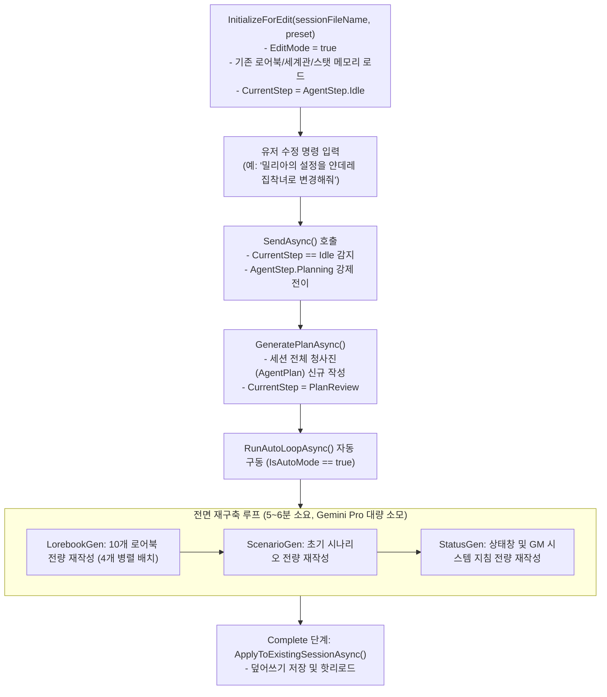
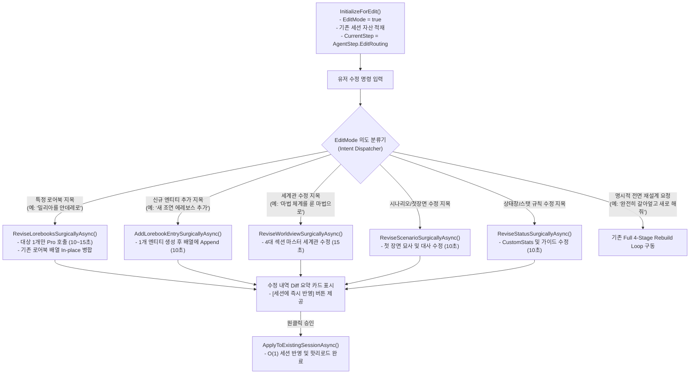

# GRC Implementation Roadmap & Session Architect Surgical Refactoring

본 문서는 GRC(GenAI Roleplay Chat) 데스크톱 클라이언트의 차기 아키텍처 고도화 과제와, 특히 **AI 세션 아키텍트의 기존 세션 편집 모드(`EditMode`)를 전면 재구축 루프(Full 4-Stage Rebuild)에서 외과수술식 핀포인트 부분 수정(Surgical Pinpoint Edit) 아키텍처로 전면 개편**하기 위한 상세 엔지니어링 명세를 기술합니다.

---

<overview>

## 1. 개요 및 로드맵 목적 (Overview & Goals)

GRC v3.0은 인지 코어(Cognitive Core 3.0), 사건 렛저(Single Event Ledger), 768차원 통일 임베딩 기반의 하이브리드 로어북 및 게이티드 RAG를 통해 장기 롤플레잉 서사의 무결성을 확보했습니다. 또한 AI 세션 아키텍트(Session Architect)를 통해 한 줄의 키워드로 10개 핵심 로어북과 시나리오, 상태창을 일괄 기획하는 4단계 자율 완주 파이프라인을 확립했습니다.

그러나 현재 구현된 **기존 세션 수정 모드(`EditMode`)**는 기획 완료 후 미세 조정(예: "길드 접수원 밀리아의 설정을 조금 더 적극적이고 얀데레 같은 집착녀로 변경해줘")을 수행할 때, 기존 세션 전체를 폐기하고 처음부터 다시 4단계(청사진 -> 로어북 10개 전량 -> 시나리오 -> 상태창/지시문)를 재작성하는 비효율적 파이프라인을 동작시키고 있습니다.

본 로드맵의 핵심 목표는 이미 백엔드에 구축되어 있는 `ReviseLorebooksSurgicallyAsync` 엔진을 뷰모델 및 UI 라우터와 유기적으로 결합하여, **기존 데이터의 손실 없이 지목된 1~2개 엔티티만 10~15초 이내에 핀포인트 재생성하고 세션에 즉시 반영하는 외과수술식 부분 수정 시스템**을 구축하는 것입니다.

</overview>

---

<problem_analysis>

## 2. 현행 아키텍처의 결함 및 병목 분석 (Current Architecture & Bottlenecks)

### 1) 현행 EditMode 실행 흐름 (As-Is Execution Trace)

현재 [SessionArchitectViewModel.cs](../../../GRC/GRC/ViewModels/SessionArchitectViewModel.cs)의 세션 수정 진입점 및 처리 흐름은 다음과 같습니다.



### 2) 3대 핵심 결함 및 병목

1. **극심한 지연 시간 및 토큰 낭비 (Latency & Token Wastage)**
   * 단 한 명의 조연 캐릭터 성격을 수정하고자 함에도 4개 배치 10개 로어북, 시나리오, 상태창을 모두 다시 생성합니다.
   * Gemini Pro 모델의 긴 Thinking 시간 및 4회 이상의 직렬/병렬 LLM 왕복으로 인해 수정 완료까지 **약 5~6분의 대기 시간**이 강제되며 불필요한 토큰 비용이 발생합니다.
2. **부수효과 및 기존 서사 맥락 손실 (Side-effect Regression & Context Drift)**
   * 유저가 이미 마음에 들어 하거나 이전 롤플레잉 과정에서 정밀하게 확립된 다른 9개 로어북 항목, 초기 시나리오 문장, 상태창 커스텀 스탯이 완전히 새로운 무작위 생성물로 덮어씌워집니다.
   * 기존 플레이어(PC)의 초기 위치나 주변 인물들의 관계망(`connectedEntities`)이 왜곡되어 기존 세션의 정체성이 훼손될 위험이 있습니다.
3. **사용자 경험(UX) 불일치**
   * 유저는 "부분 수정(Tweak)"을 요청했으나 시스템은 "전면 재기획(Rebuild)"으로 응답하여, 의도치 않은 대기 시간과 변경 결과물에 당혹감을 느끼게 됩니다.

</problem_analysis>

---

<existing_engine>

## 3. 기구현 백엔드 외과수술 엔진 분석 (Existing Surgical Engine Foundation)

GRC 백엔드 서비스 계층에는 이미 이러한 문제를 해결하기 위한 고성능 외과수술 메서드가 완비되어 있습니다.

### 1) 로어북 핀포인트 외과수술 엔진 (`ReviseLorebooksSurgicallyAsync`)
* 구현 위치: [SessionArchitectService.cs](../../../GRC/GRC/Services/SessionArchitectService.cs)
* 핵심 동작 메커니즘:
  1. `ExtractTargetLorebookNames(userFeedback, ...)`: 유저의 자연어 피드백에서 수정 대상 엔티티 이름(예: `밀리아`)을 결정론적으로 추출합니다.
  2. `existingEntries`: 기존 10개의 로어북 배열을 메모리에서 즉시 획득합니다.
  3. `isPartialSurgicalUpdate`: 지목된 엔티티가 기존 로어북의 일부(예: 1~2개)인 경우 외과수술 플래그를 활성화합니다.
  4. 프롬프트 패킹: 기존 로어북 전체는 `<existing_lorebooks>` 태그에 읽기 전용 참조 맥락으로 격리 주입하고, `<target_lorebook_items>`에는 오직 수정 대상 1개 항목만 주입합니다.
  5. Gemini Pro 호출: 대상 항목 1개만을 대상으로 엄격한 JSON 스키마 기반 고속 추론을 실행합니다 (**소요 시간: 10~15초**).
  6. 메모리 병합(Surgical Merge): 기존 10개 항목의 순서와 내용을 유지하면서, 수정된 엔티티 위치만 `O(N)` 속도로 교체(In-place Replacement)합니다.

```csharp
// SessionArchitectService.cs 핵심 발췌
if (isPartialSurgicalUpdate && existingEntries.Count > 0 && regeneratedEntries.Count > 0)
{
    var regenMap = regeneratedEntries.ToDictionary(e => e.Name.Trim(), e => e, StringComparer.OrdinalIgnoreCase);
    var mergedList = new List<LorebookEntry>(existingEntries.Count);

    foreach (var existing in existingEntries)
    {
        if (regenMap.TryGetValue(existing.Name.Trim(), out var updated))
        {
            mergedList.Add(updated); // 핀포인트 교체
        }
        else
        {
            mergedList.Add(existing); // 기존 항목 100% 보존
        }
    }
    return JsonSerializer.Serialize(mergedList, JsonWriteOptions);
}
```

### 2) 기존 세션 무손실 핫패치 엔진 (`ApplyToExistingSessionAsync`)
* 이미 단위 테스트([SessionArchitectServiceTests.cs](../../../GRC/tests/GRC.Tests/SessionArchitectServiceTests.cs))로 검증된 본 메서드는 다음을 보증합니다:
  * 대화 원문 이력(`FullHistory.json`) 절대 보존.
  * 기존 세션의 활성 캐릭터 Key(`ActiveChars`), 소모된 서사 시드(`ConsumedSeeds`), 진행 턴 수 보존.
  * 프리셋 파일(`.preset.json`)의 세계관, 로어북, 스탯 규격만 안전하게 교체.

### 3) 불일치의 근본 원인 (Root Cause)
* **상태 라우터 결여**: `ReviseLorebooksSurgicallyAsync`는 신규 생성 도중의 `AgentStep.LorebookReview` 단계(`ReviseStepAsync`)에만 연결되어 있습니다.
* `InitializeForEdit`가 호출될 때 상태 머신이 단순히 `CurrentStep = AgentStep.Idle`로 설정되므로, 뷰모델의 `SendAsync`는 이를 일반 신규 기획 진입으로 간주하여 `GeneratePlanAsync`와 `RunAutoLoopAsync`를 호출하는 구조적 단절이 존재합니다.

</existing_engine>

---

<target_architecture>

## 4. 목표 아키텍처: 외과수술식 핀포인트 라우팅 (Target Architecture & State Machine)

### 1) 개선된 EditMode 상태 전이도 (To-Be Architecture)



### 2) 수정 의도 분류기 (Edit Intent Dispatcher) 설계

자연어 명령 또는 UI 전용 퀵 액션을 통해 수정 대상을 5대 영역으로 격리 분기합니다.

| 의도 분류 (Intent) | 판별 기준 / 키워드 | 호출 파이프라인 | 소요 시간(SLA) |
|---|---|---|---|
| **로어북 핀포인트 수정** | 기존 로어북 이름 매칭 (`밀리아`, `드래곤`, `길드` 등) | `ReviseLorebooksSurgicallyAsync` | $\le 15$초 |
| **신규 엔티티 추가** | "추가", "새 인물", "새 장소", "신규" | `AddLorebookEntrySurgicallyAsync` | $\le 12$초 |
| **세계관 텍스트 수정** | "세계관", "배경", "법칙", "마법 체계", "세력 구도" | `ReviseStepAsync(AgentStep.WorldviewReview)` | $\le 15$초 |
| **초기 시나리오 수정** | "시나리오", "도입부", "첫 장면", "첫 대사", "시작 위치" | `ReviseStepAsync(AgentStep.ScenarioReview)` | $\le 12$초 |
| **상태창/스탯 수정** | "스탯", "상태창", "수치", "호감도 규칙", "시스템 지시문" | `ReviseStepAsync(AgentStep.StatusReview)` | $\le 12$초 |
| **전면 재설계 (Full Rebuild)** | "완전히 갈아엎어", "처음부터 다시", "새로 기획", "전부 리셋" | `GeneratePlanAsync` $\to$ `RunAutoLoopAsync` | 300~360초 |

### 3) UI/UX 대시보드 인스펙터 지원

* **세션 편집 인스펙터 패널**:
  * `EditMode` 진입 시 좌측/상단에 현재 세션의 [로어북 칩 목록(10개)], [세계관 요약 카드], [초기 시나리오], [스탯 목록]을 탭 또는 카드 형태로 바인딩.
  * 각 로어북 칩에 `[수정]`, `[삭제]` 퀵 액션 버튼을 배치하여, 클릭 시 채팅창에 `@밀리아 ` 접두사를 자동으로 삽입.
  * 수정된 항목은 하이라이트 표시되며, 전체 재구축 루프 없이 **[세션에 저장]** 버튼을 누르면 즉시 세션 파일에 동기화.

</target_architecture>

---

<implementation_tasks>

## 5. 단계별 구현 및 리팩토링 태스크 (Step-by-Step Implementation Tasks)

### Phase 1: ViewModel 상태 머신 분기 및 의도 라우터 구축
* **대상 파일**: [SessionArchitectViewModel.cs](../../../GRC/GRC/ViewModels/SessionArchitectViewModel.cs)
* **작업 항목**:
  1. `AgentStep.EditRouting` 열거형 단계 정의 또는 `EditMode` 가드 추가.
  2. `InitializeForEdit`:
     * `CurrentStep = AgentStep.EditRouting`으로 설정.
     * 안내 메시지 출력: `"기존 세션 '{preset.Name}'의 편집 모드입니다. 특정 인물/장소의 설정을 수정하거나 새로운 항목을 추가할 수 있습니다. (예: '밀리아를 얀데레로 수정해줘', '새로운 조연 엘프 마법사 추가해줘')"`
  3. `SendAsync`:
     * `EditMode == true`인 경우 `AgentStep.Idle` 분기를 타지 않고 `HandleSurgicalEditInputAsync(userMsg)`로 직결.
     * 의도 분류 결과에 따라 적절한 백엔드 외과수술 메서드로 디스패치.

### Phase 2: 백엔드 외과수술 서비스 확장
* **대상 파일**: [SessionArchitectService.cs](../../../GRC/GRC/Services/SessionArchitectService.cs)
* **작업 항목**:
  1. `ReviseLorebooksSurgicallyAsync`를 `public`으로 승격하고, `AgentPlan`이 `null`인 경우(기존 세션 데이터만 있는 경우)에도 동작하도록 오버로드 또는 기본값 방어 로직 추가.
  2. `AddLorebookEntrySurgicallyAsync(string userPrompt, ArchitectSession session, CancellationToken ct)` 신규 구현:
     * 기존 10개 로어북과 세계관을 컨텍스트로 전달하고 단 1개의 새 엔티티만 생성하여 리스트에 `Add`.
  3. 세계관/시나리오/상태창 개별 수정 메서드를 `ArchitectSession` 직접 참조 가능하도록 독립 엔드포인트로 노출.

### Phase 3: WPF 뷰 및 인터랙션 컨트롤 고도화
* **대상 파일**: [SessionArchitectWindow.xaml](../../../GRC/GRC/Views/SessionArchitectWindow.xaml)
* **작업 항목**:
  1. `EditMode` 활성화 시 하단 액션 영역에 [세션에 즉시 반영] 버튼 및 단계 점프 네비게이터 노출.
  2. 로어북 개별 수정 결과에 대한 Markdown Diff 렌더링 카드 템플릿 추가.

### Phase 4: 무결성 검증 및 단위/통합 테스트
* **대상 파일**: [SessionArchitectServiceTests.cs](../../../GRC/tests/GRC.Tests/SessionArchitectServiceTests.cs)
* **작업 항목**:
  1. `ReviseLorebooksSurgically_WhenSingleEntityTargeted_ModifiesOnlyTargetAndPreservesOthers` 단위 테스트 추가:
     * 10개 로어북 중 1개(`밀리아`)만 수정했을 때 나머지 9개 항목의 이름, 카테고리, 내용이 불변인지 검증.
  2. `AddLorebookEntrySurgically_AppendsSingleEntry_WithoutModifyingExistingEntries` 단위 테스트 추가:
     * 기존 10개에 신규 항목 1개가 추가되어 총 11개가 정상 반환되는지 검증.
  3. `EditMode_WhenUserRequestsTargetedTweak_DoesNotTriggerFullAutoLoop` 뷰모델 상태 전이 테스트 추가.

</implementation_tasks>

---

<quality_and_invariants>

## 6. 불변 제약 및 품질 검증 기준 (Invariants & SLA)

본 로드맵 구현 시 반드시 충족해야 할 엔지니어링 불변식과 품질 기준입니다.

1. **지연 시간 SLA (Latency Benchmark)**:
   * 핀포인트 1개 엔티티 수정: **$\le 15$초** 이내 완료 (기존 300~360초 대비 95% 이상 단축).
   * 단일 엔티티 추가: **$\le 12$초** 이내 완료.
2. **비파괴성 불변식 (Non-destructive Invariant)**:
   * 수정을 요구하지 않은 기존 로어북 엔트리, 커스텀 스탯, GM 시스템 지시문은 단 한 글자의 변형도 없이 원형을 유지해야 합니다.
   * `ApplyToExistingSessionAsync` 호출 후 `FullHistory.json`의 체크섬 및 대화 턴 수가 100% 보존되어야 합니다.
3. **토큰 절감 기준 (Token Efficiency)**:
   * 단일 수정 시 Gemini Pro 호출을 1회(또는 Thinking 포함 단일 턴)로 한정하여, 전체 재생성 대비 **입/출력 토큰 소비량을 90% 이상 절감**해야 합니다.
4. **네이티브 스레드 보호 (STA Thread Safety)**:
   * 모든 외과수술 API 호출과 결과 병합은 비동기 파이프라인(`IAsyncEnumerable` 또는 `Task.Run`)에서 실행되며, WPF UI STA 스레드를 차단(Freeze)해서는 안 됩니다.

</quality_and_invariants>
