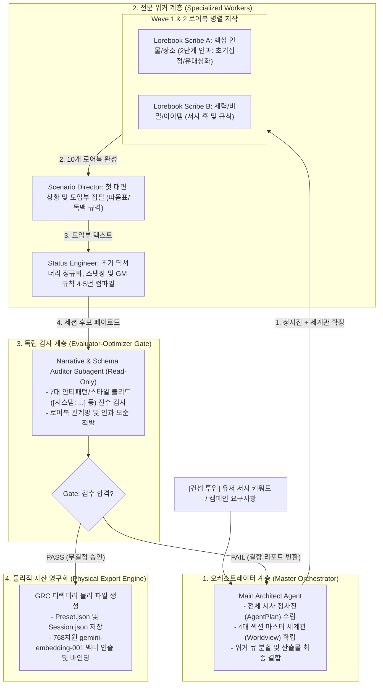

# GRC Session Architect Agentic Orchestration Template

본 문서는 GRC(GenAI Roleplay Chat)의 **세션 아키텍트(Session Architect)** 기술을 안티그래비티(Antigravity) 에이전트 협동 환경에서 직접 구동하여, 복잡한 대규모 캠페인이나 배포용 고품질 세션 팩(`.preset.json`, `.session.json`)을 자율 제작할 때 준수해야 하는 **공식 멀티 에이전트 오케스트레이션 템플릿 및 실행 절차서(SOP)**를 정의합니다.

> [!IMPORTANT]
> **기술 종속성 및 메타 아키텍처 계승**
> 본 템플릿은 GRC 전용 데이터 규격([CharacterPreset.cs](../../../GRC/GRC/Models/CharacterPreset.cs), [SessionArchitectModels.cs](../../../GRC/GRC/Models/SessionArchitectModels.cs)) 및 Cognitive Core 3.0 인지 메모리 엔진에 엄격히 종속됩니다. 에이전트 팀 토폴로지와 계쇄 거버넌스는 [AI_Agent_Architecture_Paradigms_Guidelines.md](../../ai_agent_refs/AI_Agent_Architecture_Paradigms_Guidelines.md)의 글로벌 5대 패턴(Orchestrator-Workers, Parallelization, Prompt Chaining, Evaluator-Optimizer)을 단일 진실 공급원(SSOT)으로 준용합니다.

---

<agent_topology>

## 1. 멀티 에이전트 조직 및 역할 분담 (Agent Team Topology)

안티그래비티 환경에서 세션 아키텍트를 구동할 때는 컨텍스트 오염을 차단하고 서사 일관성을 극대화하기 위해 다음과 같이 비대칭 권한과 단일 책임(SRP)을 가진 4대 워커 및 독립 감사관 팀으로 조직합니다.



### 서브에이전트별 불변 역할 규격

| 역할 명칭 | 실행 모드 | 도구 권한 | 핵심 책임 및 산출물 |
|---|---|---|---|
| **Main Architect** | Orchestrator | Read / Write / Command | 유저 컨셉 수렴, `AgentPlan` 및 4대 섹션 세계관 수립, 팀 조율, 물리 파일 생성 |
| **Lorebook Scribes** | Parallel Workers | Read-Only | 10개 핵심 엔티티의 2단계 관계망(`초기 접점 / 유대 심화`) 및 768차원 키워드 작성 |
| **Scenario Director** | Chained Worker | Read-Only | 대사 큰따옴표(`" "`), 독백 낫표(`「 」`), 지문 무마크다운 소설체 첫 장면 집필 |
| **Status Engineer** | Chained Worker | Read-Only | 스탯창 게이지/호감도 설계, 등장인물 Key 정규화, 세션 특화 GM 4·5번 지시문 조립 |
| **Narrative Auditor** | Evaluator-Optimizer | Read-Only (수정 절대 금지) | JSON 스키마 유효성, 자가 모순, 수치 누출(Zero Numeric), 시스템투 전수 감사 |

</agent_topology>

---

<data_contracts>

## 2. 물리적 데이터 규격 및 JSON 스키마 (Data Contracts)

안티그래비티 에이전트가 최종 생성하는 파일은 GRC 데스크톱 클라이언트의 `Sessions/` 폴더 내에 즉시 로드될 수 있는 완전한 물리 구조여야 합니다.

### 1) 파일 시스템 배치 경로
```text
GRC/bin/Debug/net8.0-windows/Sessions/{SanitizedSessionTitle}_{yyyyMMdd}_{HexHash}/
├── Preset.json          (CharacterPreset 스키마)
├── Session.json         (ChatSession 스키마: Turn 0 이력 및 ChapterContext 포함)
└── FullHistory.json     (초기 빈 배열 '[]' 또는 Turn 0 산문 앵커)
```

### 2) Preset.json 데이터 규격 ([CharacterPreset.cs](../../../GRC/GRC/Models/CharacterPreset.cs))
```json
{
  "Name": "세션 제목",
  "Worldview": "1. 배경 및 세계의 핵심 법칙\n- ...\n\n2. 세력 구도 및 사회적 현실\n- ...\n\n3. 주인공(PC)의 초기 입지 및 직면 환경\n- ...\n\n4. 서사 톤앤매너 및 감각적 디테일\n- ...",
  "SystemPrompt": "<system_directive>\nRole: 3인칭 전지적 게임 마스터\n</system_directive>\n\n<rules>\n1. 추상적 감정 라벨링, 시스템 수치 언급, 문단 끝의 교훈적 요약을 배제하고, 오감(시·청·후각 등)에 기반한 물리적 행동, 시선, 어조, 환경 변화로만 객관적 서술.\n2. 유저 캐릭터(PC)의 대사, 행동, 내면의 생각·감정을 임의로 대신 서술하지 말고, PC의 선택이나 대응이 필요한 시점에서 서술을 멈추고 턴을 넘길 것.\n3. 작위적인 주인공 보정(무조건적 호의·기적적 성공)과 억지 실패 보정을 모두 배제하고, 세계관 법칙 및 당사자 간의 실제 역량·무력·상황 격차와 인물 가치관에 부합하는 현실적 인과율로 판정할 것.\n4. [세션 특화 서사 톤 및 환경 디테일 판정 수칙]\n5. [세션 특화 인과 관계 및 사건 개입 판정 수칙]\n</rules>",
  "Temperature": null,
  "MaxOutputTokens": 8192,
  "Lorebooks": [
    {
      "Name": "엔티티 명칭",
      "Keywords": ["키워드1", "키워드2"],
      "Content": "분류(인물/장소/아이템/세계관): 요약\n  * 감각/외관: ...\n  * PC 관계: 초기 접점(...) / 유대 심화(...)\n  * 서사 훅: ...",
      "Category": "인물",
      "Priority": 0,
      "Embedding": [/* 768차원 부동소수점 배열 */]
    }
  ],
  "CustomStats": {
    "체력": "100/100",
    "호감도": "0/100"
  },
  "StatusUpdateGuide": "상태창 갱신 규칙 및 포맷 가이드라인"
}
```

### 3) Session.json 데이터 규격 ([ChatSession.cs](../../../GRC/GRC/Models/ChatSession.cs))
```json
{
  "Preset": { /* 상기 Preset 객체와 100% 동일 */ },
  "History": [
    {
      "Role": "user",
      "Text": "[도입부 시작 시나리오 전문]"
    },
    {
      "Role": "model",
      "Text": "\"주어진 세계관과 초기 상황의 흐름을 받아들여, 첫 발걸음을 뗄 준비를 마쳤습니다.\""
    }
  ],
  "CurrentContext": {
    "Chapter": 1,
    "Chars": { "인물명": "현재 상태" },
    "Places": ["현재 위치"],
    "Items": ["초기 소지품"],
    "CustomStats": { /* 초기 수치 */ },
    "ConsumedSeeds": [],
    "IsSceneResolved": false,
    "LastSeedTriggeredTurn": 0,
    "EventLedgers": []
  },
  "LongTermSummary": "세션 초기 상황 개요 (150자 이내)",
  "ChapterCount": 1,
  "TotalTurnCount": 0,
  "MediumTermUpdateCount": 0
}
```

</data_contracts>

---

<orchestration_sop>

## 3. 단계별 안티그래비티 오케스트레이션 실행 절차 (Execution SOP)

### Step 1: 컨셉 분석 및 청사진 수립 (Planning & Worldview)
* **주체**: Main Architect Agent
* **입력**: 유저의 한 줄 아이디어 또는 심층 시놉시스
* **절차**:
  1. `AgentPlan` 인터페이스를 준수하여 장르, 표면 호흡(`surfaceTone`), 갈등 무게감(`coreWeight`), PC 초기 입지(`pcInitialPosition`) 도출.
  2. 10개 핵심 로어북 기획안(`lorebookPlan`: 인물 5, 장소 2, 세력/세계관 2, 아이템 1)의 상호 관계망(`connectedEntities`) 정의.
  3. 4대 번호 섹션(`1. 배경 및 세계의 핵심 법칙`, `2. 세력 구도 및 사회적 현실`, `3. 주인공(PC)의 초기 입지 및 직면 환경`, `4. 서사 톤앤매너 및 감각적 디테일`)으로 완결된 마스터 세계관 텍스트 확정.

### Step 2: 로어북 2-Wave 인과 병렬 저작 (Parallel Lorebook Generation)
* **주체**: Lorebook Scribe Subagents (Wave 1 & Wave 2)
* **원칙**:
  * **Wave 1 (독립 앵커 5종)**: 핵심 주연 2인, 거점 장소, 핵심 세력, 마스터 세계관 법칙 저작.
  * **Wave 2 (의존 확장 5종)**: Wave 1의 산출물을 참조 컨텍스트로 전달받아 보조 조연 3인, 파생 사건/아이템 2종 저작.
  * **2단계 PC 관계 강제**: 인물 카테고리의 `* PC 관계` 불릿은 반드시 `초기 접점(첫 대면 계기 및 초기 태도) / 유대 심화(함께 겪을 핵심 사건 및 호감도 변화 조건)`의 슬래시(`/`) 2단계 규격을 적용.

### Step 3: 초기 시나리오 및 상태창 역추출 (Scenario & Status Induction)
* **주체**: Scenario Director & Status Engineer
* **절차**:
  1. **Scenario First**: 마스터 세계관 4번 섹션과 로어북을 바탕으로, PC가 직면한 첫 순간의 감각 묘사와 AI 캐릭터의 첫 대사를 집필. 대사는 큰따옴표(`" "`), 독백은 낫표(`「 」`), 마크다운 강조(*별표*)는 배제.
  2. **Status Induction**: 완성된 시나리오 텍스트를 역스캔하여, 오프닝 현장에 실제로 등장한 인물만을 `initialChars`로 추출하고 로어북 정식 명칭으로 정규화(`NormalizeInitialCharKeys`).
  3. **GM 규칙 4·5번 컴파일**: 세계관 4번 섹션을 기반으로 세션 고유의 서술 호흡 및 인과율 판정 수칙을 2문장의 명령형 규칙(`~할 것`)으로 조합.

### Step 4: 독립 감사관 게이트 실사 (Independent Evaluator Gate)
* **주체**: Narrative & Schema Auditor Subagent (Read-Only)
* **검수 기준 (Auditor Rubric)**:
  * [ ] **규격 준수**: 큰따옴표(`" "`), 낫표(`「 」`) 준수 및 마크다운 별표(`*`) 오염 여부.
  * [ ] **스타일 블리드 배제**: 모델 응답에 `[시스템: ...]`, `[안내: ...]` 등 시스템적 기계 어투가 전혀 없는가?
  * [ ] **수치 누출 차단 (Zero Numeric)**: 지문이나 대사에 `체력 -10`, `호감도 +5` 등 시스템 수치 언급이 완전히 배제되었는가?
  * [ ] **인과 정합성**: 로어북 항목 간의 `connectedEntities`에 상호 모순이나 명칭 불일치가 없는가?
* **탈출 조건**:
  * 감사관이 `[GATE PASS]` 보고서를 회신할 때까지 Main Agent가 핀포인트 보정을 수행하며, 3회 이상 불합격 시 서킷 브레이커 발동 후 유저에게 에스컬레이션.

### Step 5: 768차원 벡터 인출 및 물리 파일 영구화 (Asset Export)
* **주체**: Main Architect Agent (Terminal Tool 실행)
* **절차**:
  1. 각 로어북의 `Content` 및 `Keywords`를 결합하여 Google Cloud Vertex AI / AI Studio 통일 임베딩 모델(`gemini-embedding-001`, MRL 768차원) API를 호출해 벡터 배열 확보.
  2. 대상 세션 폴더(`Sessions/<Title>_<Date>_<Hash>/`) 생성.
  3. `Preset.json`, `Session.json`, `FullHistory.json`을 들여쓰기 2칸의 UTF-8 JSON 포맷으로 디스크에 기록.

</orchestration_sop>

---

<prompt_blueprints>

## 4. 프롬프트 청사진 및 핵심 불변 지침 (Prompt Blueprints & Invariants)

### 1) 시스템 헌법 접두사 ([CoreSystemDirectivesHeader](../../../GRC/GRC/Services/SessionArchitectService.cs#L139))
에이전트가 생성하는 모든 GM 지시문(`SystemPrompt`) 상단에는 반드시 아래 불변 헌법이 100% 바이트 단위로 보존되어야 합니다.

```xml
<system_directive>
Role: 3인칭 전지적 게임 마스터
</system_directive>

<rules>
1. 추상적 감정 라벨링, 시스템 수치 언급, 문단 끝의 교훈적 요약을 배제하고, 오감(시·청·후각 등)에 기반한 물리적 행동, 시선, 어조, 환경 변화로만 객관적 서술.
2. 유저 캐릭터(PC)의 대사, 행동, 내면의 생각·감정을 임의로 대신 서술하지 말고, PC의 선택이나 대응이 필요한 시점에서 서술을 멈추고 턴을 넘길 것.
3. 작위적인 주인공 보정(무조건적 호의·기적적 성공)과 억지 실패 보정을 모두 배제하고, 세계관 법칙 및 당사자 간의 실제 역량·무력·상황 격차와 인물 가치관에 부합하는 현실적 인과율로 판정할 것.
4. {세션_특화_서사톤_및_환경디테일_판정수칙}
5. {세션_특화_인과관계_및_사건개입_판정수칙}
</rules>
```

### 2) 7대 엄격 부정 제약 (Never Rules)
* **Never use system bracket speech**: `ChatMessage("model", "[시스템: ...]")` 형태의 메타 태그를 절대 0번 턴 응답으로 삽입하지 마십시오. 반드시 자연스러운 3인칭 산문 앵커(`"주어진 세계관과 초기 상황의 흐름을 받아들여, 첫 발걸음을 뗄 준비를 마쳤습니다."`)를 사용하십시오.
* **Never mix dynamic context in system instruction**: `SystemInstruction` 영역에 가변 타임스탬프, 동적 세션 ID, 또는 런타임에 변하는 스탯 수치를 주입하지 마십시오.
* **Never mutate unapproved entities during surgical edits**: 부분 수정 시 지목되지 않은 다른 9개 로어북 엔트리를 임의로 재생성하거나 필드 순서를 변경하지 마십시오.

</prompt_blueprints>

---

<verification_criteria>

## 5. 최종 산출물 검증 기준 (Ground Truth Verification)

안티그래비티 에이전트가 빌드한 세션 자산이 정상 작동하는지 확인하는 필수 QA 기준입니다.

1. **스키마 및 역직렬화 무결성**:
   * C# .NET 클라이언트의 `SessionService.LoadSessionAsync` 및 `PresetStorageService.LoadPresetAsync`를 통해 단 하나의 예외(Exception) 없이 메모리에 로드되어야 합니다.
2. **벡터 차원 일치성**:
   * 모든 로어북의 `Embedding` 필드가 정확히 768개의 부동소수점(`float[768]`)으로 채워져 있어야 하며, `NaN` 또는 `Infinity` 값이 존재하지 않아야 합니다.
3. **런타임 호환성 (Zero-Delay Streaming)**:
   * GRC 클라이언트를 실행하고 해당 세션을 열었을 때, 첫 유저 입력 전송 시 Cognitive Core 3.0 인지 프롬프트가 즉시 조립되어 0초 지연으로 60FPS 서사 스트리밍이 개시되어야 합니다.

</verification_criteria>
