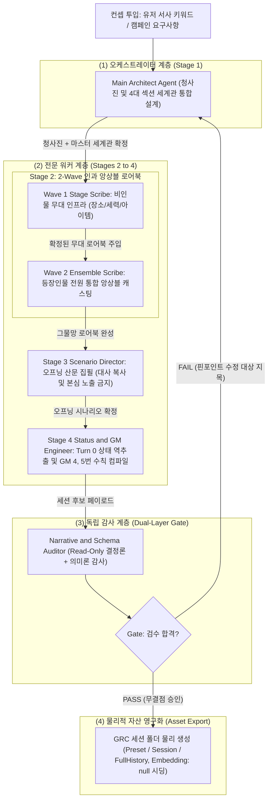

# GRC Session Architect 2.0 Agentic Orchestration Template

본 문서는 GRC(GenAI Roleplay Chat)의 **세션 아키텍트 2.0(Session Architect 2.0)** 4단계 인과 파이프라인과 **Cognitive Core 3.0 스토리 시드(Story Seeds) 엔진** 기술을 안티그래비티(Antigravity) 멀티 에이전트 협동 환경에서 구동하여, 배포용 고품질 세션 팩(`Preset.json`, `Session.json`, `FullHistory.json`)을 자율 제작할 때 준수해야 하는 **공식 오케스트레이션 템플릿 및 실행 절차서(SOP)**를 정의합니다.

> [!IMPORTANT]
> **기술 종속성 및 런타임 파서 계약 계승**
> 본 템플릿은 GRC 전용 데이터 규격([CharacterPreset.cs](../../../GRC/GRC/Models/CharacterPreset.cs), [ChatSession.cs](../../../GRC/GRC/Models/ChatSession.cs), [ChapterContext.cs](../../../GRC/GRC/Models/ChapterContext.cs), [SessionArchitectModels.cs](../../../GRC/GRC/Models/SessionArchitectModels.cs)), [SessionArchitectService.cs](../../../GRC/GRC/Services/SessionArchitectService.cs)의 결정론적 정제기(Sanitizers), 그리고 [MemoryManagerService.cs](../../../GRC/GRC/Services/MemoryManagerService.cs)의 3대 스토리 시드 정규식 파서(`Pool A/B/C`)에 바이트 단위로 종속됩니다. 에이전트 팀 토폴로지와 계쇄 거버넌스는 [AI_Agent_Architecture_Paradigms_Guidelines.md](../../ai_agent_refs/AI_Agent_Architecture_Paradigms_Guidelines.md) 및 [AI_Prompt_Engineering_Guidelines.md](../../ai_agent_refs/AI_Prompt_Engineering_Guidelines.md)를 단일 진실 공급원(SSOT)으로 준용합니다.

---

<agent_topology>

## 1. 멀티 에이전트 조직 및 역할 분담 (Agent Team Topology)

안티그래비티 환경에서 세션 아키텍트를 구동할 때는 단일 앱 런타임([SessionArchitectService.cs](../../../GRC/GRC/Services/SessionArchitectService.cs))의 **4단계 통합 상태 기계(청사진·세계관 통합 -> 2-Wave 인과 로어북 -> 오프닝 시나리오 선행 -> 상태창·GM 수칙 역추출)**를 그대로 계승하면서, 컨텍스트 오염 차단과 교차 검증 능력을 극대화하기 위해 다음과 같은 4대 전문 워커 및 이중 감사 게이트로 조직합니다.



### 서브에이전트별 불변 역할 규격

| 역할 명칭 | 대응 파이프라인 단계 | 도구 권한 | 핵심 책임 및 산출물 |
|---|---|---|---|
| **Main Architect** | Stage 1 (Orchestrator) | Read / Write / Command | 유저 컨셉 분석, `AgentPlan` 및 `<master_setting>`용 4대 번호 섹션 개조식 세계관 동시 수립, 외과수술식 보정 조율, 최종 물리 파일 및 임베딩 생성 |
| **Wave 1 Stage Scribe** | Stage 2 - Wave 1 | Read-Only | 비인물(`장소`, `아이템`, 세부 `세계관`/조직) 무대 인프라 전체를 단일 추론 공간에서 저작 (3줄 불릿 규격 및 `* 서사 훅` 필수) |
| **Wave 2 Ensemble Scribe** | Stage 2 - Wave 2 | Read-Only | 확정된 Wave 1 무대 로어북 전문을 바탕으로 모든 `인물` 전원을 단일 추론 공간에서 앙상블 캐스팅 (5줄 불릿 규격, 말투/결핍 차별화, 양방향 관계망 직조) |
| **Scenario Director** | Stage 3 (Chained) | Read-Only | 확정된 세계관과 로어북 전문 기반 3~4문단 순수 문학 산문 오프닝 집필 (로어북 예시 대사 복사 금지, 내면 본심 조기 노출 금지, PC 행동/대사 불간섭) |
| **Status & GM Engineer** | Stage 4 (Chained) | Read-Only | 오프닝 현장 기반 Turn 0 상태(`initialChars`, `initialPlaces`, `initialItems`) 역추출, 신규 인물 동적 추적 포함 `StatusUpdateGuide` 설계, 비수치 GM 수칙 4·5번 컴파일 |
| **Narrative Auditor** | Evaluator Gate | Read-Only (수정 절대 금지) | C# 결정론적 정규식 계약(Story Seeds `Pool A/B/C` 파싱 호환성) 및 의미론적 정합성(양방향 관계망, Zero-Numeric, PC 불간섭) 전수 감사 |

</agent_topology>

---

<data_contracts>

## 2. 물리적 데이터 규격 및 JSON 스키마 계약 (Data Contracts)

안티그래비티 에이전트가 최종 생성하는 파일은 GRC 데스크톱 클라이언트의 `Sessions/` 폴더 내에 즉시 로드되어 첫 턴부터 **0초 지연 스트리밍**과 **스토리 시드(`ExtractAvailableStorySeeds`)**가 완벽히 작동해야 합니다.

### 1) 파일 시스템 배치 경로 ([ChatDataHelper.cs](../../../GRC/GRC/Helpers/ChatDataHelper.cs))
폴더명은 `GenerateSessionFileName` 규격(`{SafeSessionTitle}_{yyyyMMdd}_{6자리HexGuid}`)을 준수합니다.
```text
GRC/bin/Debug/net8.0-windows/Sessions/{SanitizedSessionTitle}_{yyyyMMdd}_{6CharHex}/
├── Preset.json          (CharacterPreset 스키마: 로어북 Embedding은 null로 시딩 -> GRC 세션 진입 시 자동 백필)
├── Session.json         (ChatSession 스키마: <initial_scenario> 래핑 이력 및 Turn 0 ChapterContext 포함)
└── FullHistory.json     (UI 말풍선 렌더링용 초기 로그: 반드시 [초기 상황] user 메시지 1개 포함)
```

### 2) Preset.json 데이터 규격 ([CharacterPreset.cs](../../../GRC/GRC/Models/CharacterPreset.cs))
```json
{
  "Name": "세션 고유 제목",
  "Worldview": "1. 배경 및 세계의 핵심 법칙\n- 항목명: 명사구 중심 개조식 내용\n\n2. 세력 구도 및 사회적 현실\n- 항목명: 명사구 중심 개조식 내용\n\n3. 주인공(PC)의 초기 입지 및 직면 환경\n- 항목명: PC의 객관적 위장 신분, 물리적 제약, 당면 과제 (성격/감정 단정 금지)\n\n4. 서사 톤앤매너 및 감각적 디테일\n- 항목명: 일상 호흡(surfaceTone)과 위기 무게감(coreWeight)의 오감 환경 및 NPC 압박감 묘사 기준",
  "SystemPrompt": "<system_directive>\nRole: 3인칭 전지적 게임 마스터\n</system_directive>\n\n<rules>\n1. 추상적 감정 라벨링, 시스템 수치 언급, 문단 끝의 교훈적 요약을 배제하고, 오감(시·청·후각 등)에 기반한 물리적 행동, 시선, 어조, 환경 변화로만 객관적 서술.\n2. 유저 캐릭터(PC)의 대사, 행동, 내면의 생각·감정을 임의로 대신 서술하지 말고, PC의 선택이나 대응이 필요한 시점에서 서술을 멈추고 턴을 넘길 것.\n3. 작위적인 주인공 보정(무조건적 호의·기적적 성공)과 억지 실패 보정을 모두 배제하고, 세계관 법칙 및 당사자 간의 실제 역량·무력·상황 격차와 인물 가치관에 부합하는 현실적 인과율로 판정할 것.\n4. 평소에는 주변 환경의 감각 묘사와 NPC들의 일상 대화 템포를 중심으로 서술하되, 위기나 금기 접촉 시 공기의 냉각과 적대 세력의 압박감으로 환경 분위기를 급반전시킬 것.\n5. 세계관과 로어북의 고유 법칙·제약에 기반하여 유저 행동의 개연성, 대가(Risk), 세력 및 환경의 반작용을 공정하게 판정할 것.\n</rules>",
  "Temperature": null,
  "MaxOutputTokens": 8192,
  "Lorebooks": [
    {
      "Name": "아리아 폰 블랑셰",
      "Keywords": ["아리아 폰 블랑셰", "아리아", "백은의 성녀", "교황청 특사", "성녀"],
      "Content": "분류(인물): 교황청 제1검문소 파견 특사 및 이단 심문관\n  * 외양/특징: 은백색 장발, 금실 자수 성직자 제복, 차가운 푸른 눈동자, 긴장 시 장갑 끝을 매만지는 버릇\n  * 표면/내면: 표면(원칙주의적이고 냉철한 교황청 엘리트의 위엄) / 내면(과거 마녀 사냥에서 동생을 잃은 죄책감, 주인공의 이질적 마력에 대한 지적 호기심과 공범 의식)\n  * PC 관계: 초기 접점(검문소 밀수품 수색 현장에서 수상한 여행자인 주인공을 직접 심문하며 날 선 경계 유지) / 유대 심화(지하 카타콤 이단 습격 사건에서 등을 맞대고 생환한 뒤 교황청의 부패를 함께 추적하는 비밀 동맹으로 전환)\n  * 타 인물/세력 관계: 집행관 카시우스와는 과잉 진압 방식을 두고 사사건건 대립, 잿불 상단과는 정보 거래 관계\n  * 말투/대사: 격식 있는 하오체와 단호한 냉소적 어조. \"통행증을 제시하십시오. 변명은 심문실 기록관에게나 남기시지요.\" / \"당신이 이단이라 해도 상관없습니다. 이번만큼은 제 검이 당신의 방패가 되어드리겠습니다.\"",
      "Category": "인물",
      "Priority": 0,
      "Embedding": null
    },
    {
      "Name": "성채 지하 카타콤",
      "Keywords": ["성채 지하 카타콤", "카타콤", "지하 묘지", "봉인 제단", "이단 은신처"],
      "Content": "분류(장소): 성채 도시 하부 수로와 연결된 고대 순교자 지하 묘지 및 금지 구역\n  * 감각/외관: 젖은 이끼와 오래된 유향 냄새, 푸른 인광석이 깜빡이는 좁은 석조 회랑, 멀리서 울리는 물방울 소리와 기괴한 저음의 성가\n  * 규칙/원리: 성광석 등불 없이는 심층부의 환각 독기에 노출되어 방향 감각 상실, 주간에는 교황청 봉인 결계로 정문 폐쇄\n  * 서사 훅: 아리아 폰 블랑셰가 실종된 동생의 유품을 찾기 위해 단독 잠입을 시도하는 위험 거점이며, 고대 성유물 봉인 해제의 핵심 단서 은닉",
      "Category": "장소",
      "Priority": 1,
      "Embedding": null
    }
  ],
  "CustomStats": {
    "체력": "100/100",
    "정신력": "100/100",
    "아리아 폰 블랑셰 신뢰도": "25/100"
  },
  "StatusUpdateGuide": "- 체력: 전투 부상이나 독기 노출 시 -10~-30 감소, 치료나 휴식 시 +15~+40 회복 (0~100 범위 유지)\n- 정신력: 환각 독기 노출이나 극단적 위기 시 -10~-25 감소, 안전 거점 정비 시 +10~+30 회복 (0~100 범위 유지)\n- 아리아 폰 블랑셰 신뢰도: 원칙을 존중하거나 위기에서 협력 시 +3~+10 상승, 기만이나 민간인 피해 유발 시 -5~-20 하락 (0~100 범위 유지)\n- 신규 인물 관계도: 본편 진행 중 아직 상태창에 없는 로어북 주요 인물과 대면·상호작용 시 해당 인물의 호감도 또는 신뢰도(초기치 20~30/100)를 상태창에 신규 추가하여 추적"
}
```

### 3) Session.json 데이터 규격 ([ChatSession.cs](../../../GRC/GRC/Models/ChatSession.cs) & [ChapterContext.cs](../../../GRC/GRC/Models/ChapterContext.cs))
> [!WARNING]
> **런타임 파서 및 상태창 오염 방어 필수 계약**
> 1. `History[0].Text`는 반드시 `<initial_scenario>\n...\n</initial_scenario>` 태그로 감싸야 합니다. [MemoryManagerService.cs](../../../GRC/GRC/Services/MemoryManagerService.cs#L1212)의 `BuildStatusRequest`는 `<initial_scenario>` 포함 여부를 검사하여 장문의 오프닝이 매 턴 상태창 갱신 컨텍스트(`<recent_context>`)에 섞여 들어가는 현상을 차단합니다.
> 2. `History[1].Text`는 이스케이프된 안쪽 따옴표 없이 순수 문자열 `"주어진 세계관과 초기 상황의 흐름을 받아들여, 첫 발걸음을 뗄 준비를 마쳤습니다."`로 고정합니다.
> 3. `CurrentContext`에는 존재하지 않는 `Chapter` 필드 대신, 반드시 `Plot`(`"[제 1장]\n* {ScenarioOutline}"`)과 `ActiveStorySeeds`(`[]`)를 포함해야 하며, `LongTermSummary`의 초기값은 `"아직 요약된 줄거리가 없습니다."`로 설정합니다.

```json
{
  "Preset": { /* 상기 Preset.json 객체와 동일 */ },
  "History": [
    {
      "Role": "user",
      "Text": "<initial_scenario>\n[3~4문단 순수 문학 산문으로 작성된 오프닝 시나리오 전문]\n</initial_scenario>",
      "Timestamp": "2026-10-26T09:00:00+09:00"
    },
    {
      "Role": "model",
      "Text": "주어진 세계관과 초기 상황의 흐름을 받아들여, 첫 발걸음을 뗄 준비를 마쳤습니다.",
      "Timestamp": "2026-10-26T09:00:01+09:00"
    }
  ],
  "CurrentContext": {
    "Plot": "[제 1장]\n* 검문소 밀수품 수색 현장에서 특사 아리아 폰 블랑셰와 대면하여 첫 심문에 직면함.",
    "CustomStats": {
      "체력": "100/100",
      "정신력": "100/100",
      "아리아 폰 블랑셰 신뢰도": "25/100"
    },
    "Chars": {
      "아리아 폰 블랑셰": "날 선 경계심, 장갑 끝을 매만지며 통행증 제시를 요구 중"
    },
    "Items": [
      "위조된 상단 통행증",
      "품속의 봉인 단검"
    ],
    "Places": [
      "성채 도시 제1검문소"
    ],
    "EventLedgers": [],
    "ConsumedSeeds": [],
    "IsSceneResolved": false,
    "LastSeedTriggeredTurn": 0,
    "ActiveStorySeeds": []
  },
  "LongTermSummary": "아직 요약된 줄거리가 없습니다.",
  "ChapterCount": 1,
  "TotalTurnCount": 0,
  "MediumTermUpdateCount": 0
}
```

### 4) FullHistory.json 데이터 규격 ([FullHistoryLogger.cs](../../../GRC/GRC/Helpers/FullHistoryLogger.cs))
GRC 클라이언트는 세션을 열 때 `FullHistory.json`을 역직렬화하여 채팅 화면의 말풍선 목록을 렌더링합니다. **빈 배열(`[]`)로 두면 세션 진입 시 오프닝 시나리오가 화면에 표시되지 않으므로**, 반드시 아래와 같이 `[초기 상황]` 접두어가 붙은 `user` 메시지 1개를 기록해야 합니다([SessionArchitectService.cs](../../../GRC/GRC/Services/SessionArchitectService.cs#L1715-L1716) 준용).
```json
[
  {
    "Role": "user",
    "Text": "[초기 상황]\n[3~4문단 순수 문학 산문으로 작성된 오프닝 시나리오 전문]",
    "Timestamp": "2026-10-26T09:00:00+09:00"
  }
]
```

</data_contracts>

---

<story_seeds_contract>

## 3. Cognitive Core 3.0 스토리 시드(`Pool A/B/C`) 정규식 파싱 계약

런타임 중 장면이 일단락(`IsSceneResolved == true`)되거나 유저가 `[빠른 진행]`(`fast_forward`)을 실행하면, [MemoryManagerService.cs](../../../GRC/GRC/Services/MemoryManagerService.cs#L228-L406)의 `ExtractAvailableStorySeeds`가 로어북 `Content`를 정규식으로 파싱하여 다음 에피소드 떡밥(`<story_seeds>`)을 자동 주입합니다. 에이전트가 저작하는 모든 로어북은 아래 **정규식 추출 계약**을 100% 만족해야 합니다.

| 시드 풀(Pool) | 발동 대상 및 해금 조건 | 런타임 정규식 추출 대상 필드 (로어북 `Content` 내부) | 슬래시(`/`) 2단계 분리 및 필수 작성 규격 |
|---|---|---|---|
| **Pool A: 미등장 인물 첫 만남** (`CHAR:{Name}`) | `Category == "인물"` 중 아직 `Chars`에 등재되지 않고 미소모된 최우선(`Priority` 오름차순) 인물 1명 | 1) `분류(인물): ...`<br>2) `  * 외양/특징: ...`<br>3) `  * 말투/대사: ...`<br>4) `  * PC 관계: ...` | - **1턴 딜레이 방지 프리뷰**: 첫 조우 턴에는 아직 유저 입력에 해당 인물명이 없어 로어북이 미인출되므로, 엔진이 `분류`, `외양/특징`, `말투/대사`의 첫 번째 큰따옴표 대사(`"..." / "..."` 중 앞쪽)를 추출해 시드에 직접 동봉함.<br>- `* PC 관계:` 값에서 `/ 유대 심화` 앞부분(**초기 접점**)을 추출하여 첫 대면 계기로 제시. |
| **Pool B: 미방문 거점·사건 훅** (`HOOK:{Name}`) | `Category != "인물"` 중 아직 `Places`나 `Items`에 등록되지 않고 미소모된 최우선 항목 1개 | `  * 서사 훅: ...` (`NarrativeHookFieldRegex`) | - 해당 장소·아이템·세력과 접촉했을 때 발생할 구체적인 사건·위기·비밀 단서와 연관 인물 고유명사를 1줄로 명시. |
| **Pool C (1단계): 동료 유대 심화** (`BOND:{Name}`) | 이미 만난 인물(`Chars` 등록) 중 `CustomStats` 내 `{인물명} 호감도/신뢰도/유대/친밀` 수치가 **30 이상** 달성 시 | `  * PC 관계: 초기 접점(...) / 유대 심화(...)` (`PcRelationFieldRegex`) | - 반드시 ` / ` 또는 `/ 유대 심화` 구분자를 포함해야 함.<br>- 뒷부분(**유대 심화**)에 주인공과 함께 겪을 중반부 핵심 에피소드 및 관계 전환 조건을 구체적 명사 키워드와 함께 서술. |
| **Pool C (2단계): 내면·비밀 해금** (`BOND_SECRET:{Name}`) | 이미 만난 인물 중 호감도/신뢰도 수치가 **60 이상** 달성 시 (`BOND`와 동시 또는 순차 해금) | `  * 표면/내면: 표면(...) / 내면(...)` (`InnerThoughtFieldRegex`) | - 반드시 `표면(...) / 내면(...)` 2단계 구분자를 포함해야 함.<br>- 뒷부분(**내면**)에 깊은 신뢰 관계에서만 드러나는 트라우마, 숨겨진 진실, 본심을 서술. |

> [!CAUTION]
> **인물 로어북 필드명 오기 주의**
> 인물(`Category == "인물"`) 로어북에서 `* 외양/특징:` 대신 비인물용 헤더인 `* 감각/외관:`을 사용하면 `AppearanceFieldRegex`(`^\s*[\*\-]\s*(?:외양/특징|외양|외모)\s*:\s*(.+)$`) 매칭이 실패하여 미등장 인물 첫 조우 시 외양 정보가 누락됩니다. 인물 5줄 불릿(`분류(인물)` -> `* 외양/특징` -> `* 표면/내면` -> `* PC 관계` -> `* 타 인물/세력 관계` -> `* 말투/대사`)과 비인물 3줄 불릿(`분류(카테고리)` -> `* 감각/외관` -> `* 규칙/원리` -> `* 서사 훅`)을 엄격히 구분하십시오.

</story_seeds_contract>

---

<orchestration_sop>

## 4. 단계별 안티그래비티 오케스트레이션 실행 절차 (Execution SOP)

### Stage 1: 컨셉 분석, 그물망 청사진 및 4대 섹션 마스터 세계관 통합 수립 (Planning & Worldview Co-Design)
* **주체**: Main Architect Agent
* **입력**: 유저의 한 줄 아이디어 또는 캠페인 요구사항
* **절차**:
  1. `AgentPlan` 스키마를 준수하여 `sessionTitle`, 일상 호흡(`surfaceTone`), 핵심 갈등 무게감(`coreWeight`), PC 초기 객관적 입지(`pcInitialPosition`)를 도출합니다.
     * **PC 불간섭 원칙**: `surfaceTone`과 `coreWeight`는 오직 세계 환경과 NPC들의 일상/위기 연출 기준이어야 하며, PC의 개인적 성격·유머 감각·감정 상태를 규정해서는 안 됩니다.
  2. **4대 섹션 개조식 마스터 세계관(`Worldview`) 작성**:
     * 번호 섹션 헤더(`1. 배경 및 세계의 핵심 법칙`, `2. 세력 구도 및 사회적 현실`, `3. 주인공(PC)의 초기 입지 및 직면 환경`, `4. 서사 톤앤매너 및 감각적 디테일`)와 각 하위 하이픈 불릿(`- 항목명: 내용`, 섹션당 3~4개)으로 작성합니다.
     * 서술어 어미(`~이다`, `~한다`)를 배제한 **명사구 중심 개조식(Telegraphic Compression)**으로 압축하며, Turn 0 시점의 무대와 법칙만 정의합니다.
  3. **그물망 로어북 기획(`lorebookPlan`, 8~15개)**:
     * 주요 인물(4~6명), 구체적 단일 장소(2~4곳), 핵심 단일 아이템/무구(1~3개), 고유 세부 조직/사건(1~2개)으로 구성합니다.
     * **역할 분리 및 단일 개체 원칙**: 거시적 세계 법칙은 이미 `Worldview`(`<master_setting>`)에서 상시 제공하므로 이를 단순 반복하는 중복 '세계관' 로어북 작성을 금지하며, `'A와 B'`처럼 2개 이상의 개체를 묶는 복합 명칭을 금지합니다.
     * 모든 항목의 `connectedEntities`에 타 인물·장소·세력·아이템과의 구체적 연결고리(소속, 대립, 감시, 거래, 공유한 과거)를 명시하여 고립된 부품이 없도록 설계합니다.

### Stage 2: 2-Wave 인과 앙상블 로어북 저작 (Causal 2-Wave Ensemble Lorebook Generation)
* **주체**: Wave 1 Stage Scribe & Wave 2 Ensemble Scribe
* **원칙 ([SessionArchitectService.GenerateLorebooksCausallyAsync](../../../GRC/GRC/Services/SessionArchitectService.cs#L644-L761) 준용)**:
  1. **Wave 1 — 비인물 무대 인프라 통합 저작 (`Category != "인물"`)**:
     * 장소, 아이템, 세부 조직/법칙 항목 전체를 먼저 저작하여 지리적·제도적 설정을 확정합니다.
     * **비인물 3줄 불릿 구조**:
       ```text
       분류(장소|아이템|세계관): 핵심 정의 한 줄 요약
         * 감각/외관: 시·청·후각적 핵심 환경/외형 디테일 (명사구 중심)
         * 규칙/원리: 고유 법칙, 규율, 작동 원리 및 제약/대가
         * 서사 훅: 연관된 인물·세력 고유명사 및 상호작용 시 발생 가능한 사건·이면
       ```
  2. **Wave 2 — 등장인물 전원 통합 앙상블 캐스팅 (`Category == "인물"`)**:
     * 확정된 Wave 1 무대 로어북 전문(`<established_world_lore>`)과 전체 청사진 명단(`<full_blueprint_roster>`)을 참조하여 **모든 등장인물 전원**을 동시 조형합니다.
     * **앙상블 차별화 수칙**: 인물마다 서로 겹치지 않는 고유한 말투·어미·대사 스펙트럼을 부여하고, 내면 결핍과 호감 표현 방식이 동일한 클리셰(독점욕·집착 등)로 획일화되지 않도록 관계 발전의 결(선의의 경쟁, 순수한 헌신, 지적 호기심과 공범 의식, 어른스러운 비호 등)을 명확히 차별화합니다.
     * **인물 5줄 불릿 구조**:
       ```text
       분류(인물): 신분/소속 및 핵심 정체성 한 줄 정의
         * 외양/특징: 핵심 시각적 인장, 복장, 습관적 행동/버릇 (명사구 나열)
         * 표면/내면: 표면(대외적 태도·역할) / 내면(친밀·위기 시 드러나는 속마음, 결핍, 갭 모에)
         * PC 관계: 초기 접점(첫 대면 계기·초기 태도) / 유대 심화(함께 겪을 핵심 사건·태도 변화 조건)
         * 타 인물/세력 관계: 로어북 내 다른 등장인물 및 소속 세력·장소와의 구체적 역학·감정·이해관계 (고유명사 직접 명시)
         * 말투/대사: 어조 특징 요약. "일상 대표 대사 샘플" / "본심·감정 노출 시 대사 샘플"
       ```
  3. **우선순위(`Priority`) 및 키워드(`Keywords`) 정규화**:
     * `Priority`는 오름차순 스케일(`0`=최우선 핵심 주연/거점, `1`=주요 조연/장소, `2`=일반, `3`=배경)로 부여합니다.
     * `Keywords`는 `NormalizeKeywords` 규칙에 따라 ① 엔트리 정식 `Name`, ② 공백 포함 다어절 이름(예: `"아리아 폰 블랑셰"`)인 경우 첫 어절(`"아리아"`), ③ 한국어 조사가 제거된 고유명사·직함·별칭을 합쳐 최대 8개로 구성합니다.

### Stage 3: 오프닝 시나리오 선행 집필 (Scenario-First Prose Authoring)
* **주체**: Scenario Director Subagent
* **절차**:
  1. 확정된 `Worldview`와 전체 로어북 전문을 바탕으로 Turn 0 첫 직면 장면을 **3~4문단 분량의 순수 문학 산문**으로 집필합니다.
  2. **문장 부호 및 순수 산문 규격**: 외부 발화 대사는 큰따옴표(`"..."`), 내면 독백 및 강조는 낫표(`「...」`), 지문은 마크다운 별표(`*`)나 헤더(`#`)가 일절 없는 평문으로 작성합니다.
  3. **3대 오프닝 연출 금지 수칙**:
     * **[대사 복사 금지]**: 로어북 `* 말투/대사` 항목에 적힌 예시 대사 문장을 그대로 복사·인용하는 것을 엄격히 금지하며, 말투 특징만 유지한 채 오프닝 상황에 맞는 새로운 대사를 창작합니다.
     * **[본심 조기 노출 금지]**: 유대가 깊어진 뒤에야 드러나는 2단계 `내면`의 본심(연정 고백, 집착, 은밀한 과거 등)을 첫 만남에서 조기 노출하지 않습니다.
     * **[PC 주체성 침해 금지]**: 주인공(PC)의 대사, 의사결정, 감정 단정을 임의로 서술하지 말고, NPC(1~3명 이내로 밀도 있게 집중)가 말을 건네거나 사건이 발생하여 주인공이 첫 행동을 선택해야 하는 직면 순간에서 서술을 멈춥니다.

### Stage 4: Turn 0 상태창 역추출 및 하이브리드 GM 시스템 프롬프트 컴파일 (Status Induction & Prompt Compilation)
* **주체**: Status & GM Engineer Subagent
* **절차**:
  1. **초기 스탯(`CustomStats`) 및 상태창 갱신 가이드(`StatusUpdateGuide`) 설계**:
     * 주인공 핵심 상태 수치(범위형 `"100/100"`, 단일 정수 `"100"`, 상태형 `"평온"`)와 오프닝 현장에 직접 등장한 인물의 초기 관계도(`"{인물명} 호감도"` 또는 `"{인물명} 신뢰도"`, 예: `"25/100"`)를 설정합니다.
     * `StatusUpdateGuide`는 순수 하이픈 개조식(`- 스탯명: 상승 조건(+폭) / 하락 조건(-폭) / 유효 범위`)으로 작성하며, **미등장 로어북 인물과 본편에서 신규 조우 시 해당 인물의 호감도/신뢰도(초기치 20~30/100)를 상태창에 동적 추가하여 추적하는 규칙**을 반드시 마지막 줄에 포함합니다(Pool C 시드 해금 필수 조건).
  2. **Turn 0 현장 컨텍스트(`initialChars`, `initialPlaces`, `initialItems`) 정밀 역추출**:
     * `initialChars`: 오프닝 시나리오에 직접 등장해 대사·행동을 주고받은 NPC만 등록합니다. **Key는 반드시 로어북 인물 정식 `Name`과 100% 일치**시켜야 하며(직함·수식어 제거, `NormalizeInitialCharKeys`), **Value는 `"초기 태도(...)"` 같은 고정 라벨이나 복장·장소 중복 묘사를 배제하고 오프닝 마지막 순간의 `"핵심 감정·태도 키워드, 즉각적 행동 요약"`만 3~6어절(25자 이내)**로 간결하게 작성합니다.
     * `initialPlaces`: 오프닝 장면이 실제로 벌어지고 있는 구체적인 시작 장소명 배열(1~2개).
     * `initialItems`: 오프닝 마지막 순간 주인공이 몸에 직접 휴대·착용 중이거나 손이 닿는 현장 소지품(1~4개)만 등록하며, 다른 공간에 보관·봉인된 물품이나 거점 시설은 제외합니다.
  3. **하이브리드 시스템 프롬프트(`SystemPrompt`) 컴파일 (`CompileHybridSystemPrompt`)**:
     * 불변 상단 헌법(`CoreSystemDirectivesHeader`, 규칙 1~3번) 하단에 세션 특화 비수치 GM 수칙 4번·5번(`genreDirectives`)을 결합하고 `</rules>`로 닫습니다:
       * `4. {서사 분위기 및 환경 연출 수칙}`: 일상 호흡(`surfaceTone`)과 위기 긴장감(`coreWeight`)의 온도차를 **배경 환경의 감각 묘사(공기, 빛, 소리, 냄새)와 NPC들의 대사 템포·태도·압박감**으로만 연출하도록 지시(PC의 감정/성격/유머/살기 규정 절대 금지).
       * `5. {세계관 인과율 및 위험 판정 수칙}`: 세계관과 로어북의 고유 법칙·제약에 기반하여 유저 행동의 개연성, 대가(Risk), 세력/환경의 반작용을 공정하게 판정하도록 지시(스탯 수치 언급 완전 배제 — Zero-Numeric).

### Stage 5: 독립 감사관 이중 게이트 실사 (Dual-Layer Deterministic & Semantic Gate)
* **주체**: Narrative & Schema Auditor Subagent (Read-Only)
* **검수 기준 (Auditor Rubric)**:
  * [ ] **결정론적 구조 검수 ([ReviewStepContentAsync](../../../GRC/GRC/Services/SessionArchitectService.cs#L1498-L1623) 동등성)**:
    * 기획된 모든 로어북 항목이 누락 없이 생성되었는가?
    * 모든 `인물` 로어북이 5줄 필수 불릿(`* 외양/특징`, `* 표면/내면`, `* PC 관계`, `* 타 인물/세력 관계`, `* 말투/대사`)을 갖추었으며, `* 표면/내면`과 `* PC 관계`에 `/` 구분자가 존재하고, `* 말투/대사`에 큰따옴표 샘플 대사 2개(`"..." / "..."`)가 포함되었는가?
    * 모든 비인물 로어북이 3줄 필수 불릿(`* 감각/외관`, `* 규칙/원리`, `* 서사 훅`)을 갖추었는가?
    * 텍스트 내 비정상 다국어 글리치 문자(`[\u0400-\u06FF\u0900-\u0E7F]+`), 마크다운 볼드/별표(`**`, `*`), `#` 헤더, 대괄호 의사 태그(`[표면]` 등)가 완전히 제거되었는가?
    * `Session.json`의 `History[0].Text`에 `<initial_scenario>` 래퍼가 있고, `CurrentContext.Plot` 및 `FullHistory.json`의 `[초기 상황]` 엔트리가 정확히 기록되었는가?
  * [ ] **의미론적 심층 검수 (Multi-Agent Deep Audit)**:
    * **말투 및 내면 비획일화**: 등장인물들의 대사 어조와 내면 결핍이 천편일률적인 집착/독점욕으로 복제되지 않고 각기 고유한 스펙트럼을 형성하는가?
    * **오프닝 대사 비복사 및 본심 은닉**: 오프닝 시나리오가 로어북의 샘플 대사를 그대로 베끼지 않았으며, 첫 만남에서 2단계 내면 비밀을 조기 폭로하지 않았는가?
    * **PC 불간섭 및 Zero-Numeric**: `Worldview`, `SystemPrompt`(4·5번 수칙), `Scenario` 어디에도 PC의 성격/대사/행동을 강제하거나 시스템 수치(`+10`, `호감도` 등)를 노출한 흔적이 없는가?
* **외과수술식 핀포인트 보정 (`[수정 대상: 항목명]`)**:
  * 특정 로어북 항목에 결함이 발견된 경우 전체 배열을 재작성하여 압축 손실(Lazy Compression)을 유발하지 말고, `[수정 대상: 항목1, 항목2]` 형태로 결함 항목만 핀포인트 재생성하여 병합합니다([ReviseLorebooksSurgicallyAsync](../../../GRC/GRC/Services/SessionArchitectService.cs#L1064-L1203) 준용).

### Stage 6: 물리 파일 영구화 및 런타임 임베딩 자동 백필 위임 (Physical Export & Runtime Auto-Backfill)
* **주체**: Main Architect Agent (Write / File Tool 실행)
* **절차**:
  1. **로어북 `Embedding: null` 시딩 및 더미 벡터 절대 금지**:
     * 에이전트가 `Preset.json`을 생성할 때 각 로어북 엔트리의 `"Embedding"` 필드는 반드시 **`null`**로 기록합니다.
     * [ChatViewModel.InitializeWithSession](../../../GRC/GRC/ViewModels/ChatViewModel.cs#L231-L297)은 세션을 로드할 때 `Embedding == null || Embedding.Length != 768`인 로어북을 감지하면 백그라운드(`Task.Run`)에서 자동으로 [LorebookService.EnsureEmbeddingsAsync](../../../GRC/GRC/Services/LorebookService.cs#L133-L194)를 호출하여 `"{Name} ({Keywords}): {Content}"` 포맷 기반 `gemini-embedding-001` (`SEMANTIC_SIMILARITY`, 768차원) 실측 벡터를 발급·병합하고 `Preset.json`과 `Session.json`에 영구 저장합니다.
     * **주의**: 만약 에이전트가 임의의 가짜 숫자 768개를 채워 넣으면 `EnsureEmbeddingsAsync`가 이미 유효 임베딩이 있는 것으로 오판(`entry.Embedding.Length == 768` 스킵 가드)하여 시맨틱 검색이 영구 손상되므로, 더미 배열 생성을 엄격히 금지합니다.
  2. **물리 파일 기록**:
     * `Sessions/{SanitizedSessionTitle}_{yyyyMMdd}_{6CharHex}/` 디렉터리에 `Preset.json`, `Session.json`, `FullHistory.json` 3개 파일을 UTF-8(`WriteIndented: true`, `UnsafeRelaxedJsonEscaping`)로 저장합니다.

</orchestration_sop>

---

<prompt_blueprints>

## 5. 프롬프트 청사진 및 핵심 불변 지침 (Prompt Blueprints & Invariants)

### 1) 시스템 헌법 접두사 ([CoreSystemDirectivesHeader](../../../GRC/GRC/Services/SessionArchitectService.cs#L139))
에이전트가 생성하는 모든 GM 지시문(`SystemPrompt`) 상단에는 반드시 아래 불변 헌법이 100% 바이트 단위로 보존되어야 하며, 4번·5번에 세션 특화 비수치 수칙이 결합됩니다.

```xml
<system_directive>
Role: 3인칭 전지적 게임 마스터
</system_directive>

<rules>
1. 추상적 감정 라벨링, 시스템 수치 언급, 문단 끝의 교훈적 요약을 배제하고, 오감(시·청·후각 등)에 기반한 물리적 행동, 시선, 어조, 환경 변화로만 객관적 서술.
2. 유저 캐릭터(PC)의 대사, 행동, 내면의 생각·감정을 임의로 대신 서술하지 말고, PC의 선택이나 대응이 필요한 시점에서 서술을 멈추고 턴을 넘길 것.
3. 작위적인 주인공 보정(무조건적 호의·기적적 성공)과 억지 실패 보정을 모두 배제하고, 세계관 법칙 및 당사자 간의 실제 역량·무력·상황 격차와 인물 가치관에 부합하는 현실적 인과율로 판정할 것.
4. {세션_특화_배경환경_감각묘사_및_NPC_템포_연출수칙_PC불간섭}
5. {세션_특화_세계관법칙_인과관계_및_위험대가_판정수칙_ZeroNumeric}
</rules>
```

### 2) 7대 엄격 부정 제약 (Never Rules)
1. **Never use system bracket speech**: `ChatMessage("model", "[시스템: ...]")` 형태의 메타 태그를 0번 턴 응답으로 삽입하지 마십시오. 반드시 표준 3인칭 산문 앵커(`"주어진 세계관과 초기 상황의 흐름을 받아들여, 첫 발걸음을 뗄 준비를 마쳤습니다."`)를 사용하십시오.
2. **Never omit `<initial_scenario>` or `FullHistory.json` seed**: `Session.json`의 `History[0].Text`에서 `<initial_scenario>` 태그를 누락하거나 `FullHistory.json`을 빈 배열(`[]`)로 방치하지 마십시오.
3. **Never mix dynamic context or numeric rules in `SystemPrompt`**: `SystemPrompt` 영역에 가변 타임스탬프, 스탯 수치 증감 폭(`+10`, `uiBadges` 등), 개별 인물 프로필을 주입하지 마십시오(수치 규칙은 오직 `StatusUpdateGuide`에만 격리).
4. **Never prescribe PC personality or emotion**: `surfaceTone`, `coreWeight`, `Worldview` 3·4번 섹션, `SystemPrompt` 4번 수칙, `Scenario` 어디에서도 주인공(PC)의 성격, 유머, 살기, 감정, 대사를 대신 규정하지 마십시오.
5. **Never duplicate `<master_setting>` in lorebooks or merge multiple entities**: 거시적 세계관을 로어북 항목으로 중복 생성하거나 `'A와 B'`처럼 복수 개체를 하나의 로어북으로 묶지 마십시오.
6. **Never copy sample dialogue into the opening scenario**: 로어북 `* 말투/대사`의 샘플 문장을 오프닝 시나리오에 그대로 복사해 넣거나, 첫 만남에서 인물의 2단계 `내면` 비밀을 조기 노출하지 마십시오.
7. **Never mutate unapproved entities during surgical edits**: 부분 수정 시 결함이 지목되지 않은 나머지 로어북 엔트리를 임의로 재생성하거나 축약하지 마십시오.

</prompt_blueprints>

---

<verification_criteria>

## 6. 최종 산출물 검증 기준 (Ground Truth Verification)

안티그래비티 에이전트가 빌드한 세션 자산이 실제 GRC 세션 아키텍트 2.0과 동등 이상으로 작동하는지 확인하는 필수 QA 기준입니다.

1. **스키마 및 역직렬화 무결성**:
   * C# .NET 클라이언트의 `SessionService.LoadSessionAsync`, `PresetStorageService.LoadPresetAsync`, `FullHistoryLogger.LoadFullHistoryAsync`를 통해 단 하나의 예외 없이 메모리에 로드되고, 세션 진입 즉시 오프닝 시나리오 말풍선과 상태창(`Chars`, `Places`, `Items`, `CustomStats`)이 화면에 렌더링되어야 합니다.
2. **스토리 시드(`Pool A/B/C`) 파싱 호환성**:
   * `MemoryManagerService.ExtractAvailableStorySeeds` 실행 시 미등장 인물의 `CHAR:{Name}` 시드에 `(분류: ... | 외양: ... | 말투: "...") -> 초기 접점(...)`이 누락 없이 조합되고, 미방문 장소/아이템의 `HOOK:{Name}` 시드 및 호감도 30/60 달성 시의 `BOND:{Name}` / `BOND_SECRET:{Name}` 시드가 정규식으로 정확히 추출되어야 합니다.
3. **임베딩 시딩 및 자동 백필 호환성**:
   * 에이전트가 최초 생성한 `Preset.json`의 모든 로어북 `Embedding` 필드는 `null`로 깨끗하게 시딩되어 있어야 하며(임의의 가짜 768개 부동소수점 배열 주입 절대 금지), GRC에서 해당 세션을 열었을 때 `ChatViewModel.InitializeWithSession`의 백그라운드 백필을 통해 실제 `gemini-embedding-001` (`float[768]`) 벡터가 자동 채워지고 디스크에 저장되어야 합니다.

</verification_criteria>
