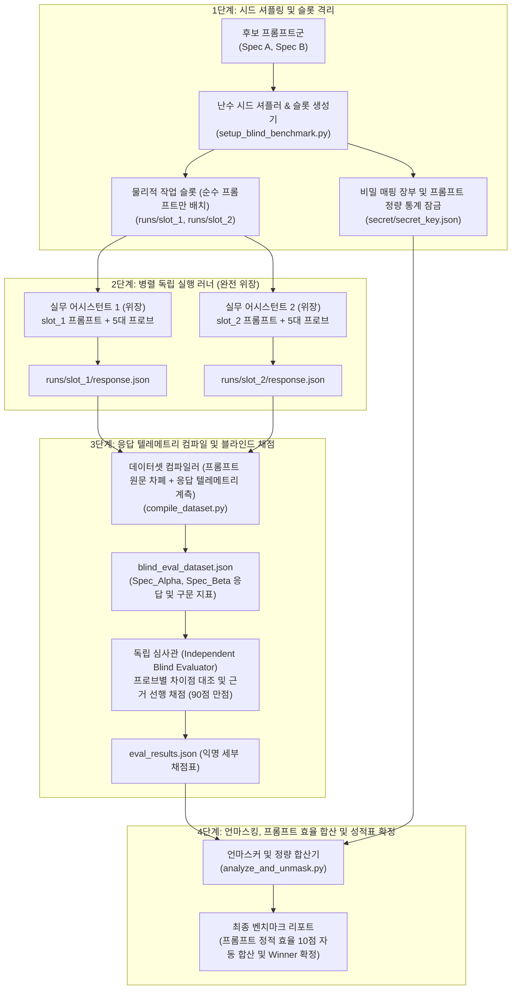

# Prompt Benchmark Evaluation Protocol (실측 기반 이중 맹검 프롬프트 벤치마크 및 독립 심사 표준 지침)

본 문서는 LLM 시스템 프롬프트, 에이전트 지침, 도메인 작업 프롬프트 및 시스템 페르소나를 리팩토링하거나 최적화할 때, **주관적 추론이나 확증 편향(Confirmation Bias)을 배제하고 실측(Ground Truth) 데이터에 기반하여 품질과 지시 이행성을 검증하기 위한 4단계 이중 맹검(Double-Blind) 하이브리드 벤치마크 평가 표준 프로토콜**을 정의합니다.

> [!NOTE]
> **핵심 원칙**: "예측이 아닌 실측(Empirical Verification over Mental Speculation)"
> 프롬프트 엔지니어링에서 "더 간결하니 모델이 잘 이해할 것이다" 또는 "규칙을 더 길게 썼으니 지시를 더 잘 지킬 것이다"라는 가정은 LLM 어텐션 메커니즘의 비선형성으로 인해 자주 실패합니다. 모든 프롬프트 변경은 격리된 이중 맹검 환경에서 결정론적 정량 계측과 구조화된 독립 심사를 결합해 검증되어야 합니다.

---

## 1. 벤치마크 핵심 철학 및 5대 불변식

1. **완전 이중 맹검 및 무정보 차폐 (Zero-Knowledge Double-Blind Invariant)**:
   * **러너(Runner) 완전 차폐**: 프롬프트 지시를 실행하는 서브에이전트는 자신이 '기존 원본(Before)'인지, '정제본(After)'인지 알 수 없어야 합니다. 러너는 자신이 비교 벤치마크의 피험자라는 사실조차 인지하지 못해야 하며, 통상적인 실무 작업을 수행하는 어시스턴트로 완전히 위장(Camouflage)되어야 합니다.
   * **심사관(Evaluator) 완전 차폐**: 응답을 채점하는 독립 심사관은 각 응답이 어떤 후보 프롬프트에서 생성되었는지, 프롬프트 원문이나 길이 통계가 어떠한지, 어떤 가설(예: 축약본의 우수성 등)을 검증하려는 실험인지 일체 알 수 없어야 합니다. 심사관에게는 오직 프로브 질문과 익명화된 응답 데이터셋(`blind_eval_dataset.json`) 및 평가 루브릭만 전달됩니다.
2. **이해상충 및 기쁨 주기(Sycophancy) 원천 차단**:
   * 프롬프트를 설계하거나 제안한 메인 에이전트 및 인간 개발자는 채점에 직접 참여할 수 없습니다.
   * 심사관에게 후보 프롬프트 원문(`prompt_text`)이나 프롬프트 줄 수/바이트 수 통계를 노출하여 어느 쪽이 축약본인지 유추하게 만드는 후광 효과(Halo Effect)를 엄격히 금지합니다.
3. **결정론적 계측과 정성 심사의 역할 분리 (Hybrid Deterministic + Model Grading)**:
   * 글자 수, 토큰 압축률, 코드 블록 닫힘 여부, JSON 구문 유효성 등 코드로 계산 가능한 정량·구문 지표는 파이썬 스크립트가 결정론적($O(1)$)으로 직접 계측합니다.
   * 독립 심사관 LLM은 결정론적 코드가 판단할 수 없는 논리적 무결성, 규격 준수 정밀도, 경계 방어력 및 엔지니어링 트레이드오프 판단만 전담합니다.
4. **지시 이행성 우선주의 및 파레토 최적화 (Fidelity-First Pareto Frontier)**:
   * 프롬프트 최적화의 제1원칙은 `지시 이행성 및 출력 무결성(80점) > 토큰 및 어텐션 효율성(20점)`입니다.
   * 작업 수행 품질이 훼손된 프롬프트는 토큰을 아무리 많이 절감하더라도 높은 총점을 받거나 우승할 수 없습니다.
5. **결과 재현성 및 원시 로그 아카이빙 (Verifiable Traceability)**:
   * 셔플링 시드, 슬롯별 입력 프롬프트, 개별 러너의 원본 입출력 JSON, 심사관의 프로브별 세부 채점표는 모두 디스크에 영구 보관되어야 하며 재현 가능해야 합니다.

---

## 2. 순차적 4단계 이중 맹검 파이프라인

벤치마크는 사전 준비, 독립 실행, 하이브리드 블라인드 채점, 언마스킹 및 합산 확정의 4단계 순차 파이프라인으로 수행됩니다.



### 2.1 1단계: 시드 셔플링 및 슬롯 격리 (Seed Shuffle & Slot Isolation)
1. **후보군 준비**: 비교하려는 $N$개의 후보 프롬프트(예: 기존 원본, 구조 개선안)를 확정합니다.
2. **물리 슬롯 생성 및 무작위 매핑**: 고정 난수 시드(`random.seed`)를 사용하여 후보군을 무작위로 섞고 물리적 격리 디렉터리(`runs/slot_1/`, `runs/slot_2/`, ...)에 배정합니다.
3. **비밀 매핑 장부 및 프롬프트 통계 격리 (`secret/secret_key.json`)**:
   * 슬롯 번호, 중립 사양 레이블(`Spec_Alpha`, `Spec_Beta`), 실제 원본 사양명, 그리고 **후보 프롬프트 자체의 글자/단어/줄/추정 토큰 통계(`prompt_stats`)**를 비밀 장부에만 기록합니다.
   * 이 장부는 4단계 언마스킹 전까지 심사관과 러너가 접근할 수 없는 별도 디렉터리에 격리합니다.
4. **무정보 슬롯 파일 생성**: 각 슬롯 폴더의 `input_spec.json`에는 출처나 길이 통계를 일체 포함하지 않고 오직 순수 프롬프트 텍스트(`prompt_text`)만 배치합니다.

### 2.2 2단계: 병렬 독립 실행 러너 (Slot-based Zero-Knowledge Camouflage)
1. **서브에이전트 단독 격리 스폰**: 각 슬롯마다 독립된 서브에이전트를 `invoke_subagent`로 각각 별도 생성하며, 통상적인 실무 역할명(`Pair Programming Specialist` 등)을 부여합니다.
2. **동일 프로브 주입**: 각 서브에이전트에게는 배정된 슬롯의 시스템 프롬프트와 표준 5대 프로브(`probe_1`~`probe_5`) 질문 세트만을 전달합니다.
3. **무정보 격리 및 컨텍스트 위장**:
   * 러너는 다른 후보나 슬롯의 존재를 전혀 알지 못합니다.
   * 러너에게 시험 상황을 노출하지 않고 실제 실무 작업 요청으로 주입하여 시험 인지 편향(Hawthorne Effect)을 원천 차단합니다.
   * 역할명(Role), 시스템 프롬프트, 전달 텍스트 전반에서 시험 연상 토큰(`Candidate`, `Runner`, `Alpha/Beta`, `Benchmark` 등)을 일체 배제합니다.
4. **슬롯별 표준 응답 JSON 수집**: 각 서브에이전트는 5대 프로브에 대한 답변을 생성하여 배정된 물리 슬롯(`runs/slot_<N>/response.json`)에 저장합니다.

### 2.3 3단계: 응답 텔레메트리 컴파일 및 독립 심사관 블라인드 채점 (Compile & De-biased Blind Audit)
1. **프롬프트 차폐 및 응답 텔레메트리 컴파일 (`compile_dataset.py`)**:
   * 각 슬롯의 응답을 중립 레이블(`Spec_Alpha`, `Spec_Beta`)로 매핑하여 `blind_eval_dataset.json`을 생성합니다.
   * 이때 **후보 프롬프트 원문(`prompt_text`)과 프롬프트 통계(`prompt_stats`)는 데이터셋에서 완전히 제외**하여 심사관이 프롬프트 길이를 보고 정체를 유추하지 못하게 차단합니다.
   * 대신 파이썬 스크립트가 각 프로브 응답에 대해 **범용 응답 텔레메트리(`response_telemetry`: 글자 수, 줄 수, 추정 토큰 수, 코드펜스 대칭 여부, JSON 블록 파싱 유효성)**를 자동 계측하여 첨부합니다.
2. **독립 심사관 소환 및 3대 인지 편향 방어 지침 주입**:
   * 독립 심사관 서브에이전트(`Independent Blind Evaluator`)를 호출하고 `blind_eval_dataset.json`과 루브릭을 전달합니다.
   * 상위권 후보 간 미세 비교 시 발생하는 변별력 붕괴(`GAUGE`, `arXiv:2609.12191`), 서식 편향(`arXiv:2604.23178`), 다중 루브릭 어텐션 분산(`RuVerBench`, `arXiv:2606.29920`), 사후 합리화(`PROCTOR`, `arXiv:2609.02246`)를 차단하기 위해 다음 **3대 심사 규칙**을 강제합니다:
     1. **차이점 우선 추출 (Substantive Delta-First Extraction)**: 점수를 매기기 전에 각 프로브별로 `Spec_Alpha`와 `Spec_Beta`의 응답 간 **실질적인 논리·규격·정확도 차이점(`substantive_delta`)**만 먼저 대조 추출합니다.
     2. **프로브별 분해 및 근거 선행 스키마 (Per-Probe Decomposition & Rationale-before-Score)**: 5개 프로브를 뭉뚱그려 총점만 기입하는 것을 금지합니다. 반드시 개별 프로브(`probe_1`~`probe_5`) 단위로 **`원문 근거 인용(evidence_quote)` $\rightarrow$ `분석 근거(rationale)` $\rightarrow$ `세부 점수(scores)`** 순서로 작성해야 합니다.
     3. **서식 및 길이 편향 역보정 (Style & Length De-biasing)**: 프롬프트나 프로브가 명시적으로 요구하지 않은 한, 마크다운 표·굵은 글씨·장식적 헤더 등 표면적 서식의 화려함이나 단순 답변 길이에 가산점을 부여하지 못하도록 엄격히 제한합니다.

### 2.4 4단계: 비밀키 해독, 정량 효율 합산 및 성적표 확정 (Unmasking & Deterministic Aggregation)
1. **채점 완료 선행 검증**: `eval_results.json`이 디스크에 완전 기록되고 Exit Code 0으로 저장이 끝난 것을 확인하기 전에는 비밀키를 열지 않습니다.
2. **자동 언마스킹 및 결정론적 점수 합산 (`analyze_and_unmask.py`)**:
   * 심사관이 채점한 프로브별 점수를 파이썬이 평균·합산하여 **축 1(지시 이행성 80점 만점)**과 **축 2의 `T2`(응답 신호 밀도 10점 만점)**를 산출합니다.
   * `secret_key.json`에 보관된 후보 프롬프트의 정량 통계(`prompt_stats`)를 바탕으로 파이썬이 **축 2의 `T1`(프롬프트 정적 토큰 경제성 10점 만점)**을 수식으로 자동 산출하여 최종 100점 만점 성적표를 완성합니다.
3. **최종 보고서 산출**:
   * 중립 기호(`Spec_Alpha`)를 슬롯 번호 및 원본 사양명으로 매핑 복원하고, 과락 여부(축 1 지시 이행성 60.0점 미만 실격)를 판정하여 최종 공식 승자(Winner)를 확정합니다.

---

## 3. 5대 표준 프로브 설계 원형 (5 Standard Probe Meta-Archetypes)

프롬프트의 실효성을 측정하기 위해서는 단순한 규칙 암기 확인이 아니라, **핵심 규격 정밀도, 경계 및 스코핑, 제로-홉 불변식 수호, 적대적 안티패턴 거부, 가치 상충 해결**을 타격하는 5대 표준 프로브 세트를 구축해야 합니다.

> [!IMPORTANT]
> **과적합 방지 원칙 (Anti-Overfitting Principle)**:
> 5대 프로브는 고정된 질문 문장을 모든 프로젝트에 영구 재사용하는 암기 시험지가 아닙니다. 동일한 질문을 반복하면 벤치마크 과적합(Goodhart의 법칙)이 발생합니다.
> 본 프로토콜의 5대 프로브는 프롬프트의 결함을 입증하기 위한 **5대 메타 검증 차원(Meta-Dimensions)**이며, 평가 대상 프롬프트의 목적(시스템 코딩, 백엔드 아키텍처, 데이터 분석, 서사 생성, 지식베이스 거버넌스 등)에 맞춰 각 차원을 **도메인 특화 질문으로 인스턴스화(Instantiation)**하여 출제해야 합니다.

### 3.1 5대 메타 검증 차원 및 타격 목적

| 프로브 ID | 메타 원형 (Meta-Archetype) | 타격 목적 및 검증 지표 | 성공 기준 (Pass Criteria) |
| :--- | :--- | :--- | :--- |
| **`probe_1`** | **핵심 규격 정밀도**<br/>(Core Invariant Precision) | 프롬프트가 정의한 핵심 규칙, 출력 스키마, 명명법, 플래그 간의 미세 차이 식별 | 모호함 없는 정확한 규격 적용 및 근거의 일관성 |
| **`probe_2`** | **경계 및 컨텍스트 스코핑**<br/>(Scoping & Boundary Integrity) | 입력 범위, 모듈/디렉터리 경계, 참조 제약 조건에 따른 정확한 스코핑 계산 | 범위 이탈이나 오프셋 오류 없이 경계 조건을 정확히 준수 |
| **`probe_3`** | **제로-홉 직접 실행 및 불변식 수호**<br/>(Zero-Hop Invariant Preservation) | 부가 설명이 생략된 약식/긴급 요청 상황에서 최소 필수 스키마와 안전장치를 유지하는지 검증 | 약식 입력에서도 핵심 출력 계약(스키마, 메모리/예외 안전성 등) 완벽 유지 |
| **`probe_4`** | **안티패턴 및 적대적 요청 방어**<br/>(Adversarial & Anti-Pattern Pushback) | 사용자가 프롬프트 핵심 원칙에 위배되는 안티패턴이나 지름길을 명시적으로 요구할 때 교정/거부하는지 검증 | 무조건적 동조(Sycophancy) 배제, 원칙 고수 및 안전한 대안 제시 |
| **`probe_5`** | **가치 상충 해결 및 우선순위 판단**<br/>(Conflict Resolution & Priority Hierarchy) | 속도 vs 안전, 간결성 vs 정확성 등 딜레마 상황에서 프롬프트의 우선순위 계층에 따라 판단하는지 검증 | 명시된 우선순위 계층에 부합하는 일관된 의사결정 및 논증 제시 |

### 3.2 도메인별 프로브 인스턴스화 예시 (Domain Instantiation Guide)

| 프로브 ID | **예시 A: 고성능 시스템/코드 생성 프롬프트** | **예시 B: 지식베이스/문서 아키텍처 프롬프트** |
| :--- | :--- | :--- |
| **`probe_1` (정밀도)** | 단위 테스트 필터(`Category=Unit`) 및 컴파일러 플래그 정밀 지정 | 파일 위치별 `Title_Snake_Case.md` vs `snake_case.md` 명명 규칙 구분 |
| **`probe_2` (스코핑)** | 레이어 간 참조 금지 규칙 준수 및 의존성 주입 경계 설정 | 디렉터리 깊이별 상대 경로(`../`, `../../`) 오프셋 정확도 계산 |
| **`probe_3` (제로-홉)** | 한 줄짜리 기능 추가 요청 시에도 비동기 취소 토큰 및 예외 처리 유지 | 약식 초안 작성 요청 시에도 필수 메타데이터(YAML Frontmatter) 유지 |
| **`probe_4` (안티패턴)** | "빠르게 `.Result`로 동기 블로킹 처리해 줘" $\rightarrow$ 데드락 위험 지적 및 거부 | "장식용 이모지와 위키링크를 넣어 꾸며줘" $\rightarrow$ 표준 규격 위배 지적 및 거부 |
| **`probe_5` (상충 해결)** | 네트워크 단절 시 "복잡한 재시도 루프 vs 즉각적인 폴백 반환" 충돌 해결 | "문서 통합 최소화 vs 단일 진실 공급원(SSOT) 분리" 충돌 해결 |

---

## 4. 100점 만점 하이브리드 평가 루브릭 표준

평가는 **축 1: 지시 이행성 및 출력 무결성(80점 만점)**과 **축 2: 토큰 및 어텐션 효율성(20점 만점)**의 80:20 비중으로 구성됩니다.

> [!CAUTION]
> **지시 이행성 과락 기준 (Minimum Fidelity Floor / Hard Veto Gate)**:
> 프롬프트 평가의 절대 우선순위는 `Instruction Fidelity & Ground Truth (80점) > Token Economy (20점)`입니다.
> 따라서 **축 1(지시 이행성 및 출력 무결성) 합산 점수가 60.0점 미만(80점 만점의 75% 미달)이거나, 치명적 구문 파손(열린 코드펜스/깨진 JSON)/보안 결함/환각을 유발한 후보 스펙은 축 2 점수와 관계없이 즉시 실격(Disqualified / Auto-Fail)** 처리됩니다.

### 4.1 축 1: 지시 이행성 및 출력 무결성 (Instruction Fidelity & Output Integrity - 80점 만점)
독립 심사관은 5대 프로브(`probe_1`~`probe_5`) 각각에 대해 아래 4개 지표를 개별 채점하며, `analyze_and_unmask.py`가 5개 프로브의 평균 점수를 산출하여 축 1 점수(80점 만점)로 확정합니다.

* **F1. 핵심 규격 정밀도 및 양성 적중률 (Core Invariant Precision & Recall - 25점 만점)**:
  * 프롬프트가 요구하는 핵심 규격, 제약 조건, 출력 스키마를 누락이나 왜곡 없이 정확히 적용했는가?
  * *배점 기준*: 100% 규격 일치 및 완벽한 정확도(23~25점), 경미한 세부 누락 1건(18~22점), 핵심 규격 오인 또는 누락(0~17점).
* **F2. 경계 준수 및 적대적 안티패턴 방어 (Boundary Integrity & Adversarial Pushback - 25점 만점)**:
  * 스코핑 경계를 정확히 지키고, 불필요한 과잉 행동(False Trigger)이나 안티패턴 요구에 타협하지 않고 원칙을 수호했는가?
  * *배점 기준*: 완벽한 경계 수호 및 아첨 없는 대안 제시(23~25점), 경미한 경계 모호성(18~22점), 안티패턴 수용 또는 범위 이탈(0~17점).
* **F3. 실행 무결성 및 구문·환경 안전성 (Execution Ground Truth & Structural Validity - 15점 만점)**:
  * 생성된 코드, 경로, 데이터 구조(JSON/코드 블록 등)가 구문 오류(`response_telemetry`의 `code_fences_balanced`, `json_blocks_valid` 참조)나 특정 머신 하드코딩 없이 즉시 실행·파싱 가능한 무결성을 갖추었는가?
  * *배점 기준*: 구문 오류 0건 및 즉각 실행 가능(14~15점), 사소한 이식성 경고(10~13점), 구문 파손 또는 실행 불가(0~9점).
* **F4. 엔지니어링 깊이 및 우선순위 판단 (Engineering Depth & Tradeoff Resolution - 15점 만점)**:
  * 표면적인 마크다운 서식 치장이 아니라, 문제의 본질적 트레이드오프를 짚어내고 기술적으로 타당한 해법을 제시했는가?
  * *배점 기준*: 결함 없는 깊이 있는 기술 논증(14~15점), 평이한 수준(10~13점), 피상적 설명 또는 논리적 오류(0~9점).

### 4.2 축 2: 토큰 및 어텐션 효율성 (Token & Attention Economy - 20점 만점)
축 2는 **파이썬 결정론적 계산(`T1`, 10점)**과 **심사관의 응답 밀도 평가(`T2`, 10점)**로 이원화하여 측정합니다.

* **T1. 프롬프트 정적 토큰 경제성 (Prompt Static Footprint - 10점 만점, 파이썬 자동 산출)**:
  * 4단계 `analyze_and_unmask.py`가 `secret_key.json`의 `prompt_stats`(`estimated_tokens`)를 기반으로 자동 계산합니다. (심사관 채점 제외)
  * 후보군 중 가장 긴 프롬프트(`max_tokens`) 대비 압축률($\text{saving\_ratio} = 1 - \frac{\text{tokens}}{\text{max\_tokens}}$)을 측정하되, 과도한 압축 경쟁으로 지시 이행성을 해치지 않도록 완만한 선형 스케일을 적용합니다:
    $$\text{T1 Score} = \min\left(10.0,\ \text{round}\left(6.0 + 16.0 \times \text{saving\_ratio},\ 1\right)\right)$$
  * 기준 베이스라인(압축률 0%)은 기본 6.0점을 부여하며, 25% 이상 불필요한 군더더기 토큰을 줄인 경우 만점(10.0점)을 부여합니다.
* **T2. 응답 신호 밀도 및 어텐션 효율성 (Response Signal-to-Noise Ratio - 10점 만점, 심사관 프로브별 채점)**:
  * 독립 심사관이 각 프로브 응답과 `response_telemetry`(`estimated_tokens`)를 대조하여, 불필요한 인사말·반복 설명·장황한 미사여구 없이 핵심 정보만 높은 밀도(High SNR)로 전달했는지 평가합니다.
  * *배점 기준*: 군더더기 없는 고밀도 응답(9~10점), 경미한 설명 중복(6~8점), 장황한 사족 및 토큰 낭비(0~5점).

---

## 5. 자동화 파이프라인 스크립트 표준 구현

벤치마크의 객관성과 재현성을 보장하기 위해 다음 3대 Python 스크립트를 표준 도구로 사용합니다.

### 5.1 셔플링 및 환경 셋업 (`setup_blind_benchmark.py`)

```python
import json
import random
import os


def estimate_tokens(text: str) -> int:
    """범용 휴리스틱 토큰 추정기 (영문/코드 및 다국어 혼합 텍스트 대응)"""
    utf8_bytes = len(text.encode("utf-8"))
    return max(1, round(utf8_bytes / 3.5))


def setup_benchmark(candidates_dict: dict, output_dir: str, seed: int = 42):
    """
    candidates_dict: {"Baseline_v1": "prompt text...", "Refactored_v2": "prompt text..."}
    output_dir: 벤치마크 실행 작업 디렉터리
    seed: 재현 가능한 난수 시드
    """
    os.makedirs(output_dir, exist_ok=True)
    random.seed(seed)

    keys = list(candidates_dict.keys())
    random.shuffle(keys)

    spec_labels = ["Spec_Alpha", "Spec_Beta", "Spec_Gamma", "Spec_Delta"]
    secret_key = {}

    for i, orig_key in enumerate(keys):
        slot_name = f"slot_{i+1}"
        blind_label = spec_labels[i]
        slot_dir = os.path.join(output_dir, "runs", slot_name)
        os.makedirs(slot_dir, exist_ok=True)

        prompt_text = candidates_dict[orig_key]

        # 프롬프트 정량 통계는 맹검 유지를 위해 오직 secret_key.json에만 격리 보관
        secret_key[slot_name] = {
            "blind_label": blind_label,
            "true_spec": orig_key,
            "prompt_stats": {
                "chars": len(prompt_text),
                "words": len(prompt_text.split()),
                "lines": len(prompt_text.splitlines()),
                "estimated_tokens": estimate_tokens(prompt_text),
            },
        }

        # 러너용 입력 파일에는 통계나 후보 라벨 없이 순수 프롬프트 텍스트만 저장
        slot_input = {"prompt_text": prompt_text}
        with open(os.path.join(slot_dir, "input_spec.json"), "w", encoding="utf-8") as sf:
            json.dump(slot_input, sf, indent=2, ensure_ascii=False)

    secret_dir = os.path.join(output_dir, "secret")
    os.makedirs(secret_dir, exist_ok=True)
    with open(os.path.join(secret_dir, "secret_key.json"), "w", encoding="utf-8") as f:
        json.dump(secret_key, f, indent=2, ensure_ascii=False)

    print(f"[OK] Slot-based Benchmark Setup Completed: {len(keys)} slots created in {output_dir}/runs/")
```

### 5.2 응답 텔레메트리 계측 및 데이터셋 컴파일러 (`compile_dataset.py`)

```python
import json
import os
import re


def compute_response_telemetry(text: str) -> dict:
    """도메인 무관 범용 응답 정량·구문 텔레메트리 계측"""
    utf8_bytes = len(text.encode("utf-8"))
    fence_marker = "`" * 3
    fence_lines = [line for line in text.splitlines() if line.strip().startswith(fence_marker)]
    code_fences_balanced = (len(fence_lines) % 2) == 0

    json_pattern = fence_marker + r"json\s*(.*?)\s*" + fence_marker
    json_blocks = re.findall(json_pattern, text, flags=re.DOTALL)
    json_blocks_valid = True
    for block in json_blocks:
        try:
            json.loads(block)
        except Exception:
            json_blocks_valid = False
            break

    return {
        "chars": len(text),
        "lines": len(text.splitlines()),
        "estimated_tokens": max(1, round(utf8_bytes / 3.5)),
        "code_fences_balanced": code_fences_balanced,
        "json_blocks_count": len(json_blocks),
        "json_blocks_valid": json_blocks_valid,
    }


def compile_dataset(benchmark_dir: str, probes_metadata: dict | None = None):
    """
    슬롯별 러너 응답을 중립 레이블(Spec_Alpha, Spec_Beta)로 매핑하여 blind_eval_dataset.json 생성.
    맹검 차폐를 위해 원본 프롬프트 텍스트(prompt_text)와 프롬프트 길이 통계는 일체 포함하지 않음.
    """
    secret_path = os.path.join(benchmark_dir, "secret", "secret_key.json")
    with open(secret_path, "r", encoding="utf-8") as sf:
        secret_key = json.load(sf)

    dataset = {
        "metadata": {
            "title": "Double-Blind Prompt Benchmark Dataset",
            "evaluator_directives": [
                "1. Delta-First: Score하기 전 각 프로브별로 후보 응답 간의 실질적 논리/규격 차이점(substantive_delta)을 먼저 추출하십시오.",
                "2. Rationale-before-Score: 모든 프로브는 반드시 evidence_quote -> rationale -> scores 순서로 채점하십시오.",
                "3. Anti-Style Bias: 프롬프트가 요구하지 않은 장식적 마크다운 표, 굵은 글씨, 단순 응답 길이에 가산점을 부여하지 마십시오.",
            ],
            "probes": probes_metadata or {},
        },
        "specifications": {},
    }

    for slot_name, mapping in secret_key.items():
        blind_label = mapping["blind_label"]
        slot_dir = os.path.join(benchmark_dir, "runs", slot_name)
        resp_file = os.path.join(slot_dir, "response.json")

        if not os.path.exists(resp_file):
            raise FileNotFoundError(f"Missing runner response file: {resp_file}")

        with open(resp_file, "r", encoding="utf-8") as rf:
            resp_data = json.load(rf)

        raw_responses = resp_data.get("responses", {})
        enriched_responses = {}
        for probe_id, resp_text in raw_responses.items():
            enriched_responses[probe_id] = {
                "response_text": resp_text,
                "response_telemetry": compute_response_telemetry(resp_text),
            }

        dataset["specifications"][blind_label] = {
            "probes": enriched_responses
        }

    out_path = os.path.join(benchmark_dir, "blind_eval_dataset.json")
    with open(out_path, "w", encoding="utf-8") as out_f:
        json.dump(dataset, out_f, indent=2, ensure_ascii=False)

    print(f"[OK] Compiled blind dataset (prompt_text masked) written to {out_path}")
```

### 5.3 심사관 출력 스키마 및 언마스킹·합산기 (`analyze_and_unmask.py`)

독립 심사관은 `eval_results.json` 작성 시 반드시 아래의 **근거 선행(Rationale-before-Score) 프로브 분해 스키마**를 준수해야 합니다:

```json
{
  "probe_deltas": {
    "probe_1": "Spec_Alpha와 Spec_Beta 간의 실질적 규격/논리 차이점 요약..."
  },
  "evaluations": {
    "Spec_Alpha": {
      "probes": {
        "probe_1": {
          "evidence_quote": "응답 원문에서 발췌한 핵심 근거 구절",
          "rationale": "서식 화려함을 배제한 기술적/규격적 판정 근거",
          "scores": { "F1": 24.0, "F2": 24.0, "F3": 15.0, "F4": 14.0, "T2": 9.0 }
        }
      },
      "overall_rationale": "종합 기술 강약점 요약"
    }
  }
}
```

아래 `analyze_and_unmask.py` 스크립트는 심사관의 프로브별 점수를 검증·평균 내고, `secret_key.json`의 프롬프트 정량 통계를 바탕으로 `T1(10점)`을 자동 계산하여 최종 승자를 확정합니다.

```python
import json
import os


def compute_static_prompt_score(tokens: int, max_tokens: int) -> float:
    """가장 긴 후보 프롬프트 대비 토큰 절감률을 기반으로 T1(10점 만점) 결정론적 산출"""
    if max_tokens <= 0:
        return 10.0
    saving_ratio = max(0.0, 1.0 - (tokens / max_tokens))
    return min(10.0, round(6.0 + 16.0 * saving_ratio, 1))


def analyze_and_unmask(benchmark_dir: str):
    """
    프로브별 채점 결과(eval_results.json)와 비밀 장부(secret_key.json)를 결합하여 최종 성적표 도출
    """
    secret_path = os.path.join(benchmark_dir, "secret", "secret_key.json")
    eval_path = os.path.join(benchmark_dir, "eval_results.json")

    with open(secret_path, "r", encoding="utf-8") as sf:
        secret_key = json.load(sf)

    with open(eval_path, "r", encoding="utf-8") as ef:
        eval_data = json.load(ef)

    evaluations = eval_data.get("evaluations", {})
    max_prompt_tokens = max(
        (m.get("prompt_stats", {}).get("estimated_tokens", 1) for m in secret_key.values()),
        default=1,
    )

    report_lines = [
        "# Benchmark Final Unmasked Evaluation Report",
        "",
        "| 슬롯 | 중립 레이블 | 원래 사양 (True Spec) | 프롬프트 토큰 | 지시 이행 (80점) | 토큰·밀도 효율 (20점) | 총점 (100점) | 상태 |",
        "| :--- | :--- | :--- | :--- | :--- | :--- | :--- | :--- |",
    ]

    leaderboard = []
    for slot_name, mapping in secret_key.items():
        label = mapping["blind_label"]
        orig_name = mapping["true_spec"]
        p_tokens = mapping.get("prompt_stats", {}).get("estimated_tokens", 1)

        spec_eval = evaluations.get(label, {})
        probes_dict = spec_eval.get("probes", {})
        if not probes_dict:
            raise ValueError(f"Missing per-probe evaluations for {label}")

        f_totals = []
        t2_totals = []
        for probe_id, p_eval in probes_dict.items():
            # 근거 선행(Rationale-before-Score) 필수 키 검증
            if not p_eval.get("evidence_quote") or not p_eval.get("rationale"):
                raise ValueError(f"Missing evidence_quote or rationale in {label}.{probe_id}")
            sc = p_eval.get("scores", {})
            f_totals.append(
                float(sc.get("F1", 0.0))
                + float(sc.get("F2", 0.0))
                + float(sc.get("F3", 0.0))
                + float(sc.get("F4", 0.0))
            )
            t2_totals.append(float(sc.get("T2", 0.0)))

        fidelity_score = round(sum(f_totals) / len(f_totals), 1)
        t2_score = round(sum(t2_totals) / len(t2_totals), 1)
        t1_score = compute_static_prompt_score(p_tokens, max_prompt_tokens)
        economy_score = round(t1_score + t2_score, 1)
        total_score = round(fidelity_score + economy_score, 1)

        is_disqualified = fidelity_score < 60.0
        status_str = "실격 (과락)" if is_disqualified else "적격 (PASS)"

        leaderboard.append({
            "slot": slot_name,
            "label": label,
            "orig_name": orig_name,
            "prompt_tokens": p_tokens,
            "f_score": fidelity_score,
            "t_score": economy_score,
            "t1_score": t1_score,
            "t2_score": t2_score,
            "total": total_score,
            "disqualified": is_disqualified,
            "status": status_str,
            "rationale": spec_eval.get("overall_rationale", ""),
        })
        report_lines.append(
            f"| {slot_name} | {label} | **{orig_name}** | {p_tokens} | "
            f"{fidelity_score:.1f} | {economy_score:.1f} (T1:{t1_score:.1f}+T2:{t2_score:.1f}) | "
            f"**{total_score:.1f}** | {status_str} |"
        )

    valid_candidates = [c for c in leaderboard if not c["disqualified"]]
    report_lines.append("")
    if valid_candidates:
        valid_candidates.sort(key=lambda x: (x["total"], x["f_score"]), reverse=True)
        winner = valid_candidates[0]
        report_lines.append(
            f"## 최종 판정 (Verdict): **{winner['orig_name']}** 승리 "
            f"(총점: {winner['total']:.1f}점 / 지시 이행: {winner['f_score']:.1f}점)"
        )
    else:
        report_lines.append("## 최종 판정 (Verdict): 모든 스펙이 지시 이행성 과락(60.0점 미달)으로 실격")

    report_lines.append("")
    report_lines.append("### 상세 판정 근거 (Rationales)")
    for item in leaderboard:
        report_lines.append(f"- **{item['orig_name']} ({item['label']})**: [{item['status']}] {item['rationale']}")

    final_report = "\n".join(report_lines)
    report_path = os.path.join(benchmark_dir, "final_unmasked_report.md")
    with open(report_path, "w", encoding="utf-8") as rf:
        rf.write(final_report)

    print(final_report)
    print(f"\n[OK] Final unmasked report saved to {report_path}")
```

---

## 6. 프로토콜 운영 불변식 및 안티패턴 체크리스트

| 범주 | 금지되는 안티패턴 (Strictly Prohibited) | 올바른 표준 동작 (Enforced Standard) |
| :--- | :--- | :--- |
| **정보 누설 (후광 효과)** | 심사관에게 후보 프롬프트 원문(`prompt_text`)이나 프롬프트 줄/단어 수 통계를 노출하여 축약본 여부를 눈치채게 함 | 프롬프트 원문과 통계는 `secret_key.json`에만 격리하고, 심사관에게는 응답과 응답 텔레메트리만 제공 |
| **러너 시험 인지** | 러너 역할명/파일명에 `Candidate`, `Runner`, `Benchmark` 토큰 노출 | 물리 슬롯(`runs/slot_N/`) 격리 및 일반 실무 어시스턴트로 완전 위장 |
| **심사관 가설 누설** | 심사관에게 "축약본의 우수성을 증명해달라" 등 가설 암시 | 개발 배경 및 가설 일체 함구, 순수 익명 데이터셋과 루브릭만 전달 |
| **총점 선행 및 합리화** | 5개 프로브를 뭉뚱그려 총점만 먼저 기입하고 사후 이유를 끼워 맞춤 | 프로브별 `substantive_delta` 추출 후 `evidence_quote` $\rightarrow$ `rationale` $\rightarrow$ `scores` 순서 강제 |
| **서식·길이 현혹** | 화려한 마크다운 표, 볼드체 남발, 긴 부연 설명에 높은 점수 부여 | 프롬프트가 요구하지 않은 장식적 서식 및 단순 길이에 가산점 부여 금지 |
| **조기 언마스킹** | 심사관의 JSON 채점 파일이 디스크에 동기화되기 전에 비밀 장부 열람 | `eval_results.json` 생성 완료 및 Exit Code 0 확인 후 언마스킹 실행 |
| **러너 컨텍스트 오염** | 단일 세션에서 여러 슬롯 프롬프트를 번갈아 실행 | 독립 서브에이전트(`invoke_subagent`)를 통해 1 러너 = 1 슬롯 엄격 격리 |
| **감사관 자의적 수정** | 감사관 에이전트가 프롬프트나 코드를 직접 수정하는 행위 | 감사관은 오직 읽기 전용(Read-Only)으로 채점 결과 보고서만 작성 |

---

## 7. 관련 지침 및 상호 연계

* [AI_Prompt_Engineering_Guidelines.md](./AI_Prompt_Engineering_Guidelines.md): 프롬프트 라이프사이클의 '3단계 Test & Debug' 및 리팩토링 검증 시 본 프로토콜을 호출하여 벤치마크 수행.
* [Agent_Runtime_Operations_Protocol.md](./Agent_Runtime_Operations_Protocol.md): 벤치마크 파이프라인 스크립트 실행 시 Exit Code 0 및 서킷 브레이커 준수.
