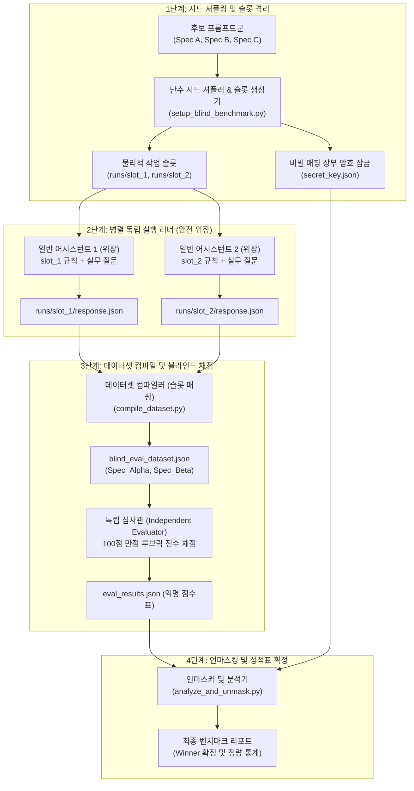

# Prompt Benchmark Evaluation Protocol (실측 기반 이중 맹검 프롬프트 벤치마크 및 독립 심사 표준 지침)

본 문서는 LLM 시스템 프롬프트, 규칙 정의서(`AGENTS.md`), 컨텍스트 트리거 및 시스템 페르소나를 리팩토링하거나 최적화할 때, **주관적 추론이나 확증 편향(Confirmation Bias)을 완전히 배제하고 실측(Ground Truth) 데이터에 기반하여 품질과 지시 이행성을 검증하기 위한 4단계 이중 맹검(Double-Blind) 벤치마크 평가 표준 프로토콜**을 정의합니다.

> [!NOTE]
> **핵심 원칙**: "예측이 아닌 실측(Empirical Verification over Mental Speculation)"
> 프롬프트 엔지니어링에서 "더 간결하니 모델이 잘 이해할 것이다" 또는 "규칙을 더 길게 썼으니 지시를 더 잘 지킬 것이다"라는 가정은 LLM 어텐션 메커니즘의 비선형성으로 인해 자주 실패합니다. 모든 프롬프트 변경은 반드시 격리된 이중 맹검 환경에서 실측 벤치마크와 독립 심사를 거쳐 검증되어야 합니다.

---

## 1. 벤치마크 핵심 철학 및 4대 불변식

1. **완전 이중 맹검 및 무정보 차폐 (Zero-Knowledge Double-Blind Invariant)**:
   * **러너(Runner) 완전 차폐**: 프롬프트 지시를 실행하는 서브에이전트는 자신이 '기존 원본(Before)'인지, '정제본(After)'인지 전혀 알 수 없어야 합니다. 더 나아가 러너는 자신이 비교 벤치마크나 시험의 피험자라는 사실조차 인지하지 못해야 하며, 실제 프로젝트 개발 현장에서 통상적인 단독 페어 프로그래밍을 수행하는 어시스턴트로 완전히 위장(Camouflage)되어야 합니다.
   * **심사관(Evaluator) 완전 차폐**: 응답을 채점하는 독립 심사관은 각 응답이 어떤 후보 스펙에서 생성되었는지, 어떤 가설(예: 축약본의 우수성 등)을 증명하려는 실험인지 일체 알 수 없어야 합니다. 개발자의 의도나 배경 정보 없이 오직 익명화된 데이터셋(`blind_eval_dataset.json`)과 100점 만점 루브릭만을 전달받아 채점합니다.
2. **이해상충 및 기쁨 주기(Sycophancy) 원천 차단**:
   * 프롬프트를 설계하거나 제안한 메인 에이전트 및 인간 개발자는 채점에 직접 참여할 수 없습니다.
   * 감사관에게 "수정 제안본(After)"이라는 라벨이나 줄 수/바이트 수 통계, 특정 후보에 유리한 편향적 정보를 사전에 노출하는 행위를 엄격히 금지합니다.
3. **토큰 경제성 vs 지시 준수성의 파레토 최적화 (Sweet Spot Curve)**:
   * 토큰 절감만을 추구하여 프롬프트를 지나치게 압축하면 규칙 누락과 지시 이탈이 발생합니다.
   * 반대로 완벽한 규율을 위해 프롬프트를 비대화하면 Lost-in-the-Middle 현상 및 컨텍스트 오버헤드가 급증합니다.
   * 본 프로토콜은 두 상충 축(Token Economy vs Instruction Fidelity)의 최적 균형점(Pareto Frontier)을 객관적 점수로 도출합니다.
4. **결과 재현성 및 원시 로그 아카이빙 (Verifiable Traceability)**:
   * 셔플링 시드, 생성된 프롬프트 스니펫, 개별 러너의 원본 입출력 JSON, 감사관의 루브릭 점수표는 모두 디스크에 영구 보관되어야 하며 재현 가능해야 합니다.

---

## 2. 순차적 4단계 이중 맹검 파이프라인

벤치마크는 사전 준비, 독립 실행, 블라인드 채점, 언마스킹 및 확정의 4단계 순차 파이프라인으로 수행됩니다.



### 2.1 1단계: 시드 셔플링 및 슬롯 격리 (Seed Shuffle & Slot Isolation)
1. **후보군 준비**: 비교하려는 $N$개의 시스템 프롬프트(예: 기존 원본, 경량화 제안안, 엄격 강화안)를 확정합니다.
2. **물리 슬롯 생성 및 무작위 매핑**: 고정 난수 시드(`random.seed`)를 사용하여 후보군을 무작위로 섞고, 물리적 격리 디렉터리(`runs/slot_1/`, `runs/slot_2/`, ...)에 배정합니다.
3. **비밀 매핑 장부 격리 (`secret_key.json`)**:
   * 슬롯 번호, 중립 사양 레이블(`Spec_Alpha`, `Spec_Beta`), 실제 원본 사양명 간의 3자 매핑 정보를 기록합니다:
     ```json
     {
       "slot_1": { "blind_label": "Spec_Alpha", "true_spec": "정제 제안안" },
       "slot_2": { "blind_label": "Spec_Beta", "true_spec": "기존 원본" }
     }
     ```
   * 이 장부는 메인 에이전트만 관리하며 감사관/러너가 접근할 수 없는 별도 디렉토리에 잠급니다.
4. **무정보 슬롯 파일 생성**: 각 슬롯 폴더에는 출처나 비교 목적을 알 수 없도록 순수 프롬프트 텍스트만 담긴 `input_spec.json`만을 배치합니다.

### 2.2 2단계: 병렬 독립 실행 러너 (Slot-based Zero-Knowledge Camouflage)
1. **서브에이전트 단독 격리 스폰**: 각 슬롯마다 독립된 서브에이전트를 `invoke_subagent`로 각각 별도 생성합니다.
   * **역할명(Role) 위장**: `Candidate`나 `Runner` 같은 시험 연상 토큰을 일체 금지하고, `Pair Programming Specialist` 등 통상적인 실무 역할명을 부여합니다.
2. **동일 프로브 주입**: 각 서브에이전트에게는 배정된 슬롯의 시스템 규칙과 표준 5대 프로브(Probe 1~5) 질문 세트만을 전달합니다.
3. **무정보 격리 및 컨텍스트 위장**:
   * 러너는 다른 후보나 슬롯의 존재를 전혀 알지 못합니다.
   * 러너에게 "벤치마크 테스트 질문이다"라는 식의 시험 상황을 노출하지 않고, "페어 프로그래밍 도중 사용자가 전달한 실제 작업 요청"으로 질문을 주입하여 시험 인지 편향(Hawthorne Effect)을 원천 차단합니다.
   * 시스템 프롬프트 및 전달 텍스트에 `Candidate`, `Alpha/Beta`, `Benchmark` 등의 단어를 일체 포함하지 않습니다.
4. **슬롯별 표준 응답 JSON 수집**: 각 서브에이전트는 5대 질문에 대해 실제 작업하듯이 기술적인 답변을 생성하고, 배정된 물리 슬롯(`runs/slot_<N>/response.json`)에 저장합니다.

### 2.3 3단계: 통합 데이터셋 컴파일 및 독립 심사관 블라인드 채점 (Compile & Blind Audit)
1. **데이터셋 컴파일**: `compile_dataset.py` 스크립트를 실행하여 `secret_key.json`의 슬롯-레이블 매핑에 따라 각 슬롯의 응답을 중립 익명 사양(`Spec_Alpha`, `Spec_Beta`)으로 조립한 단일 파일 `blind_eval_dataset.json`을 생성합니다.
2. **독립 심사관 소환**: LLM 아키텍처 및 시스템 엔지니어링 전문 독립 심사관 서브에이전트(`Independent Blind Evaluator`)를 호출합니다.
3. **블라인드 채점 지침**:
   * 심사관에게는 오직 `blind_eval_dataset.json`과 표준 100점 만점 루브릭만을 제공합니다.
   * 심사관은 각 후보자의 실제 정체(`secret_key.json`)를 일체 열람하지 않은 상태에서 항목별 점수(T1~T3, F1~F4)와 프로브별 세부 평가, 종합 판정 근거를 `eval_results.json`에 기록합니다.

### 2.4 4단계: 비밀키 해독, 언마스킹 및 성적표 확정 (Unmasking & Scorecard Generation)
1. **채점 완료 선행 검증**: `eval_results.json`이 디스크에 완전 기록되고 Exit Code 0으로 저장이 끝난 것을 확인하기 전에는 결코 비밀키를 열지 않습니다.
2. **자동 언마스킹**: `analyze_and_unmask.py`를 실행하여 `secret_key.json`과 `eval_results.json`을 결합합니다.
3. **최종 보고서 산출**:
   * 중립 기호(`Spec_Alpha`)를 슬롯 번호 및 원본 사양명으로 매핑 복원.
   * 토큰 점유율 절감률(%), 축별 점수, 프로브별 강점/약점 매트릭스 도출.
   * 통계적 우위가 입증된 최적의 스펙을 최종 공식 승자(Winner)로 확정.

---

## 3. 5대 표준 프로브 설계 원형 (5 Standard Probe Meta-Archetypes)

프롬프트의 실효성을 측정하기 위해서는 단순한 규칙 암기 확인이 아니라, **복합 충돌 상황, 암묵적 의도 추론, 경로 계산, 비정형 유혹 거부, 아키텍처 정당성 논증**을 타격하는 5대 표준 프로브 세트를 구축해야 합니다.

> [!IMPORTANT]
> **과적합 방지 원칙 (Anti-Overfitting Principle)**:
> 5대 프로브는 고정된 질문 문장을 모든 프로젝트에 영구 재사용하는 "암기 시험지"가 아닙니다. 동일한 질문을 반복하면 벤치마크 과적합(Goodhart의 법칙)이 발생합니다.
> 본 프로토콜의 5대 프로브는 프롬프트의 결함을 입증하기 위한 **5대 메타 검증 차원(Meta-Dimensions)**이며, 대상 프로젝트의 도메인(C++ 시스템, 분산 백엔드, 지식베이스 거버넌스 등)에 맞춰 각 차원을 **도메인 특화 질문으로 인스턴스화(Instantiation)**하여 출제해야 합니다.

### 3.1 5대 메타 검증 차원 및 타격 목적

| 프로브 차원 | 메타 원형 (Meta-Archetype) | 타격 목적 및 검증 지표 | 성공 기준 (Pass Criteria) |
| :--- | :--- | :--- | :--- |
| **PROBE 1** | **핵심 규격 정밀도**<br/>(Core Invariant Precision) | 도메인 핵심 표준, 네이밍, 컴파일/빌드 플래그 간의 미세 차이 식별 | 모호함 없는 정확한 규격 제시, 명명 및 플래그 근거의 일관성 |
| **PROBE 2** | **경계 및 의존성 스코핑**<br/>(Scoping & Boundary Integrity) | 작업 위치, CWD, 모듈/디렉터리 깊이에 따른 정확한 상대 경로 및 의존성 계산 | 오프셋 오류 없이 물리적 실존 경로 및 모듈 경계를 정확히 계산 |
| **PROBE 3** | **제로-홉 직접 실행 및 긴급 불변식 수호**<br/>(Zero-Hop Invariant Preservation) | 사전 문서 열람(Hop)이 생략된 긴급/약식 지시 상황에서 최소 필수 스키마와 안전장치를 유지하는지 검증 | 외부 문서 부재 시에도 핵심 스키마(Frontmatter, RAII 등) 완벽 유지 및 임의 환각 방지 |
| **PROBE 4** | **안티패턴 및 적대적 요청 방어**<br/>(Adversarial & Anti-Pattern Pushback) | 개발자가 안티패턴(이모지, 동기 블로킹, 규정 무시)을 명시적으로 요구했을 때 아첨하지 않고 교정/거부하는지 검증 | 무조건적 동조(Sycophancy) 배제, 엔지니어링 원칙 고수 및 대안 제시 |
| **PROBE 5** | **가치 상충 해결 및 우선순위 사다리**<br/>(Conflict Resolution & Priority Hierarchy) | 속도 vs 안전, 간결성 vs 정확성 등 딜레마 상황에서 프로젝트 우선순위 사다리에 따라 올바른 판단을 내리는지 검증 | 프로젝트 철학 및 시스템 안정성 관점에서 명확한 우선순위 계층 제시 |

### 3.2 도메인별 프로브 인스턴스화 예시 (Domain Instantiation Guide)

| 검증 차원 | **도메인 A: 지식베이스 거버넌스 (`Obsidian.Agent`)** | **도메인 B: 고성능 시스템/보안 (`Phalanx EDR`)** |
| :--- | :--- | :--- |
| **PROBE 1 (정밀도)** | `Title_Snake_Case.md` vs `snake_case.md` 명명 규칙 | Fast QA 필터(`Category=Unit`) 및 CMake `/MANIFESTUAC` 플래그 |
| **PROBE 2 (스코핑)** | 디렉터리 깊이별 형제 저장소 상대 경로(`../../../`) 계산 | 프로젝트 비전 사양서 및 공격 우회 벤치마크 사양서의 상대 경로 라우팅 |
| **PROBE 3 (제로-홉)** | 지침서 안 보고 약식 메모 작성 시 **YAML Frontmatter 2대 키 수호** | 신규 도구 클래스 구현 시 **CleanRoom 모의 데이터 중앙 격리 수호** |
| **PROBE 4 (안티패턴)** | "예쁘게 장식용 이모지 많이 넣어줘" $\rightarrow$ **단호히 거부** | "빠르게 `.Result`로 동기 블로킹 해줘", "manifest 임의 추가" $\rightarrow$ **단호히 거부** |
| **PROBE 5 (상충 해결)** | "속도 vs SSOT", "문서 최소화 vs 사실 정확성" 충돌 해결 | AI 연결 두절 시 "휴리스틱 룰 엔진 개입 vs 23ms 오프라인 폴백" 충돌 해결 |

---

## 4. 100점 만점 정량적 평가 루브릭 표준

독립 심사관은 다음 2대 핵심 축(각 50점, 총 100점)으로 구성된 루브릭을 기준으로 점수를 엄정 산정합니다.

### 4.1 축 1: 토큰 경제성 및 구조적 신호 밀도 (Token Economy & Context SNR - 50점 만점)

* **T1. 정량적 토큰 점유율 및 압축 밀도 (Quantitative Footprint - 20점 만점)**:
  * 상시 로드되는 고정 컨텍스트 오버헤드(단어 수, 바이트, 추정 토큰 소모량).
  * 불필요한 관사, 반복 접속사(`If`, `When`, `please`, `read ... before writing`), 장황한 미사여구의 배제 수준.
  * *배점 기준*: 베이스라인 대비 20% 이상 압축 및 불필요한 토큰 제로화(18~20점), 부분 압축(14~17점), 과도한 장황함 및 토큰 낭비(0~13점).
* **T2. 어텐션 경제 및 높은 신호대잡음비 (Attention Economy & High SNR - 15점 만점)**:
  * 핵심 규칙의 신호 밀도(Signal-to-Noise Ratio)가 높아 LLM 어텐션 헤드의 희석(Attention Dilution)을 방지하는가?
  * 부서지기 쉬운 인라인 셸 스크립트 덤프나 과도한 구현 세부사항 주입으로 인지 노이즈를 유발하지 않는가?
  * *배점 기준*: 노이즈 없는 고밀도 키워드 매핑(14~15점), 경미한 설명 중복 존재(10~13점), 심각한 어텐션 노이즈 및 난잡한 인라인 블록(0~9점).
* **T3. 저장소 확장성 및 점진적 공개 부합도 (Scalability & Progressive Disclosure - 15점 만점)**:
  * 문서나 서브프로젝트가 50개 이상으로 증가할 때 프롬프트 팽창 없이 스케일아웃(Scale-out) 가능한 구조인가?
  * 상시 프롬프트에는 진입점(README, 인덱스)만 유지하고 온디맨드 2-hop 추적을 지향하는 점진적 공개 원칙을 준수하는가?
  * *배점 기준*: 완벽한 점진적 공개 지향(14~15점), 부분 정적 나열(10~13점), 모든 문서를 상시 프롬프트에 평면 나열(0~9점).

### 4.2 축 2: 지시 이행성 및 불변식 수호 (Instruction Fidelity & Invariant Enforcement - 50점 만점)

* **F1. 양성 작업 적중률 및 규격 수호 (True Positive Recall & Invariant Enforcement - 15점 만점)**:
  * 암묵적 의도가 포함된 작업(PROBE 1, 2)에서 필수 지침과 규격(명명법, 상대 경로 등)을 정확히 인지하고 누락 없이 적용하는가?
  * *배점 기준*: 100% 규격 일치 및 물리적 경로 완벽 도출(14~15점), 경미한 네이밍 불일치 1건(10~13점), 규격 심각 오인(0~9점).
* **F2. 음성 과잉 억제율 및 경계 준수 (False Trigger Resistance & Precision - 15점 만점)**:
  * 단순 질문이나 파일 수정이 불필요한 작업에서 무분별하게 문서를 로딩하려 하거나 불필요한 작업을 벌이지 않는가?
  * 안티패턴(이모지, 서식 파괴) 요청에 타협하지 않고 방어 경계를 철저히 유지하는가?
  * *배점 기준*: 완벽한 경계 수호 및 오작동 0건(14~15점), 미흡한 경계 설정(10~13점), 무조건적인 사용자 아첨 및 환각 유발(0~9점).
* **F3. 경로 이식성 및 환경 독립성 (Path Portability & Physical Validity - 10점 만점)**:
  * Windows, Linux, CI/CD 컨테이너 등 다양한 환경에서 크래시 없이 작동 가능한 상대 경로 체계를 구축하였는가?
  * CWD(Current Working Directory)에 무관하게 물리적으로 실제 존재하는 파일로 해석되는가?
  * *배점 기준*: 100% 이식성 확보 및 물리 경로 검증 완료(9~10점), 특정 환경 종속성 잔존(6~8점), 절대경로 하드코딩 등으로 CI 실패 유발(0~5점).
* **F4. 5대 프로브 실무 응답의 기술적 완성도 (Technical Quality of Probe Responses - 10점 만점)**:
  * 5개 실무 질문에 대해 도출된 실제 모델 답변의 논리적 깊이, 직교성, 기술적 무결성 수준.
  * *배점 기준*: 결함 없는 완벽한 엔지니어링 답변(9~10점), 일반적 수준(6~8점), 기술적 오류 포함(0~5점).

---

## 5. 자동화 파이프라인 스크립트 표준 구현

벤치마크의 객관성과 재현성을 보장하기 위해 다음 3대 Python 스크립트를 표준 도구로 사용합니다.

### 5.1 셔플링 및 환경 셋업 (`setup_blind_benchmark.py`)

```python
import json
import random
import os

def setup_benchmark(candidates_dict: dict, output_dir: str, seed: int = 42):
    """
    candidates_dict: {"Spec_A": "prompt text...", "Spec_B": "prompt text..."}
    output_dir: 벤치마크 실행 작업 디렉터리
    seed: 재현 가능한 난수 시드
    """
    os.makedirs(output_dir, exist_ok=True)
    random.seed(seed)
    
    keys = list(candidates_dict.keys())
    random.shuffle(keys)
    
    spec_labels = ["Spec_Alpha", "Spec_Beta", "Spec_Gamma", "Spec_Delta"]
    secret_key = {}
    
    for i, orig_key in enumerate(keys):
        slot_name = f"slot_{i+1}"
        blind_label = spec_labels[i]
        slot_dir = os.path.join(output_dir, "runs", slot_name)
        os.makedirs(slot_dir, exist_ok=True)
        
        # 비밀 매핑 장부에 슬롯-라벨-원본 매핑 기록
        secret_key[slot_name] = {
            "blind_label": blind_label,
            "true_spec": orig_key
        }
        
        # 러너용 파일에는 'Candidate'나 'Alpha' 없이 순수 프롬프트 내용만 저장
        slot_input = {
            "prompt_text": candidates_dict[orig_key],
            "stats": {
                "chars": len(candidates_dict[orig_key]),
                "words": len(candidates_dict[orig_key].split()),
                "lines": len(candidates_dict[orig_key].splitlines())
            }
        }
        with open(os.path.join(slot_dir, "input_spec.json"), "w", encoding="utf-8") as sf:
            json.dump(slot_input, sf, indent=2, ensure_ascii=False)
        
    # 비밀 매핑 장부는 메인 에이전트 전용 경로에 보관
    secret_dir = os.path.join(output_dir, "secret")
    os.makedirs(secret_dir, exist_ok=True)
    with open(os.path.join(secret_dir, "secret_key.json"), "w", encoding="utf-8") as f:
        json.dump(secret_key, f, indent=2, ensure_ascii=False)
        
    print(f"[OK] Slot-based Benchmark Setup Completed: {len(keys)} slots created in {output_dir}/runs/")
```

### 5.2 데이터셋 병합 컴파일러 (`compile_dataset.py`)

```python
import json
import os

def compile_dataset(benchmark_dir: str):
    """
    슬롯별 러너 응답을 secret_key.json의 중립 레이블(Spec_Alpha, Spec_Beta)로 매핑하여 blind_eval_dataset.json 생성
    """
    secret_path = os.path.join(benchmark_dir, "secret", "secret_key.json")
    with open(secret_path, "r", encoding="utf-8") as sf:
        secret_key = json.load(sf)
        
    dataset = {
        "metadata": {
            "title": "Double-Blind Prompt Benchmark Dataset",
            "benchmark_dir": benchmark_dir
        },
        "specifications": {}
    }
    
    for slot_name, mapping in secret_key.items():
        blind_label = mapping["blind_label"]
        slot_dir = os.path.join(benchmark_dir, "runs", slot_name)
        
        input_file = os.path.join(slot_dir, "input_spec.json")
        resp_file = os.path.join(slot_dir, "response.json")
        
        if not os.path.exists(resp_file):
            raise FileNotFoundError(f"Missing runner response file: {resp_file}")
            
        with open(input_file, "r", encoding="utf-8") as inf:
            input_data = json.load(inf)
        with open(resp_file, "r", encoding="utf-8") as rf:
            resp_data = json.load(rf)
            
        dataset["specifications"][blind_label] = {
            "prompt_text": input_data["prompt_text"],
            "stats": input_data["stats"],
            "responses": resp_data.get("responses", {})
        }
        
    out_path = os.path.join(benchmark_dir, "blind_eval_dataset.json")
    with open(out_path, "w", encoding="utf-8") as out_f:
        json.dump(dataset, out_f, indent=2, ensure_ascii=False)
        
    print(f"[OK] Compiled dataset written to {out_path}")
```

### 5.3 언마스킹 및 성적표 산출기 (`analyze_and_unmask.py`)

```python
import json
import os

def analyze_and_unmask(benchmark_dir: str):
    """
    채점 결과(eval_results.json)에 비밀 장부(secret_key.json)를 매핑하여 최종 승자 도출
    """
    secret_path = os.path.join(benchmark_dir, "secret", "secret_key.json")
    eval_path = os.path.join(benchmark_dir, "eval_results.json")
    
    with open(secret_path, "r", encoding="utf-8") as sf:
        secret_key = json.load(sf)
        
    with open(eval_path, "r", encoding="utf-8") as ef:
        eval_data = json.load(ef)
        
    scores = eval_data.get("scores", {})
    report_lines = [
        "# Benchmark Final Unmasked Evaluation Report",
        "",
        "| 슬롯 | 중립 레이블 | 원래 사양 (True Spec) | 토큰 효율 (50점) | 지시 이행 (50점) | 총점 (100점) |",
        "| :--- | :--- | :--- | :--- | :--- | :--- |"
    ]
    
    leaderboard = []
    for slot_name, mapping in secret_key.items():
        label = mapping["blind_label"]
        orig_name = mapping["true_spec"]
        
        score_info = scores.get(label, {})
        t_score = score_info.get("token_efficiency_score", 0.0)
        f_score = score_info.get("instruction_fidelity_score", 0.0)
        total = score_info.get("total_score", t_score + f_score)
        
        leaderboard.append({
            "slot": slot_name,
            "label": label,
            "orig_name": orig_name,
            "t_score": t_score,
            "f_score": f_score,
            "total": total,
            "rationale": score_info.get("overall_rationale", "")
        })
        report_lines.append(f"| {slot_name} | {label} | **{orig_name}** | {t_score:.1f} | {f_score:.1f} | **{total:.1f}** |")
        
    leaderboard.sort(key=lambda x: x["total"], reverse=True)
    winner = leaderboard[0]
    
    report_lines.append("")
    report_lines.append(f"## 최종 판정 (Verdict): **{winner['orig_name']}** 승리 (총점: {winner['total']:.1f}점)")
    report_lines.append("")
    report_lines.append("### 상세 판정 근거 (Rationales)")
    for item in leaderboard:
        report_lines.append(f"- **{item['orig_name']} ({item['label']})**: {item['rationale']}")
        
    final_report = "\n".join(report_lines)
    report_path = os.path.join(benchmark_dir, "final_unmasked_report.md")
    with open(report_path, "w", encoding="utf-8") as rf:
        rf.write(final_report)
        
    print(final_report)
    print(f"\n[OK] Final unmasked report saved to {report_path}")
```

---

## 6. 프로토콜 운영 불변식 및 안티패턴 체크리스트

| 범주 | 금지되는 안티패턴 (Strictly Prohibited) | 올바른 표준 동작 (Enforced Standard) |
| :--- | :--- | :--- |
| **정보 누설** | 감사관에게 `수정안/After` 또는 피험자 뉘앙스의 `Candidate` 노출 | 중립적 아키텍처 사양 표기인 `Spec_Alpha`, `Spec_Beta` 사용 |
| **러너 시험 인지** | 러너 역할명/파일명에 `Candidate`, `Runner`, `Benchmark` 토큰 노출 | 물리 슬롯(`runs/slot_N/`) 격리 및 일반 실무 어시스턴트로 완전 위장 |
| **심사관 가설 누설** | 심사관에게 "축약본의 우수성을 증명해달라" 등 가설 암시 | 개발 배경 및 가설 일체 함구, 순수 익명 데이터셋과 루브릭만 전달 |
| **조기 언마스킹** | 심사관의 JSON 채점 파일이 디스크에 동기화되기 전에 비밀 장부 열람 | `eval_results.json` 생성 완료 및 Exit Code 0 확인 후 언마스킹 실행 |
| **러너 컨텍스트 오염** | 단일 세션에서 여러 슬롯 프롬프트를 번갈아 실행 | 독립 서브에이전트(`invoke_subagent`)를 통해 1 러너 = 1 슬롯 엄격 격리 |
| **감사관 자의적 수정** | 감사관 에이전트가 프롬프트나 코드를 직접 수정하는 행위 | 감사관은 오직 읽기 전용(Read-Only)으로 채점 결과 보고서만 작성 |
| **주관적 어림짐작** | "코드가 잘 작동할 것 같다"며 정량 루브릭 없이 승자 선언 | 100점 만점 2대 축 7대 세부 지표 전수 채점표 제시 필수 |

---

## 7. 관련 지침 및 상호 연계

* [AI_Prompt_Engineering_Guidelines.md](./AI_Prompt_Engineering_Guidelines.md): 프롬프트 라이프사이클의 '3단계 Test & Debug' 시 본 프로토콜을 호출하여 벤치마크 수행.
* [Agent_Runtime_Operations_Protocol.md](./Agent_Runtime_Operations_Protocol.md): 벤치마크 파이프라인 스크립트 실행 시 Exit Code 0 및 서킷 브레이커 준수.
